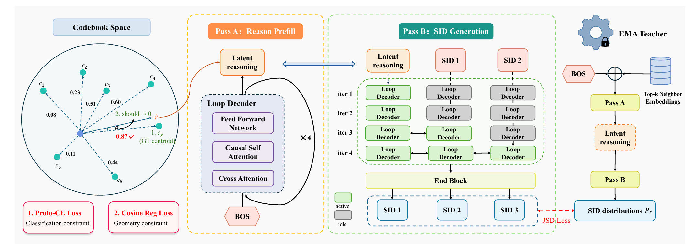

# 快手BRIDGE：三招让生成式推荐把SID猜得更准，eCPM涨0.65%

关注我，每天为你精挑细选最优质、最新鲜的推荐算法paper，陪你一起保持进步、不断精进！

> [English version](kuaishou-bridge.full.en.md)

### 论文：BRIDGE: Bridging the Semantic Quantization Gap for Generative Recommendation
### 网址：https://arxiv.org/abs/2611.07425
### 公司：快手
### 思想：先粗后细、蒸馏、按难度分配计算
### 方向：生成式推荐

## 解读：
这是快手广告生成式推荐GR4AD的又一篇改进，在decoder上做了三块改动，都是为了让SID预测得更准。每个广告的SID由3个token组成，下文说的"第1位、第2位、第3位"，就是SID的第1个、第2个、第3个token。
* **推理token**：猜第一位SID之前，先算一个推理向量，训练时让它指向目标所属的粗类，给最难猜的第一位一个参照。（[GR4AD-X](./kuaishou-gr4ad-x.md)里已经有，本文让它多算几轮）
* **EMA自蒸馏 + 学生用自己的前缀**：这块是两个trick配合。一是用一个能看到目标近邻的老师给软标签，让decoder学到哪些码彼此相近；二是学生在自己生成的前缀上训练，前缀错了也有老师的分布可学，缓解exposure bias。
* **按难度分配计算**：前面几位难、后面几位容易，就让第1、2、3位分别算4、2、1遍，参数更少、QPS更高。

三块是串在一起的：推理token就是循环decoder的第一轮，它的表示又拿来做蒸馏的对齐目标，不额外花计算。



### 1. 码本锚定的推理token：给第一位一个参照（沿用GR4AD-X）
为什么要它：对decoder来说，码只是一个编号，它知道正确答案是17号，却不知道17号码在语义空间里在哪、和哪些码离得近；第一位最难猜、错了后面全错，前面又没有已生成的码可参考。这块就是在猜第一位之前，先造一个"前缀"，也就是一个推理向量，并且把它锚到码本中心上，让它带着"目标落在语义空间哪一片"的信息。第一位就不再是凭用户行为直接从2048个编号里选，而是先有了一个参照。

这块就是GR4AD-X的推理token：在BOS和第一位SID之间插一个连续向量，把第一层码本中心再聚成256个粗原型，用原型分类+cosine回归监督它指向目标广告所属的粗原型，帮第一位猜得更准。具体见GR4AD-X的解读。

本文的不同有两点：
* **多算几轮**：GR4AD-X是一个小网络从BOS的隐状态一步算出推理token；本文让它在共享的循环decoder里反复过4轮（每轮对用户行为做cross-attention）才定下来。注意不是生成4个token，而是同一个位置的状态被反复改4遍，取最后一遍的结果，相当于用3层参数算出了12层的深度。
* **代替BOS**：GR4AD-X的输入序列是"BOS → 推理token → SID"，BOS还在；本文的BOS只用来初始化推理token，生成SID时输入序列是"推理token → SID"，BOS不再出现。

效果：离线第一位SID的loss降了3.95%，就是模型平均给正确的第一位码分了更多概率，在"概率意义上"，第一位确实预测得更好了。线上各个时间窗口稳定降2～3%。loss为什么会降，可能有三个原因，第一个是主要的：
* **猜第一位之前，先定了粗类**：训练时要求推理向量指向目标广告所属的粗原型（256个之一）。这256个原型是把第一层2048个码再聚类得到的，平均每个原型覆盖约8个码。decoder知道了"大概在哪个粗类"，第一位就从"2048选1"缩小到"十来个里选1"，正确码上的概率自然变高。
* **多读了几遍用户行为**：推理向量在循环decoder里过4遍，每遍都对用户行为做cross-attention，猜第一位之前多了一段理解用户的计算。
* **多了一个训练信号**：原型分类+cosine是一个更容易的辅助任务（256类而不是2048类），给decoder额外的梯度，帮它先学会粗粒度的结构。

### 2. 带特权的EMA自蒸馏 + 学生用自己的前缀
这一块其实是**两个trick**配合使用：老师给软标签（2.1），学生在自己生成的前缀上训练（2.2）。前者教decoder哪些码彼此相近，后者让它学会前面猜错之后怎么接。

#### （2.1）带特权的EMA自蒸馏：教decoder"哪些码彼此相近"
老师是学生自己的一个"慢副本"，训练时多看一样学生看不到的信息（目标广告的近邻），在每一位SID上给出一个软分布（2048个码各分多少概率）；学生除了照常用真实SID做交叉熵，还要让自己每一位的分布向老师靠拢：每一个SID token上，学生和老师的输出分布做对称的JS散度，推理token的表示也对齐一下（cosine）。训练完只上线学生。

为什么要它：训练标签太"硬"，丢了结构信息。one-hot标签只认对错，真实答案是17号码，其余2047个码一律算错；可其中有些码对应的广告和目标很像，有些毫不相干，猜成前者和猜成后者被罚得一样重，码与码之间的远近关系模型学不到。老师给的软分布能把"哪些码也不错"带进来。

**老师**：学生参数的滑动平均（EMA，衰减0.999），不反传梯度，比学生稳。老师有一项**特权**：训练时把目标广告的top-3语义近邻（用冻结的item embedding按cosine找）取平均，投影后加到老师的BOS上。这样做，可以让老师生成的sid更准，它给出的软分布更有价值。线上不知道要推哪个广告，自然也拿不到它的近邻，所以老师不能上线，**上线的是学生**。

为什么给近邻、不直接给真实SID：直接给答案，老师的输出会变成接近one-hot，蒸馏就退化成普通交叉熵；给近邻，老师的软分布里带的是"哪些码彼此相近、近到什么程度"。

两个稳定训练的细节：老师输出太自信（熵低于阈值）时不蒸馏；蒸馏权重前2000步线性升上来，等学生自己先学稳。训练到第22个epoch左右，学生追平老师。

#### （2.2）学生用自己的前缀：学会出错后怎么接
在自己生成的前缀上训练（每一位取自己上一步概率最大的码接着生成，不喂真实前缀），这样训练和推理的情况一致。注意这只是蒸馏那条路径：学生训练时跑两次，一次喂真实前缀、用真实SID算交叉熵，一次用自己的前缀、和老师的分布对齐。缓解exposure bias靠的是这一点和老师配合：
* **学生用自己的前缀**：训练时就见到推理时会遇到的状态，包括自己猜错之后的前缀。普通teacher forcing永远喂正确前缀，模型没学过"前面错了怎么办"。
* **老师给出这些状态下的目标**：学生前缀错了，真实标签的第2位是接在真实第1位下面的，未必还成立；老师始终用真实前缀，给出"正确路径上每一位该是什么分布"，学生不管前缀对不对都往它靠，出错之后也有明确的方向可学。

少了任何一个都不行：只有自蒸馏、学生仍喂真实前缀，见不到出错的状态；只用自己的前缀、没有老师，出错之后没有可学的标签。

### 3. 按难度分配计算：第一位多算，越往后越少
先交代背景：每个广告的SID由3个token组成，第1个token是粗类，后两个在它的基础上逐步细化，所以第1个最难猜，越往后越容易。普通decoder却给这3个token分配同样多的计算。

本文的做法：decoder换成一个3层的循环块，反复使用，SID的第1、2、3个token分别过4、2、1轮。这样既省参数又省计算：多算几轮不加参数，只多几次前向；后两位又算得少。和GR4AD的decoder比，参数少一半多，线上QPS提升约20%。

"循环"的意思是参数共享，但共享的不是3层之间的参数。普通decoder（比如GR4AD的9层）是9层各有各的参数，输入从第1层依次走到第9层，每层只走一次。BRIDGE的循环块只有3层，这3层彼此参数不同，和普通decoder一样；不同在于这个3层的块会被反复使用，第1轮用它，第2、3、4轮还是它。所以"共享"指的是**不同轮次、不同SID位置之间共用同一个3层块**，不是3层之间共享。

轮次是"右对齐"排的：三个位置都排到第4轮结束，从第几轮开始不同。第1位排在第1～4轮，第2位排在第3～4轮，第3位只排在第4轮。把轮次横着排开，三段横条的右端对齐，所以叫右对齐。注意这里的"轮"是深度上的序号（第几遍），不是时间：它决定的是后面的位去看前面位置第几遍的状态。

```
轮次:   1  2  3  4
第1位:  ■  ■  ■  ■
第2位:        ■  ■
第3位:           ■
                 ↑ 右边对齐
```

这和普通decoder很不一样。普通decoder里，第2位在第k层只能看到第1位第k层的状态，两者深度对齐；BRIDGE右对齐后，第2位的第1遍排在第3轮，对应的是第1位的第3遍，第2位直接看到的就是比自己深的状态。注意不是把第1位第1、2轮的输出拼起来给第2位，每个位置只保留最新的一份状态。前面的位先"想清楚"，后面的位在想清楚的基础上细化。

最后统一过一个轻量的输出块，把各位的状态拉回同一个空间再出概率；在这里，后面的位还能再看一次前面位置算完全部轮次的结果。

为什么要多迭代：目的是把算力往难的位置倾斜。线上每个请求的延迟预算是固定的，总计算量有上限；这块不是一味压缩计算，而是在这个上限内，把算力从容易的位置挪给更有用的位置。第1位要从2048个码里挑一个粗类，最难、错了后面全错；第3位几乎是确定的细分。迭代一遍，就是带着上一遍的结果再过一次3层块、再读一次用户行为，所以多迭代相当于加深网络：第1位过4遍，计算深度是12层。但它是加深了计算、没加参数，4遍用的都是同一套3层参数。也正因为参数共享，才能让不同位置深度不同（第1位12层、第3位3层），普通加层做不到这一点，加一层就是所有位置都加。

### 补充：用户行为这边没有Transformer encoder
每个历史item的embedding（离线实验里是用Qwen2.5-1.5B编码商品文本得到的1536维语义向量，SID也是从它量化来的，单个item的表示本身已经很丰富）各自过一个两层MLP、加上位置embedding，就直接作为"用户记忆"，item之间不做self-attention、彼此不交互。行为序列只在decoder的cross-attention里被当作查询对象，对它的建模全靠decoder一遍遍去读，这也是上面几块都在"多算几轮"上做文章的原因。

### A/B：
快手电商广告场景，5%流量，eCPM（收入）+0.65%。

## 心得：
* 三个trick说到底都是在"帮一把"：推理token是在最难的第1个token之前，先做点准备工作帮它定个方向；EMA自蒸馏是让一个更慢、更稳的自己，回过头来带一带现在的自己；按难度分配计算是在难的地方多下点功夫，把精力花在最需要的位置。

## 愚见
* 线上A/B只给了eCPM一个数，对照组也没写清楚。三块各自在线上贡献多少，只有算力那块给了QPS，没法拆。

## 可信度：生产

## 推荐等级：有实践价值

**请帮忙点赞、转发，谢谢。欢迎干货投稿 \ 论文宣传\ 合作交流**


### 【铁粉】请入微信群，群内我会给出更深入的解读，还可以共同讨论技术方案、发招聘广告、内推和交友等。
* 铁粉标准：关注公众号一个月以上，且在公众号上累计15次互动（评论、爱心、转发）、或投稿1次，只欢迎技术同学。
* 入群方法：请您加个人微信lmxhappy，我拉您入群，请备注【公司】（只我个人看，不公开）。

## 推荐您继续阅读：

