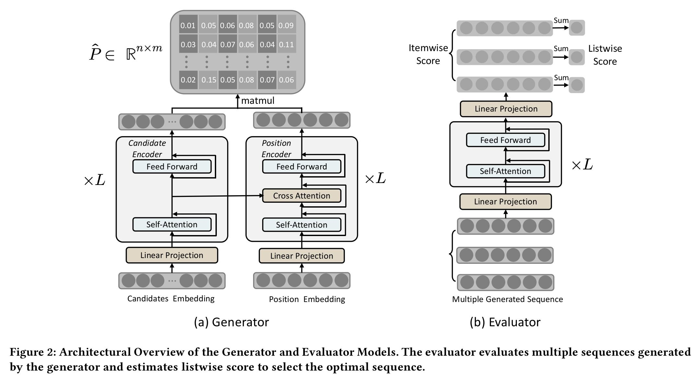
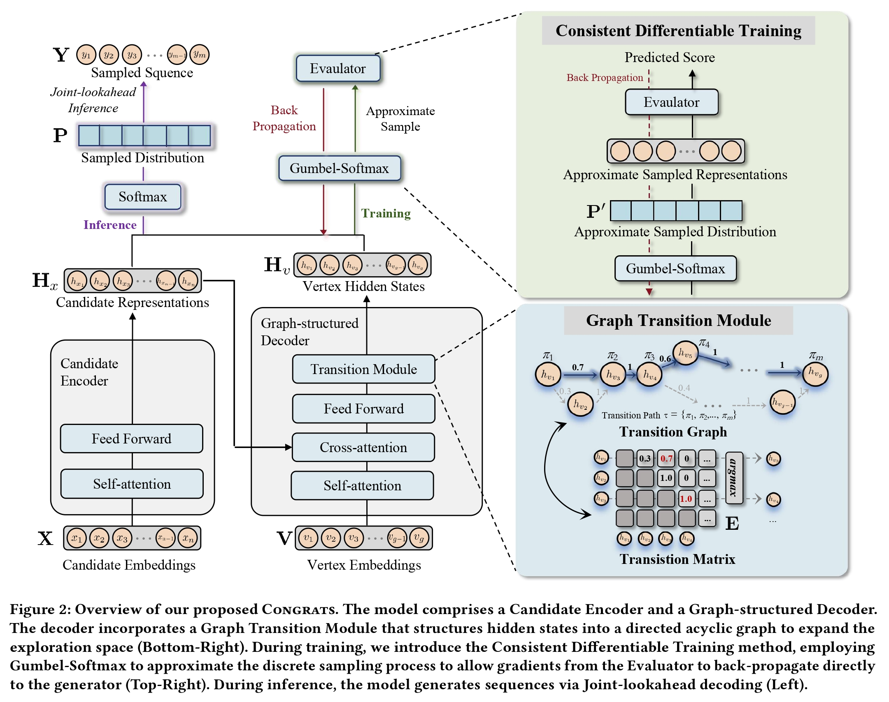

# KDD 2026 | Kuaishou generative recommendation: from NAR4Rec to CONGRATS

> [中文版](kuaishou-congrats.md)

> Paper: [Non-autoregressive Generative Models for Reranking Recommendation](https://arxiv.org/pdf/2402.06871) (NAR4Rec, KDD 2024)
>
> Paper: [Breaking the Likelihood Trap: Consistent Generative Recommendation with Graph-structured Model](https://arxiv.org/abs/2510.10127) (CONGRATS, KDD 2026)
>
> Original: [Zhihu article](https://zhuanlan.zhihu.com/p/2079338162246137426), [Zhihu article](https://zhuanlan.zhihu.com/p/2078936687367951729)

This article describes our team's thinking and practice in generative recommendation. Discussion is welcome.

Our earlier KDD 2024 paper [NAR4Rec](http://link.zhihu.com/?target=https%3A//arxiv.org/pdf/2402.06871) described our work deploying generative recommendation. Since then, quite a few major companies in the industry have deployed generative reranking in their business scenarios, with some success.

Because KDD's recommendation audience is broad, when we wrote that paper we made some accommodations for readers with a recommendation background. This time I will also go over the design principles behind it in this article.

## What is generative reranking

**First, what is the difference between generative and discriminative?** When I reported to Gai Kun, this was the first thing he asked as well. Many search / ads / recommendation engineers get confused here when they first meet generative recommendation.

A discriminative model predicts the posterior probability of various labels given a sample, i.e. $p(y\mid x)$. The common CTR, conversion rate and watch-time predictions in recommendation all belong to this class: given a user and a candidate item, predict the probability that the user takes some action.

A generative model learns the joint distribution of samples and labels, $p(x,y)$. In text generation, the explicit label $y$ gradually fades, and the focus shifts to modeling the sample distribution $p(x)$. Take a piece of text $x=(x_1,\ldots,x_T)$ as an example:

$$p(x)=\prod_{t=1}^{T}p(x_t \mid x_{\lt t})$$

The model predicts the next token from the preceding tokens, and learns the probability of different text sequences through maximum likelihood. With the label faded out, what a generative model predicts is the probability of the sample itself occurring.

**So what is the point of using generative models in reranking?**

In reranking, the sample to generate is not a single item but a complete exposure sequence. Denote the candidate set of one request as $C=\{c_1,\ldots,c_n\}$ and the final exposure sequence as $x=(x_1,\ldots,x_m)$. Choosing $m$ items out of $n$ candidates and deciding their order gives:

$|\Omega(C,m)|=A_n^m=\frac{n!}{(n-m)!}$

possibilities, and the goal is to find the sequence with the highest user return:

$x^*=\arg\max_{x\in\Omega(C,m)}R(u,x)$

If the ranking stage gives 60 candidates and reranking finally shows 6 videos, then $A_{60}^{6}=36{,}045{,}979{,}200$, about 36 billion permutations.

A discriminative model can evaluate a sequence, but to find the global optimum from that score you would still have to compute all 36 billion permutations, which is clearly impossible online.

A generative model directly learns the distribution of complete exposure sequences $p_\theta(x\mid u,C)$. During training, the selection patterns, positional relations and item relations in exposure sequences are learned into the model; at inference it decodes directly, without explicitly enumerating all combinations.

So the generative model does not eliminate the $A_n^m$ combinatorial space; it just moves the combinatorial optimization that used to be done on every request into model training. This is also **the biggest difference between generative reranking and traditional sequence scoring**.

But maximum likelihood brings another problem:

$\arg\max_x p_\theta(x\mid u,C)\overset{?}{=}\arg\max_x R(u,x)$

**The sequence with the highest probability in the training logs is not necessarily the sequence with the best user feedback.** Popular items have more historical exposure and higher frequency in the logs, so if the model keeps doing maximum likelihood, it easily concentrates more probability on these items.

The final generated sequences have high probability, but the content gets more and more repetitive, and users don't necessarily like it. In the paper we call this problem the **Likelihood Trap**.

## From NAR4Rec to CONGRATS

[An earlier write-up](https://zhuanlan.zhihu.com/p/717760596) already covered [NAR4Rec](https://arxiv.org/pdf/2402.06871) fairly completely. I won't repeat the whole paper here; I'll just go over the main designs from back then, and why we needed to go on to CONGRATS.

First, the **Matching Model**. In text generation the vocabulary is fixed, but in reranking the candidate set differs on every request, and the generated items must come from the current candidates.

NAR4Rec first encodes the candidate items with a **Candidate Encoder**, then gets output states with a **Position Encoder**, and finally computes the matching probability between candidates and positions. Named in terms of the LLM encoder–decoder framework, the Candidate Encoder is closer to an encoder, and the Position Encoder closer to a decoder. We drew the model as a two-tower structure back then mainly to fit the habits of readers with a recommendation background.

Mechanically, it can also be seen as an adaptation of the **Pointer Network** to the Transformer: the model doesn't generate a new token from a global vocabulary but points to an item in the input candidate set. The Matching Model solves the dynamic vocabulary problem; this structure can be used autoregressively or non-autoregressively. The online version uses parallel generation mainly because reranking latency is tight.

After predicting the whole sequence in parallel, there is no direct item relation between different positions. And the training data may contain several reasonable sequence patterns at the same time; if each position takes its highest-probability item independently, the result may not form a reasonable sequence.

So we added **Contrastive Search** at decoding: when choosing an item, besides the generation probability at the current position, it also considers the item's embedding relation to the items already chosen, using the dot product to approximate the transition probability between items. To make it easier for people with a recommendation background to understand, we explained it then as a diversity prior. In training we also added a Contrastive Loss, partly to stay consistent with decoding and partly to mitigate embedding collapse under weight tying.

In addition, online exposure logs are not all positive samples. Some sequences got very good user feedback after exposure, and some got poor feedback. If you do maximum likelihood on all of them, the probability of negative sequences gets raised too. NAR4Rec therefore added **Unlikelihood Training**, separating positive and negative sequences by posterior feedback and lowering the generation probability of negative sequences.

These designs solved the problems NAR4Rec ran into at deployment, **but two points could be pushed further:**

- On one hand, the online version still uses $m$ fixed position hidden states to generate a sequence of length $m$. All reasonable sequences share the same set of position distributions, so the generation paths it can express are fairly limited. Contrastive Search adds item relations at decoding time; the model itself does not explicitly learn item dependencies.

- On the other hand, Unlikelihood Training still has to split positive and negative samples by posterior feedback and a threshold. **The Generator learns sequence probability, the Evaluator learns user feedback**, and the two are still trained separately. Even if the Evaluator finds that some sequence is better, it cannot pass that information directly back to the Generator.

So CONGRATS changed two things. One is to expand the fixed positions into a graph, increasing the paths the model can generate; the other is to plug the Evaluator into the Generator's training, so user feedback directly affects the generative model:

## Graph-structured Model

NAR4Rec originally used $m$ fixed position hidden states to generate a sequence of length $m$.

The problem is not only that there are few paths to choose from. More importantly, many possible content combinations all have to squeeze into the same set of position distributions. Different sequence patterns easily interfere with each other, and the model ends up concentrating more easily on a few high-probability items.

CONGRATS expands these $m$ fixed positions into a directed acyclic graph of $g=\lambda m$ vertices. Online $m=6$ and $\lambda=4$, so the decoder has 24 vertices inside, and finally a path of length 6 is chosen among them. Different content combinations can be carried by different paths, so the model gets larger hidden states and a larger space of path combinations.

Concretely, the model learns two matrices at once: the prediction matrix $P$ gives the generation probability of each candidate item at each vertex, and the transition matrix $E$ gives the transition probabilities between vertices. For a path $\tau=(\pi_1,\ldots,\pi_m)$ and an exposure sequence $x$, the joint probability has two parts:

$p_\theta(x,\tau\mid u,C)=\prod_{t=1}^{m-1}E_{\pi_t,\pi_{t+1}}\prod_{t=1}^{m}P_{x_t,\pi_t}$

The first term judges whether the path is reasonable; the second judges whether the vertices on the path can generate the target items. Compared with only computing matches between candidate items and fixed positions, transitions on the graph also explicitly add the dependencies between generation positions.

The key in training is that the real logs only record the final exposure sequence $x$, not which path in the graph it corresponds to. The path is not supervision and there is no need to assign it by hand. So in training the path $\tau$ is treated as a latent variable, and the joint probability is marginalized over all valid paths:

$p_\theta(x\mid u,C)=\sum_{\tau\in\Gamma}p_\theta(x,\tau\mid u,C)$

While fitting exposure sequences, the model learns by itself which vertex combinations and transition paths suit different users, candidate sets and target sequences. This sum can be computed by dynamic programming, without enumerating all paths one by one.

At inference, though, a path really has to be chosen. If you first choose a path using only the transition matrix $E$, then pick items from $P$ along that path, you may get a suboptimal result: some vertex has a high transition probability but no high-confidence candidate item on it.

So CONGRATS uses **Joint-lookahead**. When choosing the next vertex, it looks not only at the probability of transitioning from the current vertex, but also ahead at the best candidate that vertex can generate:

$\begin{aligned}(\pi_t^*,x_t^*)=\arg\max_{\pi_t,x_t}\;&P_\theta(\pi_t\mid\pi_{t-1},u,C)\\&P_\theta(x_t\mid\pi_t,u,C)\end{aligned}$

That is, "where to go" and "what to pick there" are judged together. The transition and prediction matrices can both be computed in parallel; online only $m$ vertices need to be chosen in sequence, and $m$ in reranking is usually small, so the added latency is limited.

What the graph structure brings is not unconstrained random sampling but structured exploration constrained jointly by path transitions and item prediction: it enlarges the sequence space the model can express while keeping the generated results relevant.

## Consistent Differentiable Training

The graph structure answers which sequences the Generator can explore, but it doesn't change what the Generator is learning. As long as the training objective is still to maximize the likelihood of logged sequences, the model is still learning which sequences appear often in historical data, not which sequences bring better user feedback. The Likelihood Trap does not go away just because the decoding space got bigger.

The traditional Generator–Evaluator framework seems to already use user value: the Generator produces several sequences, the Evaluator predicts the return of each, and the best one is chosen. But this is only a chain at inference time. In training, the Generator fits log likelihood and the Evaluator learns user feedback such as clicks and views; the two objectives are still separate.

The limitation is that the Evaluator can only choose among sequences the Generator has already generated. If the truly high-value sequence was never generated, no matter how accurately the Evaluator scores, it can't pick it. In other words, the Evaluator knows which sequences are better, but this information doesn't change the Generator's probability distribution.

So our idea is direct: first train the Evaluator with real user feedback, then feed the sequences the Generator produces to the Evaluator, aiming for the Evaluator to give higher probability on every positive feedback objective, and pass this signal back to the Generator. This way the Evaluator is no longer only responsible for choosing the final sequence; it also starts to affect what the Generator is willing to generate.

The real technical obstacle sits between the two. The Generator has to pick concrete items by argmax or sampling to get a discrete sequence; discrete selection is not differentiable, so the Evaluator's gradient breaks here.

**Gumbel-Softmax** can be understood as a differentiable approximation of sampling. It adds Gumbel noise to each candidate item's logit, then gets new selection probabilities through a Softmax with a temperature parameter:

$\begin{aligned}\mathbf{P}^{\prime}&=\operatorname{Softmax}\left(\frac{\mathbf{Z}+\mathbf{r}}{T}\right),\\\mathbf{r}&\sim\operatorname{Gumbel}(0,1)\end{aligned}$

Here $\mathbf{Z}$ is the item logits output by the Generator, the Gumbel noise simulates discrete sampling, and the temperature $T$ controls how sharp the distribution is. The smaller $T$, the closer the result is to a true one-hot choice; but the whole computation is still made of continuous functions, so it can be backpropagated.

Simply put, it lets the model approximately "pick an item" in the forward pass while keeping the gradient in the backward pass. Only then can the multi-objective user feedback learned by the Evaluator pass through the generation process back to the Generator.

The final training objective is:

$\mathcal{L}_{\mathrm{total}}=\mathcal{L}_{\mathrm{con}}+\alpha\mathcal{L}_{\mathrm{gen}}$

$\mathcal{L}_{\mathrm{gen}}$ keeps the Generator fitting real exposure sequences, preserving the relevance constraint provided by the log distribution; $\mathcal{L}_{\mathrm{con}}$ pushes it to generate sequences the Evaluator thinks are more likely to get positive feedback. With only the former, it easily keeps chasing high-frequency patterns; with only the latter, it lacks the constraint of the real sequence distribution. Putting the two losses together is what "Consistent" means here: the Generator's generation direction starts to agree with the user value the Evaluator represents.

With this, the two changes in CONGRATS fit together: **the Graph-structured Model enlarges the sequence space the Generator can express and explore, and Consistent Differentiable Training** then uses user feedback to decide which direction those probabilities should move.

## Experimental results

There are many experiments; here I mainly look at a few groups directly related to the motivation.

First, accuracy. On Kuaishou data, CONGRATS raises Recall@6 relative to NAR4Rec from 65.05% to 72.84%, up **7.79** percentage points; Recall@10 goes from 73.16% to 81.83%. On Avito data, AUC goes from 0.7234 to 0.7541 and NDCG from 0.7409 to 0.7553.

Next, diversity:

|Method|Repetition Rate ↓|Item Coverage ↑|Distinct-2 ↑|
|---|---|---|---|
|NAR4Rec|33.43%|64.33%|11.80%|
|CONGRATS|23.25%|72.57%|65.52%|

Repetition Rate drops from 33.43% to 23.25%, Item Coverage and Distinct-2 both rise, and Recall rises at the same time. If diversity were raised merely by random sampling, relevance would usually suffer; that is not what happens here.

Under the same consistency training, swapping the graph structure back to a vanilla decoder drops Recall@6 from 72.84% to 68.41%, so the graph structure itself also brings a fairly clear gain.

The online ablation of consistency training shows the Likelihood Trap more clearly:

|Training objective|Views|Watch Time|
|---|---|---|
|Generation likelihood loss only|+0.979%|-0.150%|
|With consistency training|+0.780%|+0.109%|

When only generation likelihood is optimized, Views rise 0.979% but Watch Time falls 0.150%. The model makes it easier for users to start a play but doesn't bring longer consumption. With the Evaluator added, Views rise 0.780% and Watch Time becomes +0.109%. Higher generation probability does not mean higher user value.

Finally, the overall online result. With NAR4Rec as the baseline, CONGRATS ran for 5 consecutive days on 5% of Kuaishou traffic:

|Views|Effective Views|Long Views|Complete Views|Likes|
|---|---|---|---|---|
|+0.780%|+1.301%|+2.180%|+3.016%|+0.515%|

From Views to Long Views and Complete Views, the deeper the consumption, the larger the gain. The extra latency from the graph structure is small: in an offline test on a Tesla T4 with batch size 1024, inference time goes from NAR4Rec's 0.043 s to 0.045 s, because most of CONGRATS's computation is still parallel.

Overall, the Graph-structured Model mainly changes **which sequences the model can generate**, and Consistent Differentiable Training mainly changes **which sequences the model prefers to generate**. These are the two questions this paper wants to discuss.

From NAR4Rec to CONGRATS, the main thread is really two levels of the same problem: NAR4Rec used non-autoregressive parallel generation to deploy generative reranking in an industrial setting; CONGRATS goes on to answer "what is better to generate": it uses a graph-structured decoder to enlarge the sequence exploration space and add modeling of dependencies between items, and uses consistency training to align the generation objective with user value, breaking the Likelihood Trap.

I hope this article gives you some insight. Feedback is very welcome; let's make generative recommendation / reranking better together.
