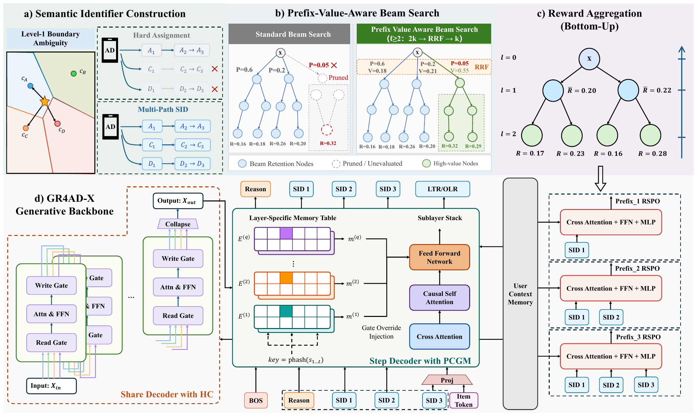

---

Kuaishou, generative ad retrieval: a 3x bigger model bought +0.53% revenue and cost two thirds of QPS. Three targeted fixes bought +3.07% instead.

The system generates an ad's Semantic ID token by token, then maps it back to an ad. It was already fully deployed. Here is what the team found in production data, written as checks you can run on your own SID-based retriever:

1. Count your boundary items. Nearly 30% of ads were about as close to their second-nearest first-level centroid as to their nearest, so which subtree they landed in was close to random, and beam search pruned them for good. Fix: give them two first-level codes, branch only at level 1. Same beam, same latency, +0.58%.

2. Scale with lookups, not width. Prefix n-gram memory tables (keyed on s1, then s1+s2) replace the FFN gate projection. Parameters go up, dense compute goes down, QPS recovers.

3. Compare top-10 by probability with top-10 by value. Theirs overlapped at 0.021. Fix: a value head per prefix level, trained to rank rather than regress. In beam search, keep 2k by probability and fuse the probability and value ranks with RRF, never raw scores. Skip level 1, or the value head picks coarse codes with few valid ads underneath.

4. Rerank inside the same network. One more decoder step on the finished SID plus ad features, reusing the user-side memory. No separate ranking model. Tied for the biggest single gain, +0.58%.

No new paradigm, just a careful audit of a system after it shipped.

Full breakdown:
https://github.com/lmxhappy/step-by-step-learning-ai/blob/main/generative-recommendation/kuaishou-gr4ad-x.full.en.md

#RecommenderSystems #GenerativeRecommendation #Advertising #MachineLearning #AI
