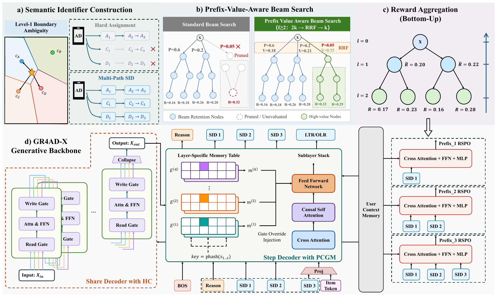

# Kuaishou GR4AD-X: three rounds of polish on generative ad retrieval, revenue +3%

> [中文版](kuaishou-gr4ad-x.md)

### Paper: Towards Reliable, Scalable, and Value-Aligned Generative Recommendation for Large-Scale Advertising
### Link: https://arxiv.org/abs/2610.38378
### Company: Kuaishou
### Idea: soft cluster assignment, business alignment
### Area: generative recommendation

## Overview:
This is the sequel to GR4AD, Kuaishou's generative recommendation system for ads, with improvements in three directions.

First, what GR4AD is: a "user sequence → generate SID → map to ad" framework. That is, **take the user's behavior sequence as input, generate the SID (the ad's discrete code) of an ad the user may be interested in, one position at a time, the way an LLM generates text, then map the SID to a concrete ad**.

The paper groups the problems GR4AD hit after launch into three:
* SID quality: first-level SID assignment is too "hard", so ads on the boundary are easily pruned by beam search;
* Scaling is inefficient: simply making the model wider and deeper drops QPS sharply while revenue barely moves;
* Ad metrics are not aligned: value optimization only happens at the whole-sequence level; nobody checks whether each intermediate SID level is chosen well, and beam search prunes by probability, cutting high-value candidates early. Three problems, three changes.

The three parts below are **parallel improvements in three directions**, each addressing one of the problems above. They do not depend on each other; the numbering is just for the write-up:
* **Change how SIDs are built** (Multi-Path SID): ads on SID boundaries get pruned too easily;
* **Change how the model scales** (multi-dimensional scaling): simply growing the backbone is not worth it;
* **Change how training and inference align with eCPM** (UniVGD): generation probability and eCPM don't agree.

### ① Multi-Path SID: the first level no longer gets just one code
Background: the first SID level decides which subtree to go down. Once beam search prunes that prefix, the ad can never be generated afterwards. The problem is that many ads sit almost equally close to two first-level centroids: per the paper's statistics, nearly 30% of ads are about as far from their nearest first-level centroid as from the second nearest. For them, which centroid they get hard-assigned to is close to random.

The method is simple: **only at the first level**, keep the m nearest centroids (m=2 online). Later levels don't branch: each first-level centroid does ordinary residual quantization downward on its own, and the final hash level is unchanged. So each ad has only m SID paths, of the same length. Note: these m paths are an index built for the ads in the ad corpus "that are to be generated"; the items in the user's history sequence are not copied m times, and the input side is unchanged. Why branch only at the first level: the boundary problem is mostly at the first level, which decides which subtree to go down; if every level branched, the number of paths would grow as m to the power of the number of levels, which neither decoding nor indexing can handle. In training, the m paths of the same positive are supervised together and summed with weights; to avoid recomputing the user side, the teacher-forcing inputs of the m paths are packed into blocks with a causal mask that hides blocks from each other, all in one forward pass. Inference decodes as usual; since one ad has m paths, different generated results may map back to the same ad, so results are deduplicated by ad at the end, keeping the highest-scoring path.

Offline, first-level hit rate goes up a few points at every cutoff. Online, with beam width and decoding depth unchanged and no added latency, revenue +0.58%.

### ② Multi-dimensional scaling: not just growing the backbone, and restrained about going wider or deeper
Background: the paper finds that growing the dense backbone from 0.16B to 0.50B gives only +0.53% revenue, with only 33% of QPS left. So the paper takes a different route and adds capacity along five dimensions, each adding as little online compute as possible:
* **Input**: total input length stays the same; what changes is what goes in. 20+ user profile and context features are brought in from the fine-ranking system. To make room, sequence length is reallocated by feature importance: important features (including the new fine-ranking ones) get more positions, and less important inputs are compressed or replaced.
* **Encoder**: embedding dimension of key high-cardinality features goes from 16 to 64; the FFN becomes SwiGLU.
* **Vocabulary memory (PCGM)**: each decoder layer gets its own SID memory table, plus 1-gram, 2-gram and 3-gram memories keyed on SID prefixes (table size set by polynomial hashing modulo). The lookup key can only be a prefix that has already been generated: in autoregressive generation, predicting the current position only sees earlier positions, so predicting s2 looks up with s1 (1-gram), predicting s3 looks up with (s1, s2) (2-gram), and the full SID (3-gram) has to wait until all three positions exist, so it is kept for the later rank step. Note that the retrieved vector is not inserted into the input sequence as a new token (the autoregressive input is still the same SID token sequence, same length). Instead, inside the current layer's FFN, it directly replaces the gate projection branch (the gate that used to be computed by multiplying the hidden state by a matrix now just comes from the lookup), which shapes this layer's output and helps predict the next position. The reason for this design is the tight online latency and throughput budget: appending it as an input token would lengthen the sequence and raise attention compute; injecting it into the FFN gate brings prefix-specific information into the current layer while a lookup replaces part of a matrix multiply, so parameters go up while dense compute actually goes down a little. In GR4AD the full-SID position was used to predict an eCPM token; the paper moves the eCPM signal into the ad-side features of the rank token.
* **Residual stream (diagonal Hyper-Connections)**: background first. Every Transformer sublayer has a residual connection of the form "input + sublayer output", so the whole network has a single residual stream from start to end that every layer reads from and writes to, and its capacity is limited. ByteDance's Hyper-Connections (2024, arXiv:2409.19606) expands this one stream into several parallel residual streams: each sublayer reads a combination from the streams with learnable weights, computes, then writes back to each stream with weights, which lets different layers pass information through different "channels". Attention and the FFN themselves are unchanged, so it adds almost no compute. GR4AD-X uses its diagonal variant directly: the residual stream is copied into 4 streams, each sublayer reads a weighted combination of the 4, computes, then writes back to the 4 through gates; "diagonal" means each stream only keeps its own value and doesn't mix with the others, which makes reading and writing cheaper. Attention and the FFN are still computed only once.
* **Reasoning token**: the first-level SID is predicted right after BOS (Begin of Sequence, a fixed special token that tells the model "start generating"), with no prefix to rely on. So a continuous "reasoning token" is inserted between BOS and s1, produced from the BOS hidden state by a small network. To make it learn something, the 16,384 first-level centroids are clustered again into 256 coarse prototypes, and it is supervised with a prototype classification loss plus a cosine loss. Put plainly, it adds a "position 0" before the real SID: first make a rough call on the general direction (1 of 256), then predict s1. But it is a continuous vector, not a discrete SID code; it is not part of the final SID sequence and plays no part in mapping back to an ad. It only helps the first level predict better. So SID depth is unchanged, and the first-level SID loss drops by about 3%.

With all five stacked, the parameter count is about the same as naively growing the backbone, but revenue rises more and QPS drops far less. PCGM is the best deal: it adds the most parameters, yet QPS actually recovers.

### ③ UniVGD: using eCPM to adjust the model
The paper finds that on online requests, the top 10 by eCPM and the top 10 by generation probability overlap at only about 0.021 HR@10; and the overlap is about the same whether you look at level 1 only, the first 2 levels, or all 3. So the mismatch is not a single level's problem: the whole generation process is out of line with commercial value.

What UniVGD does is use eCPM as the reward/label to adjust the model: look not only at whether the user is interested, but also at whether this ad makes money. Three parts:
* **PV-RSPO (training)**: train a prefix value head for each level.
* **PV-BeamSearch (online inference)**: use the trained value heads in beam search pruning, so high-value prefixes are not pruned too early.
* **Discriminative reranking (two scoring heads trained in training, used in online inference)**: after online beam search ends, rerank the selected candidate ads once more.

In detail:

* **PV-RSPO (training): train a value head for each prefix level**. The old sequence-level reward gives the same credit to every level of an SID, so a correct prefix with only the last position wrong gets penalized along with it. GR4AD-X instead computes and learns a value for each prefix separately, in three steps:
  1. **Compute prefix values**: during training, the model first samples a batch of candidate ads, each with its own eCPM reward. Average bottom-up over the SID prefix tree: a prefix's value is the average reward of the ads under it. For example, if 3 ads are sampled under first-level code A with eCPM 30, 20 and 10, A's value is the average, 20.
  2. **One value head per level**: a lightweight network (the prefix embedding cross-attends to the user memory; the user memory is the representation the model encodes from the user behavior sequence and context features before generation starts) gives the current level's prefix a score.
  3. **Teach the value head to rank, not to regress values**: put the prefixes of one level together as a small list, sort them by true value into an ideal order, and train the value head so its scores fall into the same order. Inversions are penalized, more heavily the bigger the value gap between the two prefixes and the higher up the positions. Each level is computed once and the results are summed with weights. This is the listwise loss of RSPO in GR4AD, just moved down from "the whole SID" to "each level's prefix".

  Why ranking rather than regressing values? Because at every level beam search just does "keep the top k, prune the rest": it only cares who ranks ahead, not what the scores actually are. Say first-level A, B and C have true values 20, 12 and 5. Whether the value head outputs 2.0, 1.5, 0.3 or 200, 150, 30, as long as the order is A>B>C the pruning result is the same; but once it outputs B>A, beam search may prune A. On top of that, eCPM varies a lot in magnitude across users and requests, so regressing exact numbers is hard and learning relative order is more stable. Once trained, this value head is handed to PV-BeamSearch below for online inference.
* **PV-BeamSearch (online inference): prune with the value head so high-value prefixes are not cut**. This step only happens in the beam search of online inference (generating ads for real requests); training is unchanged. Ordinary beam search keeps only the top k by generation probability at each level, so prefixes with modest probability but high value are pruned early and can never be generated afterwards. PV-BeamSearch turns pruning at each level (from level 2 on) into three steps:
  1. **Keep more first**: keep 2k candidates by generation probability (k=512, so 1,024) instead of k directly. The extra half gives prefixes that are "average in probability but possibly valuable" a chance to be reconsidered.
  2. **Score with the value head**: the value head trained by PV-RSPO gives each of the 2k candidates a value score. Now each candidate has two ranks: by probability and by value.
  3. **Fuse the two ranks, keep the top k**: the fusion is RRF (Reciprocal Rank Fusion). It adds up the reciprocals of the ranks: 1st place gets 1 point, 2nd gets 1/2, 3rd gets 1/3, and so on (the actual formula is 1/(c + rank), where c is a smoothing constant; same idea). The two terms add up to a candidate's total score, and the top k by total score are kept.

  Why fuse ranks instead of adding probability and value scores with weights? Because they are on different scales: probability is a small number between 0 and 1, while the value head's score only guarantees the right order and its magnitude means nothing (as above, it learns ranking), so adding them makes the weights hard to tune. Ranks are 1, 2, 3, … on both sides, naturally comparable.

  Why no fusion at level 1? First-level codes are the coarsest categories, and some have very few valid ads under them. Letting the value head vote at level 1 tends to pick coarse codes that "look valuable but have few ads underneath", so later levels can't produce valid ads and decoding validity drops noticeably. So level 1 is still pruned by probability only, and value comes in from level 2.
* **Discriminative reranking (scoring heads trained in training, used in online inference): rank once more after beam search**. In online inference, after beam search produces a batch of candidates, the full SID embedding and the ad-side features (including eCPM-related signals) are concatenated and projected into a rank token, appended after the user context, and the decoder runs one more step (the same decoder that generated the SID position by position in beam search, and where PCGM attaches its memory tables in ②; no separate network). It reuses the user-side memory from the generation stage (the representation encoded from the user behavior sequence and context features before generation starts, the same one the value heads above look at, not PCGM's SID memory tables in ②), with no recomputation. Two heads sit on top: one learns eCPM ranking with Lambda Loss, one learns progressively deeper conversion actions with ordinal logistic regression, and the two ranks are fused with RRF again. This step is not a bolted-on ranking model; it is the same network taking one more step.

  Why do it this way: during generation the model writes out the SID one position at a time, optimizing generation probability and prefix value, and it can't see the complete ad while writing; once writing is done the candidate is complete, so it can be judged again with more direct objectives (eCPM ranking, conversion depth). The user sequence is the same for every candidate and was already encoded during generation, so reusing it saves recomputation and adds little latency; and because it is the same backbone, the SID representation and the scoring parameters are one set, avoiding the mismatch of "one model generates, another ranks".

With UniVGD added, full HR@10 goes from 0.021 to 0.298; even without fusion at level 1, level-1 HR@10 goes from 0.017 to 0.145, which comes from PV-RSPO. The cost is 75% of QPS retained.

### A/B:
The control is the fully deployed GR4AD. Full GR4AD-X gives a cumulative +3.07% revenue over GR4AD. The largest single-step gains are discriminative reranking (+0.58%) and Multi-Path SID (+0.58%).

## Takeaways:
* The paper keeps the basic framework of the earlier work, polishes each component, finds problems through data analysis, and solves them with new ideas.
* It innovates along several dimensions on top of the earlier work. This is a team effort: at two people per direction, it still takes a dozen or so strong MLEs.

## Caveats
* In the paper's architecture figure, "SID 1, SID 2, SID 3" mean the 1st, 2nd and 3rd codes of one SID (s1, s2, s3), not a first, second and third SID. Since the paper also has Multi-Path SID, where one ad really does have several SIDs, the label is easy to misread. Labeling them s1, s2, s3 would be much clearer.

## Credibility: production

## Recommendation: practically useful
