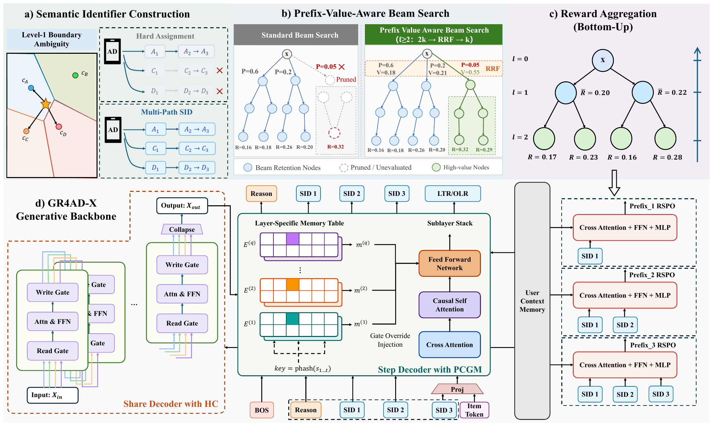

# 快手GR4AD-X：生成式广告召回三处打磨，收入+3%

关注我，每天为你精挑细选最优质、最新鲜的推荐算法paper，陪你一起保持进步、不断精进！

### 论文：Towards Reliable, Scalable, and Value-Aligned Generative Recommendation for Large-Scale Advertising
### 网址：https://arxiv.org/abs/2610.38378
### 公司：快手
### 思想：聚类软分配、业务对齐
### 方向：生成式推荐

## 解读：
这是快手广告生成式推荐GR4AD的续作，在3个方向上做了改进。

先说GR4AD是什么：一个"用户序列→生成SID→映射广告"的框架，即**输入用户行为序列，像大模型生成文字一样，一位一位生成用户可能感兴趣的广告SID（广告的离散编码），再把SID映射成具体广告**。

论文把GR4AD上线后暴露的问题归成三个：
* SID质量不够：SID首层分配太"硬"，边界上的广告容易被beam剪掉；
* 大了就不高效：直接把模型加宽加深，QPS掉得厉害、收入却涨不动；
* 广告指标没对齐：价值优化只在整条序列层面做，中间每一层SID选得好不好没人管，beam search按概率剪枝会把高价值候选提前剪掉。三个问题对应三块改动。

下面三块是**三个方向上并列的改进**，各自对应前面说的一个问题，彼此没有先后依赖，编号只是为了方便叙述：
* **改SID怎么建**（多路径SID）：解决SID边界上的广告容易被剪掉；
* **改模型怎么扩**（多维度扩容）：解决直接放大骨干不划算；
* **改训练和推理怎么对齐eCPM**（UniVGD）：解决生成概率和eCPM对不上。

### ① 多路径SID：首层不再只给一个码
背景：SID第一层决定了往哪棵子树走，beam search一旦把这个前缀剪掉，这个广告后面就再也生成不出来。问题是很多广告离两个首层中心差不多近：论文统计，将近三成的广告，离最近和第二近的首层中心几乎一样远。对它们来说，硬分到哪个中心几乎是随机的。

做法很简单：**只在第一层**取最近的m个中心（线上m=2），后面各层不再分叉，每个首层中心各自往下做普通的残差量化，最后一层hash也不变。这样每个广告只有m条SID路径，长度不变。注意，这m条路径是给广告库里"要被生成出来的广告"建的索引，不是把用户历史序列里的每个item都复制m份，输入侧不变。为什么只在第一层分叉：边界问题主要出在第一层，它决定了往哪棵子树走；如果每层都分叉，路径数会按m的层数次方膨胀，解码和索引都扛不住。训练时同一个正样本的m条路径一起监督，按权重加和；为了不重复算用户侧，把m条路径的teacher-forcing输入打包成多个块，用块间不可见的causal mask，在一次前向里算完。推理照常解码，因为一个广告有m条路径，不同的生成结果可能映射回同一个广告，所以最后按广告去重，保留得分最高的路径。

离线看首层命中率各档都涨了几个点。线上在beam宽度和解码深度都不变、延迟不增加的情况下，收入+0.58%。

### ② 多维度扩容：不单纯放大骨干，加宽加深也做得很克制
背景：论文发现直接把稠密骨干从0.16B加到0.50B，收入只+0.53%，QPS只剩33%。所以本文换了个思路，在五个维度上加容量，每一个都尽量不加在线计算：
* **输入**：总输入长度不变，换的是里面装什么。从精排系统里拿20多个用户画像、上下文特征加进来；腾地方的办法是按特征重要性重新分配序列长度，重要的特征（包括新加的精排特征）多占位置，原来重要性不高的输入被压缩或替换掉。
* **编码器**：关键高基数特征embedding维度从16加到64，FFN换成SwiGLU。
* **词表记忆（PCGM）**：每一层decoder一张独立的SID记忆表；再按SID前缀建1-gram、2-gram、3-gram的记忆（多项式hash取模定表大小）。查表的key只能是已经生成出来的前缀：自回归生成时，预测当前这一位只看得到前面的位，所以预测s2时用s1去查（1-gram），预测s3时用(s1,s2)去查（2-gram），完整SID（3-gram）要等三位都出来，留给后面的rank步用。注意，查出来的向量不是当成一个新token塞进输入序列（自回归的输入还是原来那串SID token，序列长度不变），而是在当前层FFN内部，直接替换门控投影那一路（原来要拿隐状态乘一个矩阵算出来的门控，现在直接用查表结果），以此影响这一层的输出，帮助预测下一位。这么设计是因为线上延迟和吞吐卡得紧：追加成输入token会拉长序列，attention计算跟着涨；注入FFN门控既能把前缀相关的信息带进当前层，又是拿查表顶替了一部分矩阵乘，所以参数变多了，稠密计算反而少了一点。GR4AD里完整SID位置是用来预测eCPM token的，论文把eCPM信号挪到了rank token的广告侧特征里。
* **残差流（对角Hyper-Connections）**：先说背景。Transformer每个子层都是"输入 + 子层输出"这样的残差连接，整个网络从头到尾只有一条残差流，所有层都往这一条上读写，容量有限。字节2024年的Hyper-Connections（arXiv:2409.19606）提出把这一条扩成多条并行的残差流，每个子层从多条流里按可学习的权重读一个组合进去算，算完再按权重写回各条流，相当于让不同层可以用不同的"通道"传信息；attention和FFN本身不变，所以几乎不加计算。GR4AD-X直接用了它的对角变体：把残差流复制成4路，每个子层从4路读一个加权组合进去算，算完再按门控写回4路；"对角"指每一路只保留自己原来的值、不和其他路互相混，这样读写的开销更小。attention和FFN还是只算一次。
* **推理token**：首层SID在BOS（Begin of Sequence，序列开始符，一个固定的特殊token，告诉模型"开始生成了"）之后直接预测，没有任何前缀可依赖。于是在BOS和s1之间插一个连续的"推理token"，由BOS隐状态经一个小网络生成。为了让它学到东西，把首层16384个中心再聚成256个粗原型，用原型分类loss加cosine loss监督它。说白了，就是在正式SID前面多加了一个"第0位"：先粗粗判断一下大方向（256选1），再预测s1。不过它是个连续向量，不是离散的SID码，不算进最终的SID序列，也不参与映射回广告，只是帮第一层预测得更准。所以SID深度不变，首层SID的loss降了约3%。

五个维度叠完，参数量和朴素放大骨干差不多，但收入涨得更多、QPS掉得少得多；其中PCGM最划算，参数涨得最多，QPS反而回升。

### ③ UniVGD：用eCPM来调整模型
论文发现：线上请求里，按eCPM排的top10和按生成概率排的top10，重合率HR@10只有0.021左右；而且只看第1层、看前2层、看全部3层，重合率都差不多。说明错位不是某一层的问题，而是整个生成过程都没对上商业价值。

UniVGD要做的，就是把eCPM当作reward/label，拿来调整模型：不光看用户会不会感兴趣，还要看这个广告能不能赚钱。分三块：
* **PV-RSPO（训练阶段）**：把每一层的前缀价值头训练好。
* **PV-BeamSearch（线上推理阶段）**：用训好的价值头参与beam search剪枝，避免高价值前缀被过早剪掉。
* **判别式重排（训练阶段训好两个打分头，线上推理阶段使用）**：线上beam search结束后，对选出来的候选广告再排一次序。

下面具体讲解：

* **PV-RSPO（训练阶段）：给每一层前缀训一个价值头**。原来的序列级reward对一条SID的每一层给一样的信用，前缀选对了、只是最后一位错了也一起被罚。GR4AD-X改成给每个前缀单独算价值、单独学，分三步：
  1. **算前缀的价值**：训练时先让模型采样出一批候选广告，每个广告有自己的eCPM reward。在SID前缀树上自底向上取平均：一个前缀的价值，就是它下面这些广告reward的平均。比如首层码A下面采样到了3个广告，eCPM分别是30、20、10，A的价值就是平均值20。
  2. **每层配一个价值头**：轻量的小网络（前缀embedding对用户记忆做cross-attention；用户记忆是生成开始前，模型把用户行为序列和上下文特征编码出来的表示），给当前这一层的前缀打一个分。
  3. **让价值头学排序，不学数值**：同一层的几个前缀放在一起当成一个小列表，按真实价值排出理想顺序，训练价值头打出的分数尽量排成同样的顺序。排反了就罚，两个前缀价值差得越多、排的位置越靠前，罚得越重。每层各算一次，最后加权求和。这就是GR4AD里RSPO的listwise loss，只是从"整条SID"下放到了"每一层前缀"。

  为什么学排序而不是回归数值？因为beam search每一层做的事就是"留top-k，剪掉其余"，只看谁排在前面，不看分数具体是多少。假设首层A、B、C的真实价值是20、12、5，价值头打出2.0、1.5、0.3也好，200、150、30也好，只要顺序是A>B>C，剪枝结果都一样；可一旦打成B>A，beam就可能把A剪掉。再加上不同用户、不同请求的eCPM量级差别很大，回归准确的数字很难，学相对顺序更稳。这个价值头训好之后，就交给下面的PV-BeamSearch在线上推理时用。
* **PV-BeamSearch（线上推理阶段）：用价值头剪枝，别把高价值前缀剪掉**。这一步只发生在线上推理（给真实请求生成广告）的beam search里，不改训练。普通beam search每层只按生成概率留top-k，概率不高但价值高的前缀会被提前剪掉，后面就再也生成不出来。PV-BeamSearch在每一层（从第2层开始）把剪枝改成三步：
  1. **先多留一些**：按生成概率留2k个候选（k=512，即留1024个），而不是直接留k个。多出来的这一半，就是给"概率一般、但可能值钱"的前缀一个被重新考虑的机会。
  2. **价值头打分**：用PV-RSPO训好的价值头，给这2k个候选各打一个价值分。这样每个候选手里有两个排名：按概率的排名、按价值的排名。
  3. **两个排名融合，留top-k**：融合用的是RRF（Reciprocal Rank Fusion，倒数排名融合）。做法是把排名取倒数再相加：排第1得1分，排第2得1/2分，排第3得1/3分……（实际公式是1/(c+排名)，c是一个平滑常数，道理一样）。两项加起来就是候选的总分，按总分留top-k。

  为什么用排名融合，不直接把概率和价值分数加权相加？因为两者不在一个尺度上：概率是0到1之间的小数，价值头的分数只保证顺序对，数值本身没有意义（上面说了它学的是排序），硬加起来权重很难调。换成排名，两边都是1、2、3……，天然可比。

  第1层为什么不融合？首层码是最粗的类目，有的首层码底下合法的广告很少。如果在第1层就让价值头投票，容易选出这种"看着值钱、底下却没几个广告"的粗码，后面几层生成不出合法广告，解码有效性明显变差。所以第1层仍然只按概率剪枝，价值从第2层开始介入。
* **判别式重排（训练阶段训打分头，线上推理阶段使用）：beam search结束后再排一次**。线上推理时，beam search出来一批候选后，把完整SID的embedding和广告侧特征（含eCPM相关信号）拼起来投影成一个rank token，接在用户上下文后面再跑一步decoder（就是前面beam search里一位一位生成SID的那个decoder，也是②里PCGM挂记忆表的地方，没有另建网络），复用生成阶段的用户侧记忆（就是生成开始前对用户行为序列和上下文特征编码出来的那份表示，和上面价值头看的是同一份，不是②里PCGM的SID记忆表），不用重算。上面挂两个头：一个用Lambda Loss学eCPM排序，一个用有序逻辑回归学逐级加深的转化行为，两个排名再用RRF融合。这一步不是外挂一个精排模型，而是同一个网络多走一步。

  为什么这么做：生成时模型是一位一位往外写SID，优化的是生成概率和前缀价值，写的时候还看不到完整的广告；写完以后候选是完整的了，就可以用更直接的目标（eCPM排序、转化深度）再判断一次。用户序列对所有候选都一样，生成阶段已经编码好了，直接复用，省掉重复计算、不增加多少延迟；又因为用的是同一个主干，SID的表示和打分的参数是一套，不会出现"生成用一个模型、排序用另一个模型"对不上的问题。

加了UniVGD之后，完整HR@10从0.021到0.298；即使在第1层不做融合，第1层HR@10也从0.017到0.145，这部分来自PV-RSPO。代价是QPS保留75%。

### A/B：
对照组是线上全量的GR4AD。完整GR4AD-X相对GR4AD累计收入+3.07%。单步增量最大的是判别式重排（+0.58%）和多路径SID（+0.58%）。

## 心得：
* 本文是保持前序工作基本框架不变的情况下，打磨各个组件，通过数据分析发现问题，并创新性解决。
* 在前序工作上，多个维度上做了创新，这是一个团队的成果，每个方向2个人，这也得十几个优秀MLE的成果。

## 愚见
* 论文架构图里的"SID 1、SID 2、SID 3"，指的是同一条SID的第1、2、3位码（s1、s2、s3），不是第1个、第2个SID。偏偏本文又有多路径SID，一个广告真的有好几条SID，这个标记很容易让人误读。写成s1、s2、s3会清楚得多。

## 可信度：生产

## 推荐等级：有实践价值

**请帮忙点赞、转发，谢谢。欢迎干货投稿 \ 论文宣传\ 合作交流**

### 【铁粉】请入微信群，群内我会给出更深入的解读，还可以共同讨论技术方案、发招聘广告、内推和交友等。
* 铁粉标准：关注公众号一个月以上，且在公众号上累计15次互动（评论、爱心、转发）、或投稿1次，只欢迎技术同学。
* 入群方法：请您加个人微信lmxhappy，我拉您入群，请备注【公司】（只我个人看，不公开）。

## 推荐您继续阅读：

