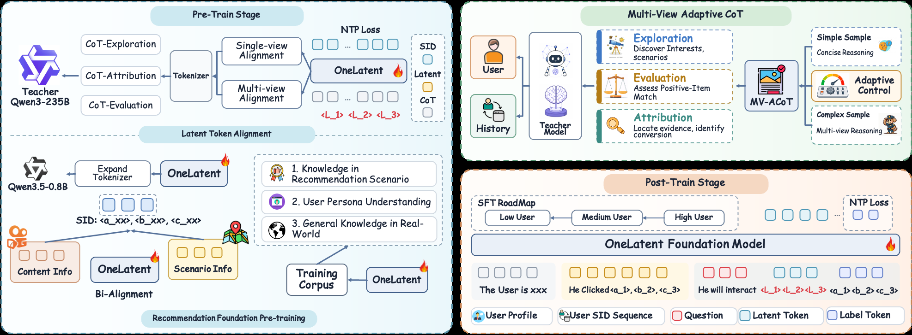

# Kuaishou squeezes chain-of-thought into 3 tokens: the model "thinks" online without writing a word, revenue +9.6%

> [中文版](kuaishou-onelatent.md)

### Paper: OneLatent: Latent Reasoning for Efficient Foundation Recommendation Models
### Link: https://arxiv.org/abs/2610.30675
### Company: Kuaishou
### Idea: chain-of-thought is used only as a training signal; online it is replaced by 3 fixed tokens
### Area: generative recommendation, LLM reasoning

## Overview:
Kuaishou's generative recommendation uses an LLM as the backbone: it takes the user profile and behavior history as input and directly generates the SID (Semantic ID, an item's semantic code, three levels from coarse to fine) of the next item. The earlier work OneReason had the model first write a chain-of-thought analyzing the user, then generate the SID. There were two problems. First, it is slow: throughput with chain-of-thought is only 1/17 of throughput without. Second, it is not necessarily more accurate: even simple requests get a long write-up, and if one step in the middle goes wrong, the SID after it goes wrong too. OneReason itself reported that "thinking" mode is not always better than "not thinking".

This paper's approach: insert 3 special tokens `<L1><L2><L3>` between the user input and the target SID. These are 3 fixed tokens newly added to the vocabulary, shared by all samples, not vectors learned separately per sample. In training, the model first learns to "write the teacher's chain-of-thought after these 3 tokens", then learns to "output the SID directly after these 3 tokens". Online it only outputs the SID, at the same cost as not thinking.

### 1. Data: the teacher writes chain-of-thought from three angles

The teacher is Qwen3-235B. For the same user it writes one piece from each of three angles:
* **Exploration**: given only the profile and history, not the answer. It writes an interest analysis and lists several possible consumption intents.
* **Evaluation**: told which item the user actually clicked, it gives a 1–5 match score and its reasons.
* **Attribution**: also told the answer, it explains which signals in the history led to this click.

The last two use the answer, but the answer is shown only to the teacher; the target item never appears in the student model's input.

**Adaptive length**: the prompt has the teacher first judge whether this user's behavior is simple (one obvious strong signal) or complex (conflicting interests, lots of noise). Simple cases converge quickly and get less writing; complex ones get multi-angle comparison. Average length drops 35%.

### 2. Training: three steps to "squeeze" chain-of-thought into 3 tokens

The backbone is Qwen3.5-0.8B. First the vocabulary is extended with SIDs and continued pretraining is done in the recommendation domain (e.g. generating SIDs and item text from each other). Then three steps:
* **Step 1, single view**: input = profile + history + view marker + `<L1><L2><L3>`, target = one kind of chain-of-thought written by the teacher; loss is computed only on the chain-of-thought part.
* **Step 2, multi-view**: all three kinds of chain-of-thought are used, each with its loss averaged over its own length, so the longer one doesn't get more weight.
* **Step 3, connect to recommendation**: the input additionally gets request context (time, location, search query, comments, etc.), and the target after `<L1><L2><L3>` is replaced with the next item's SID.

**Post-training**: first ordinary "input → SID" fine-tuning, adding data step by step in the order of high-activity, mid-activity and low-activity users; then the version with the 3 tokens is added, and the two kinds of samples are mixed 1:1 in training, so the model works with or without the 3 tokens.

Note that attention here is unrestricted: later tokens can still see the raw input directly, and all parameters are updated. So the chain-of-thought information is not necessarily really "squeezed" into these 3 tokens; the paper itself says this can't be treated as a strict information bottleneck.

### 3. Online: an independent retrieval channel, computed asynchronously and cached

At inference, the 3 tokens are appended to the input and beam search outputs the SID directly, at the same speed as not thinking.

Even so, calling a 0.8B model synchronously on every request is still too slow. So it is deployed as an independent retrieval channel, off the request path: when a user has new behavior, user value and behavior strength decide whether and how fast to refresh; a scheduler deduplicates, keeps only the latest context, and caps total QPS; the model generates SIDs, maps them to items, and writes them into Redis. When a request comes, the cache is read directly, merged with the existing retrieval results, and sent into the ranking stage together. If the model hasn't refreshed in time, the previous result is used.

Offline results in one sentence: on the industrial dataset, explicitly writing chain-of-thought (SID@64 0.1505) is actually worse than not writing it (0.1851); this paper gets 0.1993. Going from 1 latent token to 3 improves results; more than that doesn't help further.

### A/B:
A sub-scenario of Kuaishou local-services ads, with 5% traffic each for treatment and control, running 7 days (2026-09-03 to 09-10). The control is the online system (including the two channels OneRec and OneReason); the treatment additionally plugs in this paper's retrieval channel: impressions +2.566%, ad spend +5.157%, estimated revenue +9.6% (estimated by a posterior estimator, not a directly observed value). Fully launched.

## Takeaways:
* Chain-of-thought goes from "output at inference" to "supervision signal at training": online not a single word is written, but in training the model is forced to learn to think. Tencent's [TGR-Reason](tencent-tgr.md) is in the same direction; the difference is that TGR lets the latent vector roll forward a few steps by itself, while this paper inserts fixed tokens and aligns them with the teacher's chain-of-thought.
* Another example of moving heavy computation off the request path: the large model is not in the online synchronous chain; it is triggered by behavior, refreshed asynchronously, and its results are cached.
* Explicitly writing chain-of-thought in recommendation doesn't pay: it is slow and may be worse. This paper and OneReason reach the same conclusion here.

## Caveats
* **"Squeezed into 3 tokens" is not proven.** A key control is missing: no latent tokens, with chain-of-thought generation simply trained alongside as an auxiliary task. The gain may come from "an extra chain-of-thought supervision" itself rather than from these 3 tokens. In the interpretability experiment, the rationales the model generates have 0.79–0.80 semantic similarity with the teacher's, but the user profile is kept in the input, so this doesn't show that the tokens carry the reasoning.
* **The 9.6% is an estimate**; what is directly observed is spend +5.2%. And the treatment is "online system + one more retrieval channel", so part of the gain comes from simply having one more retrieval channel.
* **Offline data is very small**: the industrial dataset has 100k training and 20k test samples, from only 7 days of data. Against the strongest non-proposed method, SID@64 is only 1.6% higher.

## Credibility: production

## Recommendation: practically useful
