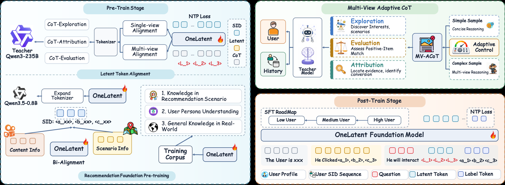

# 快手，思维链压进 3 个 token，线上不写字也能"想"，收入 +9.6%

关注我，每天为你精挑细选最优质、最新鲜的推荐算法paper，陪你一起保持进步、不断精进！

### 论文：OneLatent: Latent Reasoning for Efficient Foundation Recommendation Models
### 网址：https://arxiv.org/abs/2610.30675
### 公司：快手
### 思想：思维链只当训练信号，线上用 3 个固定 token 代替
### 方向：生成式推荐、LLM 推理

## 解读：
快手的生成式推荐用 LLM 当底座，输入用户画像和行为历史，直接生成下一个 item 的 SID（Semantic ID，item 的语义编号，由粗到细三层）。前作 OneReason 让模型先写一段思维链分析用户、再生成 SID，问题有两个：一是慢，写思维链的吞吐只有不写的 1/17；二是不一定更准，简单请求也写一大段，中间写错一步，后面的 SID 就跟着错。OneReason 自己也报告，"思考"模式并不总比"不思考"好。

本文的做法：在用户输入和目标 SID 之间插 3 个特殊 token `<L1><L2><L3>`。这是词表里新增的 3 个固定 token，所有样本共用，不是每个样本单独学的向量。训练时先让模型学会"在这 3 个 token 之后能写出老师的思维链"，再让它"在这 3 个 token 之后直接吐 SID"。线上只吐 SID，开销和不思考一样。

### 1. 数据：老师从三个角度写思维链

老师是 Qwen3-235B，针对同一个用户从三个角度各写一段：
* **探索**：只给画像和历史，不给答案。写兴趣分析，并列出几个可能的消费意图。
* **评估**：告诉它用户实际点了哪个 item，让它给出 1–5 的匹配分和理由。
* **归因**：同样告诉它答案，让它解释历史里哪些信号导致了这次点击。

后两种用到了答案，但答案只给老师看，学生模型的输入里始终没有目标 item。

**自适应长度**：prompt 让老师先判断这个用户的行为是简单（有一个明显的强信号）还是复杂（兴趣冲突、噪声多），简单的快速收敛、少写，复杂的多角度比较。平均长度降了 35%。

### 2. 训练：三步把思维链"压"进 3 个 token

底座是 Qwen3.5-0.8B，先扩充 SID 词表，做推荐领域的继续预训练（比如 SID 和 item 文案互相生成）。然后分三步：
* **第一步，单视角**：输入 = 画像 + 历史 + 视角标记 + `<L1><L2><L3>`，目标 = 老师写的某一种思维链，只对思维链部分算 loss。
* **第二步，多视角**：三种思维链都用，每种按自身长度平均 loss，防止长的那段占的权重更大。
* **第三步，接到推荐上**：输入再加上请求上下文（时间、地点、搜索词、评论等），`<L1><L2><L3>` 后面的目标换成下一个 item 的 SID。

**后训练**：先做普通的"输入→SID"微调，按高活跃、中活跃、低活跃用户的顺序逐步加数据；再加带 3 个 token 的版本，两种样本 1:1 混着训，保证有没有这 3 个 token 都能用。

注意，这里的注意力不受限制，后面的 token 照样能直接看到原始输入，所有参数也都在更新。所以思维链的信息不一定真的被"压"进了这 3 个 token，论文自己也说不能当成严格的信息瓶颈。

### 3. 线上：独立召回通道，异步算好存缓存

推理时，输入后面接 3 个 token，直接 beam search 出 SID，速度和不思考一样。

但即便这样，每个请求同步调一次 0.8B 模型还是太慢。所以它被部署成一路独立召回，不在请求路径上：用户有新行为时，按用户价值和行为强弱决定要不要刷新、多快刷新；调度器去重、只保留最新上下文、限总 QPS；模型生成 SID 后映射成 item，写进 Redis。请求来时直接读缓存，和原有召回结果合并，一起进精排。模型没来得及刷新，就用上一次的结果。

离线效果一句话：工业数据集上，显式写思维链（SID@64 0.1505）反而比不写（0.1851）差，本文 0.1993。latent token 从 1 个加到 3 个效果上升，再多就不涨了。

### A/B：
快手本地生活广告的一个子场景，实验组和对照组各 5% 流量，跑 7 天（2026-09-03 至 09-10）。对照组是线上系统（包括 OneRec、OneReason 两路），实验组额外接入本文这路召回：曝光 +2.566%，广告消耗 +5.157%，估算收入 +9.6%（由后验估计器估算，不是直接观测值）。已全量上线。

## 心得：
* 思维链从"推理时的输出"变成"训练时的监督信号"：线上一个字都不写，但训练时逼模型学会想。腾讯的 [TGR-Reason](tencent-tgr.md) 也是这个方向，区别是 TGR 让隐向量自己滚几步，本文是插固定的 token 再用老师的思维链去对齐。
* 又一个把重计算挪出请求路径的例子：大模型不进线上同步链路，由行为触发、异步刷新、结果存缓存。
* 推荐里显式写思维链不划算，又慢又可能更差，这一点本文和 OneReason 的结论一致。

## 愚见
* **"压进 3 个 token"没有被证明。** 缺一个关键对照：不加 latent token，只把思维链生成当辅助任务一起训。收益可能来自"多了一份思维链监督"本身，而不是这 3 个 token。解释性实验里，模型生成的理由和老师的语义相似度 0.79–0.80，但输入里保留了用户画像，说明不了 token 承载了推理。
* **9.6% 是估算值**，直接观测到的是消耗 +5.2%。而且实验组是"线上系统 + 多一路召回"，增益里有一部分来自多了一路召回本身。
* **离线数据很小**：工业数据集训练 10 万条、测试 2 万条，只有 7 天数据。相对最强的非本文方法，SID@64 只高 1.6%。

## 可信度：生产

## 推荐等级：有实践价值

**请帮忙点赞、转发，谢谢。欢迎干货投稿 \ 论文宣传\ 合作交流**

### 【铁粉】请入微信群，群内我会给出更深入的解读，还可以共同讨论技术方案、发招聘广告、内推和交友等。
* 铁粉标准：关注公众号一个月以上，且在公众号上累计15次互动（评论、爱心、转发）、或投稿1次、或打赏199，只欢迎技术同学。
* 入群方法：请您加个人微信lmxhappy，我拉您入群，请备注【公司】（只我个人看，不公开）。

## 推荐您继续阅读：
* [腾讯 TGR-Reason：离线 reason token 注入，新用户曝光转化 +13%](tencent-tgr.md)
