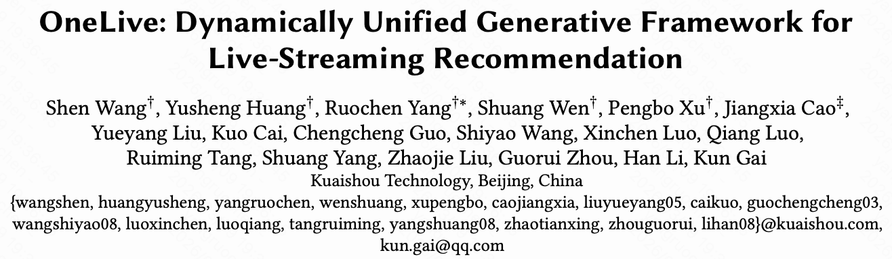
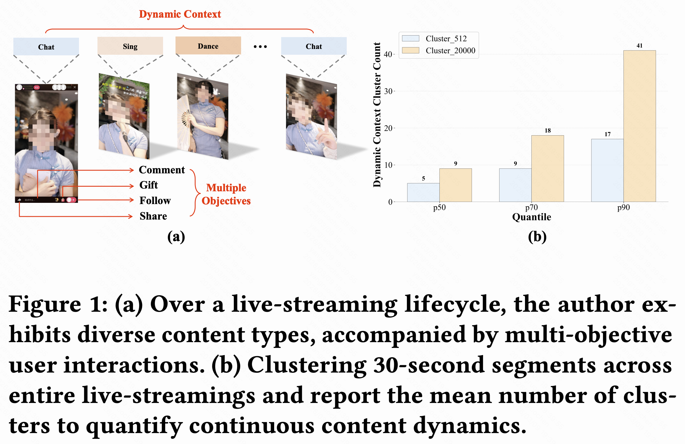
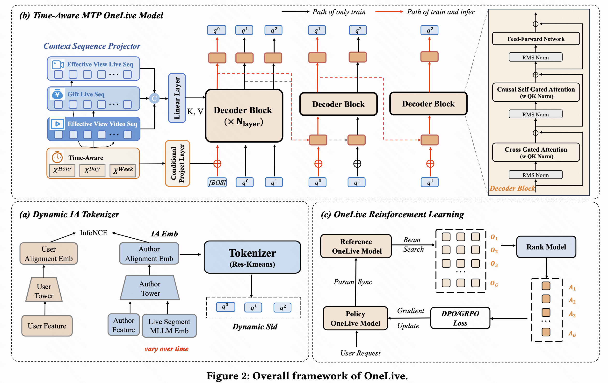
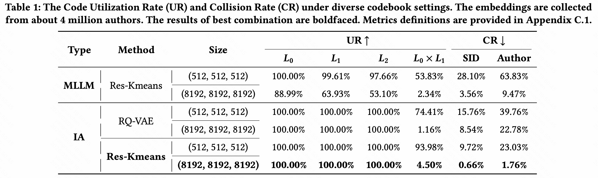
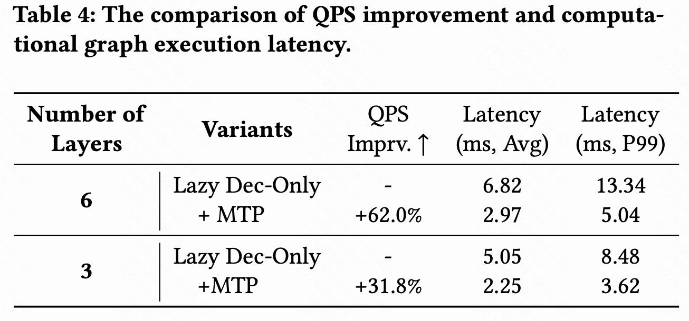
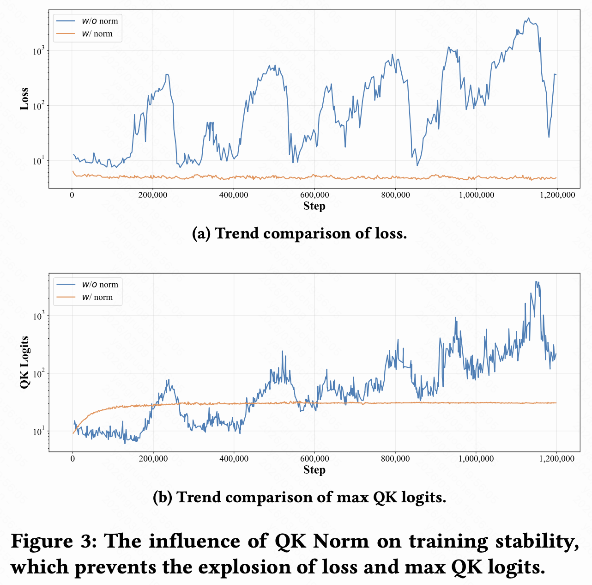
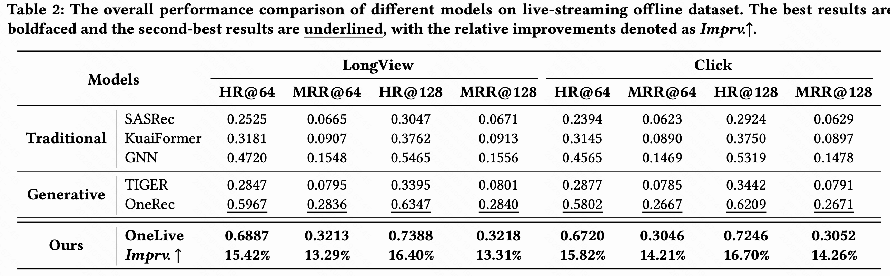
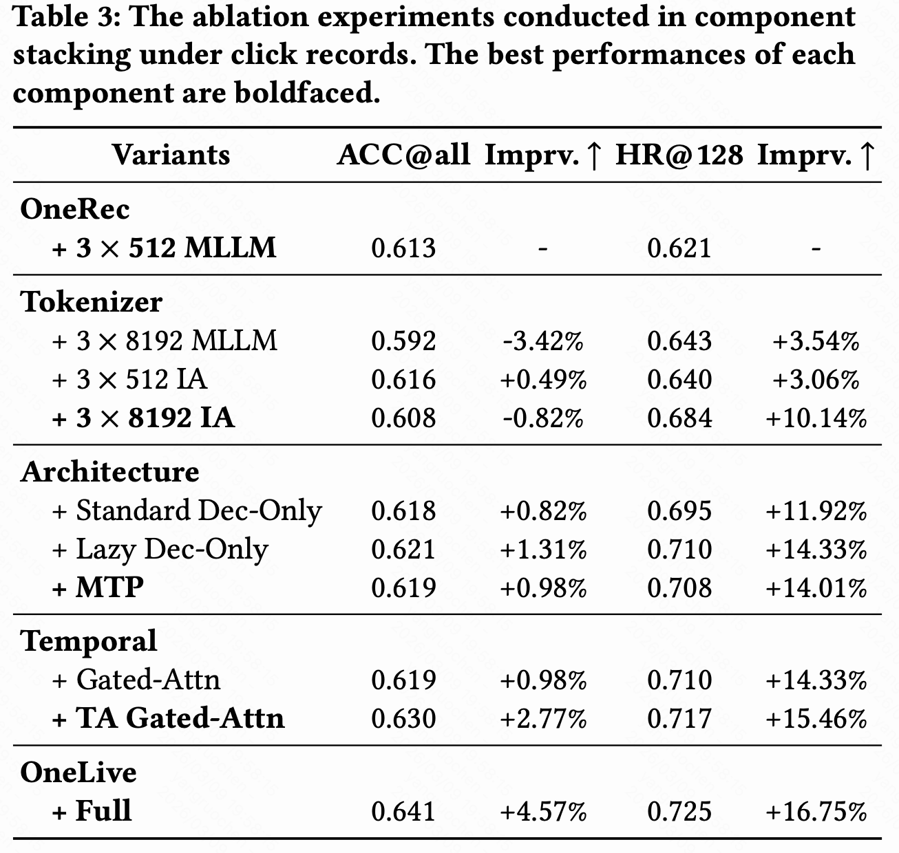
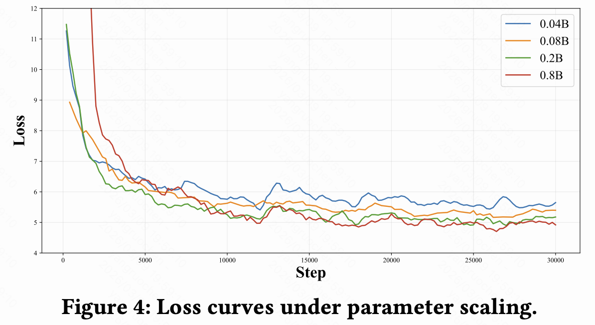
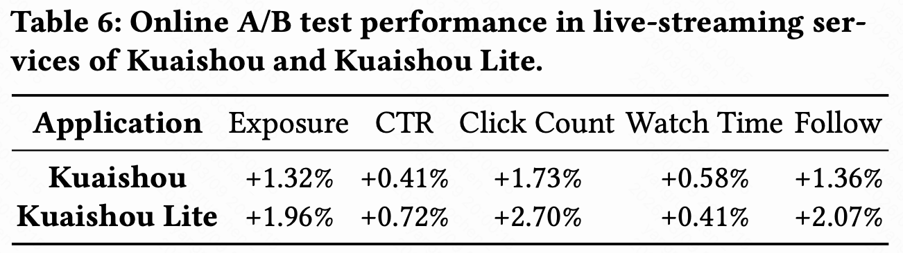

# Kuaishou OneLive: the first deployment of generative recommendation in live streaming!

> [中文版](kuaishou-onelive.md)

TL;DR:

Generative AI is accelerating the shift of recommender systems from the traditional cascade architecture toward **Generative Recommendation**. But in real scenarios like live-streaming recommendation, which are highly dynamic, strongly real-time and short-lived, existing generative paradigms still face significant deployment challenges.

The live-streaming model group of Kuaishou's recommendation model department recently released the paper **OneLive: Dynamically Unified Generative Framework for Live-Streaming Recommendation** on arXiv. Targeting the core pain points of live streaming, it proposes **the industry's first generative recommendation framework designed specifically for live streaming**, redesigns the generative structure around the dynamic nature of live streams, and has been deployed in a large-scale industrial live-streaming recommender system.

**Paper link:** https://arxiv.org/abs/2602.08612

---
## 1. Background: the difficulties of generative recommendation in live streaming

  
  
<strong>Live-stream content keeps changing</strong>

The live-streaming recommender system is the core infrastructure connecting a huge number of users with streamers in real-time interaction. Industry has traditionally used the complex "retrieval - pre-ranking - ranking" cascade architecture to handle high-concurrency online demand. In recent years, generative recommendation, by turning the matching task of recommendation into a sequence generation task, has offered a new path to break the performance bottleneck of the traditional cascade. Note, however, that existing generative recommendation architectures all rely on the assumption that content and representations are static. For example, short videos and products are fixed once uploaded, so they can be encoded once into a stable representation and reused.

When this static generative paradigm is applied directly to live streaming, it faces four core challenges:
1. **Dynamic Content:** unlike short videos and image-text posts, which are fixed once uploaded, live-stream content keeps evolving while the stream is on. The streamer's behavior, real-time comment (danmaku) feedback and the room's interaction atmosphere all change significantly over time. The traditional static representation paradigm cannot capture this change, let alone handle live content drift; a fixed representation cannot accurately describe the real-time state of a live room.
2. **Limited Lifecycle:** live streaming has strict time constraints. Only streams currently on air are eligible for recommendation, rather than a persistent content inventory as on traditional platforms, and a stream must be recommended within its golden exposure window to realize its full value.
3. **Real-Time Response Constraint:** live-streaming recommendation runs in a high-concurrency, low-latency online environment, where the candidate pool evolves quickly and user queries arrive at high frequency. This requires the generative model to infer efficiently while keeping prediction accuracy, meeting low-latency, high-throughput online deployment requirements.
4. **Multiple Objectives:** live-streaming recommendation is a typical multi-objective task, covering rich user feedback signals such as clicks, shares, follows and gifting. At the same time, users differ markedly in their preferences across interaction and consumption behaviors, with clear heterogeneity. Traditional single-objective or multi-task tower models struggle to align multi-objective preferences, and even more so to fold diverse supervision signals into a unified generative training pipeline.

Live-streaming recommendation therefore urgently needs a new generative framework tailored to it. This is the core motivation for the **OneLive** framework proposed by Kuaishou's live-streaming model group.

---
## 2. Method: OneLive, a generative live-streaming recommendation framework

  
  
<strong>Model architecture</strong>

Kuaishou's live-streaming model team built a new generative live-streaming recommendation framework, **OneLive**, for live streaming. It builds a unified generative recommendation model end to end, from **dynamic tokenization**, **time-aware generation**, **Sequential MTP for faster inference** and **QK-Norm for stable training**, to **multi-objective policy optimization**, suited to live-streaming recommendation where real-time matters and content keeps evolving:

### 1. Dynamic Tokenizer

In live-streaming recommendation, content keeps changing, and the streamer's state and behavior also change in real time, so traditional static representations can't handle these dynamic features well.

The **Dynamic Tokenizer** continuously encodes live content and user behavior signals to produce dynamic representations that can flexibly adapt to content changes. Specifically:

+ An MLLM extracts the real-time content vector $x^{30s}_{MLLM}$ (updated over a 30 s sliding window).
+ A gated mechanism fuses the author's static attributes with the content summary:
$$  
x_{MLLM}=M L P(x_{ML M}^{30s}\oplus x_{MLLM}^{pooling})
$$
$$
x_{Author}=\lambda x_{AId} + (1-\lambda)x_{MLLM} 
$$
+ This gives the final IA embedding $x_{IA}=x_{Author}$. Multi-level residual quantization (Res-Kmeans) then generates the IA Code level by level, iterating to get the streamer's complete SID $\{q_0, q_1, ..., q_T\}$.

  
  
<strong>Comparison of codes from different types and quantization methods, showing the advantage of the IA Code
</strong>

### 2. Temporal dynamics (Time-Aware Gated Attention)

Live-streaming recommendation also involves change over **time**. 1) The temporal dynamics of live rooms: on-air status, content, style and behavior patterns can differ greatly across time periods; 2) user interests also shift over time following fixed patterns (e.g. following current-affairs news during working hours, and looks or games after work). So OneLive introduces temporal dynamic information, aiming to explicitly model change over time, make the model more sensitive to temporal information, and capture interests more accurately. Specifically:
+ Add time encoding to the user history sequence:
$$
x_{i\_ta} = x_i + MLP(\text{TimeFeature})
$$
+ Apply time-aware enhancement to the generation anchor ([BOS]):
$$
x_{[BOS]\_ta} = x_{[BOS]} + MLP(\text{TimeFeature})
$$
+ Achieve dynamic temporal weighting through **Time-Aware Gated Attention**:
$$
\text{Score}(X) = \sigma(XW_{\theta})
$$
$$
O = \left(\text{MultiHeadAttn}(XW_Q, X'W_K, X'W_V) \odot \text{Score}(X)\right)W_O
$$

With this mechanism, OneLive can predict user needs in different time periods of a live stream more accurately, improving recommendation quality.

### 3. Training and inference performance optimization (Sequential MTP + QK Norm)

Standard decoder-only autoregressive inference is inefficient at generating sequences: among the three SID levels, the first is usually hard and the later ones are easier, so using a decoder with the same number of layers for all three SID levels wastes a lot of compute. So, inspired by DeepSeek-V3 [1], OneLive designs **Sequential MTP (Multi-Token Prediction)**: the main decoder (multi-layer) generates the first SID level, and a lightweight decoder (1 layer) generates the later SID levels; the three decoders also share the KV cache to further speed up inference.

The training objective is a weighted sum over the multi-level decoding modules:
$$
\mathcal{L}_{MTP} := w_0\mathcal{L}_{\text{MTP}_{main}} + w_1\mathcal{L}_{\text{MTP}_{1}} + w_2\mathcal{L}_{\text{MTP}_{2}}
$$
$$
\mathcal{L}_{\text{MTP}_{k}} := -\text{log} \ p(q^{k:2}|[\text{BOS}], q^{<2}, E)
$$

Table 4 in the paper shows that, with 3/6-layer decoders, this design raises throughput by 31.8%/62.0% with hit rate essentially unchanged.

  
  
<strong>The MTP module brings a significant throughput gain
</strong>

In addition, the sparsity enhancement introduced by Time-Aware Gated Attention improves the signal-to-noise ratio but reduces the amount of information flowing between layers, causing the logits of activated tokens to inflate. In deep attention layers the QK logits can overflow numerically, causing loss oscillation and training collapse. OneLive adds QK Norm before attention: RMS normalization suppresses hidden-state scale drift and significantly stabilizes the loss and training:
$$
\text{Attn}(Q,K,V) = \text{Softmax}(\frac{\text{RMSNorm}(Q) \text{RMSNorm}(K)^T}{\sqrt{d}})V
$$

With these two designs, OneLive keeps its generative recommendation ability while effectively addressing inference speed and compute cost.

  
  
<strong>Adding QK Norm effectively improves training stability
</strong>

### 4. Multi-objective Alignment Module

User feedback in live-streaming recommendation is very diverse, including clicks, watch time, follows, gifting and other behavior objectives. Traditional recommendation methods often treat these objectives as separate optimization problems, which easily leads to conflict and inconsistency between objectives.

To coordinate these objectives effectively, OneLive introduces a unified multi-objective optimization framework that uses reinforcement learning to optimize multiple objectives at once within a unified generative model. Specifically:
+ Use the Pantheon [2] multi-objective ranking model to compute a unified reward:
$$
Score = \text{Pantheon}(\text{User}, \text{Author})
$$
+ Use DPO or GRPO as the optimization policy

This lets OneLive handle multiple objectives in one unified framework, improving the accuracy of the recommender system while keeping the diverse objectives coordinated.

---

## 3. Industrial deployment: from the lab to the real world

Extensive experiments show **OneLive**'s strong performance on live-streaming recommendation, covering offline experiments as well as results after online deployment:

### 1. Offline experiments

  
  
<strong>Offline comparison
</strong>

The offline comparison shows that OneLive outperforms existing methods in several respects, optimizing recommendation quality more effectively especially when handling complex live content.

### 2. Component ablation

  
  
<strong>Component ablation
</strong>

The paper runs component ablations to evaluate each module's effect on the final result. Overall, every designed module contributes positively to the final recommendation quality, especially **Time-Aware Gated Attention** and the **Dynamic Tokenizer**, which are crucial for handling the dynamic and temporal nature of live content.

### 3. Scaling experiments: model size vs. performance

  
  
<strong>Curve of model size vs. performance
</strong>

The paper tests OneLive models of different sizes and observes their performance on the recommendation task. The results show that performance improves steadily overall as parameters grow, meaning the model can better capture users' complex behavior patterns and content diversity. However, diminishing returns gradually appear: as size grows, the gains get smaller. So in practice, model size needs to balance performance gains against compute cost.

### 4. Online A/B test:

  
  
<strong>Online A/B tests on both apps confirm OneLive's gains for the online business
</strong>

**OneLive** is deployed in the live-streaming business of both the Kuaishou and Kuaishou Lite apps, achieving **the first deployment of a unified generative recommendation framework on a large real-world live-streaming platform**. A/B tests on both apps show statistically significant business gains for OneLive. This not only proves the feasibility of generative recommendation in highly dynamic, strongly real-time scenarios, but also offers a valuable reference paradigm for future all-scenario, end-to-end real-time streaming recommender systems.

---

# 4. Conclusion

The successful deployment of OneLive fully shows the framework's potential in live-streaming recommendation: offline experiments confirm its advantage, and online A/B tests prove its feasibility in an industrial environment. Notably, through carefully designed components, OneLive handles the dynamic change, temporal nature and performance optimization issues of live-streaming recommendation, pushing generative recommendation toward more complex real-time scenarios.

[1]Liu A, Feng B, Xue B, et al. Deepseek-v3 technical report[J]. arXiv preprint arXiv:2412.19437, 2024.

[2]Cao J, Xu P, Cheng Y, et al. Pantheon: Personalized multi-objective ensemble sort via iterative pareto policy optimization[C]//Proceedings of the 34th ACM International Conference on Information and Knowledge Management. 2025: 5575-5582.

