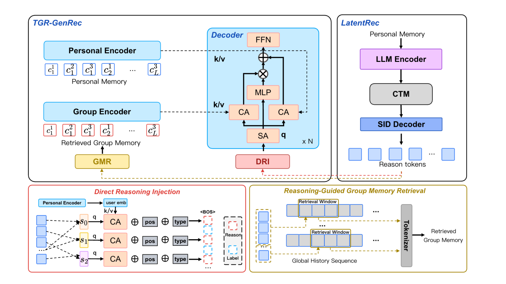
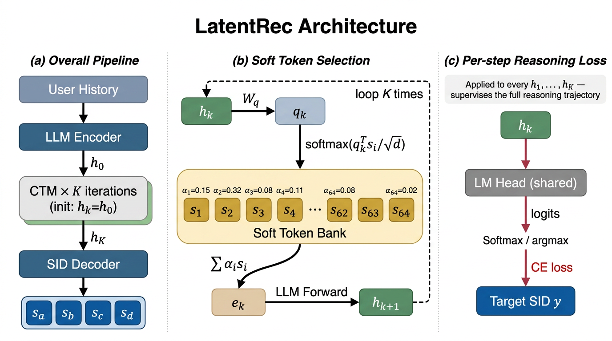

# Tencent: bringing LLM reasoning into retrieval, new-user impression conversion +13%

> [中文版](tencent-tgr.md)

### Paper: TGR: Advancing Industrial Recommendation from Generative-Paradigm Ranking toward Unified Generation and Reasoning
### Link: https://arxiv.org/abs/2609.00986
### Company: Tencent
### Idea: "large model offline, small model online"
### Area: reasoning for generative recommendation, retrieval

## Overview:
LLM reasoning works well in recommendation, but the latency is unaffordable. So it is moved offline to generate a small number of SIDs, which give the online small generator more information so it can generate better recommendations.

The pipeline has three steps:

1. **Train a large model that can think, offline**. This model is called Think: Qwen3-1.7B plus LoRA, trained with a method called LatentRec. The "Latent" in the name means hidden: an ordinary chain-of-thought writes each step of thinking out as text, which is slow; LatentRec feeds the hidden vector output by the previous step straight back to the input side as the next step's input, rolling \($K$\) steps this way (production rolls only 2), without producing a single word. At every step it is required to guess the item the user will watch next, which forces these steps to actually reason rather than spin idly.
2. **Store the "results of thinking" in batch, offline**. For each user it produces \($K_r$\) SIDs (Semantic ID, an item's semantic code: a string of numbers from coarse to fine that locates a specific item level by level) and writes them into the Reason Store. These SIDs are the "reasoning conclusions" the model worked out for this user, called **reason tokens**.
3. **Online, just a table lookup**. When a request comes, these SIDs are read out directly and fed into the decoder of the online small generator as hints, helping it generate the final SIDs to recommend more accurately.

LatentRec in the top right is the Think of step 1, with its output labeled Reason tokens; the red DRI on the left is step 3, which feeds these tokens into the decoder. (The yellow GMR / Group Encoder in the figure is another module from the same paper, not yet launched, and not covered here.)

### How Think is trained (step 1 in detail)

Below, step 1 is broken down: how Think actually "thinks", and why after thinking, online needs no thinking at all.

The three panels correspond to the three paragraphs below: (a) the whole pipeline, (b) how STS maps the hidden vector back into the vocabulary, (c) how PRL supervises step by step.

**What the silent-thinking steps look like.** The starting point is the last-layer hidden vector of the last token of the user history. Each step after that does the same thing: turn the previous step's hidden vector into a "fake token", feed it back into the model, run one forward pass, and get a new hidden vector. It rolls \(K\) steps in total; production rolls only 2. The KV cache continues on from the user history, so each step computes only one extra token, which is cheap. No new reasoning-specific module is added here; the only extra trainable parameters are the STS described below, about 2.5M, under 0.2% of the backbone. \(K=0\) means skipping this part entirely and answering straight from the starting point.

**STS: the hidden vector can't be fed back as is.** The norm of Qwen3-1.7B's last-layer hidden vector is about 14 times that of the input embedding. Fed back directly as input, the scale doesn't match and the SID logits fly out of the vocabulary. STS's fix is to prepare 64 "soft tokens" (initialized from real vocabulary embeddings) and express the hidden vector as a weighted average of these 64, with non-negative weights summing to 1, so the result necessarily falls within the range of normal inputs. Only then can the same LM head be shared to score each step. The authors say that without STS, step-wise supervision diverges in the first epoch.

**PRL: force every step toward the answer.** This is the main source of gain. At every rolled step, the same LM head is used to guess the **first SID level** of the target item, and cross-entropy is computed. Earlier steps use a high temperature (softer distribution, allowing hesitation), and the temperature lowers as it approaches the last step: \(T_k=T_b+T_s(1-k/K)\), with \(T_b=1, T_s=5\) in production. This term is added to the main loss with weight 0.1. It only targets the first SID level and ignores deeper levels, to avoid teacher-forcing prefixes step by step in training, which would conflict with the online autoregressive process.

**The most important point**: the gain from PRL remains even when \(K\) is set to 0 at inference (no rolling at all). That is, the reasoning ability is trained into the LoRA weights, not into the extra computation steps during generation. So after training, the whole Thought module can be thrown away. This is why "think offline, don't think online" works.

**Training has three stages sharing one backbone**: first extend the vocabulary to add SIDs; then do content alignment, aligning the semantics to the real items on the platform; finally freeze the backbone and train only LoRA and Thought.

**Exported output**: for each user, produce the top-\(K_r\) complete \(L\)-level SIDs. Note that \(K_r\) (how many conclusions to store) and \(K\) (how many silent-thinking steps) are not the same thing.

### How the results are integrated online (step 3 in detail)

Below, step 3 is broken down: once the online small generator reads those \($K_r$\) SIDs, how exactly it uses them. This module is called DRI.

They are treated not as an ordered chain-of-thought but as an unordered evidence set. At level \(l\), the \($K_r$\) codeword embeddings are arranged as a set. Masked mean pooling over the Personal Memory gives \(\mathbf{q}_u\); each level does its own cross-attention, selecting compatible evidence according to the current user's history. There is no candidate-rank embedding, so shuffling the order doesn't change anything; it is not copying Think's top-1. Coarse and fine levels have separate parameters. If all are missing, they are masked.

\(\mathbf{z}_u^l\) is inserted before \(y^l\). That position predicts \(y^l\) and can't see that level's target; deeper levels follow ordinary autoregression. The decoder still attends to the history. \(\mathbf{Z}_u\) is computed once before beam search; the number of SID steps and the beam width are unchanged.

If there is no Reason record, it falls back to the original generation path, so serving isn't blocked.

### Deployment
**Nothing is computed online**; it just reads once from the Reason Store. All writing and computation happens outside the request path.

Refreshing has two layers:

* **Nearline**: after triggering a recomputation it doesn't wait for the result; the current request proceeds as usual, and the result is left for later requests. Whether to recompute is decided by a controller that looks at five things: whether the user has a record, whether behavior has changed noticeably, the expected gain from recomputing, whether enough time has passed since the last refresh, and whether there is GPU budget left.
* **Offline**: a fallback batch backfill that refreshes missing, stale and version-mismatched records.

The Think model is updated weekly, and users' reason tokens daily. What makes daily updates fit in the budget is one engineering change: offline token production no longer runs beam search but switches to batched single-token decoding with a fixed number of rounds, cutting a refresh of ten million users on 8×A100 from about 2.9 days to 1.3 days.

The cost of daily updates is that **in-session intent changes can't be caught**: if the user's interest changes midway through this scrolling session, what is read is still yesterday's reasoning conclusion.

### A/B results
**Effective consumption rate +1.75%, new-user impression conversion +13.09%**, both significant.

Note that the gain is for new **users**, not new **items**; new items are still stuck at the tokenizer.

## Takeaways:
* TGR-Reason trains the LLM's multi-step intent inference into an inductive bias inside LoRA, compiles it offline into SIDs, and online uses them only as conditions.
* TGR-Reason is an offline intent inferrer, but its product is "a few complete item SIDs" fed to the online generative recommender. It is not the traditional kind of intent analyzer; it does not output labels like "sports / comedy / romance". What it outputs are item codes. The intent is encoded into these SIDs: coarse-level codes are more like categories/topics, fine-level codes more like specific items. What the downstream generator sees is "goods the user may want to see", not a sentence describing intent.
* This paper lines up the team's other work like a military parade and presents it as a framework; this write-up only takes its new content.

## Credibility: production

## Recommendation: practically useful
