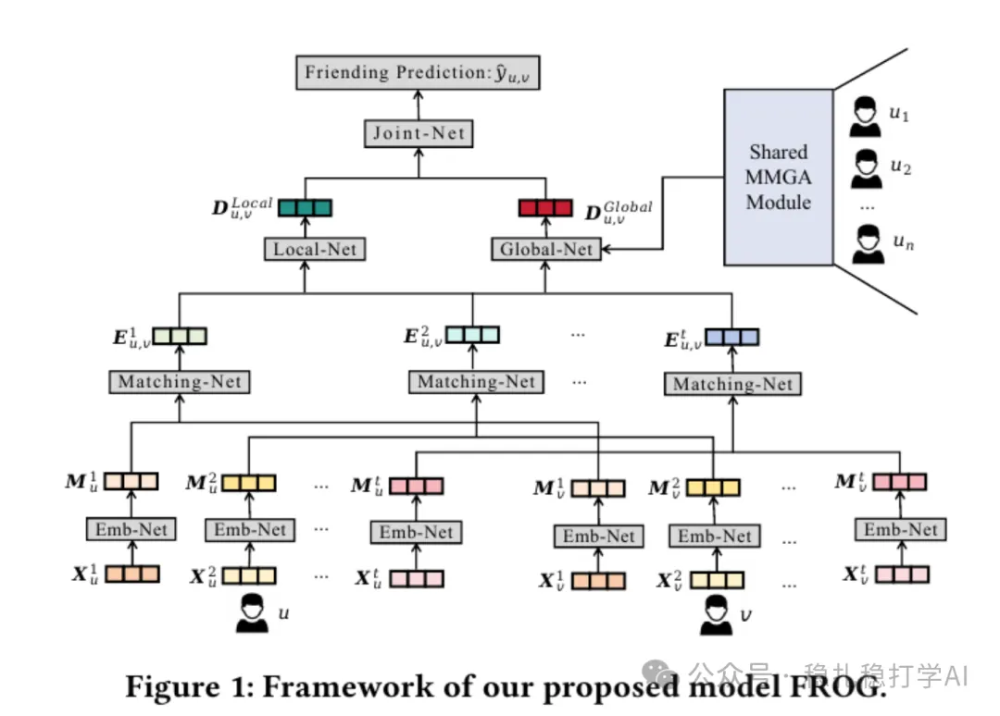

# Recommendation papers (2025.4.15): Meta FROG, friend recommendation with a multimodal graph
> [中文版](2025-04-15-meta-frog-friend-rec.md)

> Source: WeChat post https://mp.weixin.qq.com/s?__biz=MzkzNDYyNjM1NA==&mid=2247484486&idx=1&sn=6687984fa2dd4d718ea0c55554f2747d&scene=21#wechat_redirect, published 2025-04-15.
> Split from the roundup "Recommendation papers (2025.4.15): 3 papers from big companies that are not about large models"; same issue: [Meta URM unified recommendation model](../deep-retrieval/2025-04-15-meta-urm-unified-model.full.en.md), [Meta FROG multimodal friend recommendation](../graph-recommendation/2025-04-15-meta-frog-friend-rec.full.en.md), [Meta unsupervised data enhancement for sequential recommendation](../behavior-sequence-modeling/2025-04-15-meta-unsupervised-seq-enhancement.full.en.md).

FROG: A Friendly Multi-modal Graph for Friend Recommendation

Link: https://arxiv.org/pdf/2504.06617

Company: Meta

Area: multimodal friend recommendation

Overview:

Friend recommendation is done by building a graph model that contains multimodal information (images, text, graph structure). Core architecture:

(1) Embedding network: turns multimodal user data (images, text, graph structure) into a unified embedding representation (M). It produces modality-specific embeddings (EfficientNet and MoCo for images, a Transformer for text, GraphSAGE for the graph) and unifies their dimensions with fully connected layers.

(2) Matching network: matches user embeddings using methods such as cross-attention and correlation. The cross-attention module computes the relation between the source user's embedding and the target user's embedding to produce a cross-user embedding. The correlation computation uses cross-correlation to capture fine-grained associations between users (e.g. u's preference for v may differ from v's preference for u).

(3) Local-Net: produces local preference embeddings based on user-user similarity. It combines a user's embedding with the other user's embedding to compute the final local embedding.

(4) Global-Net: uses global user embeddings to produce global preferences; it concatenates the modality embeddings and weights them by a dot product with A, integrating global information efficiently. This complements Local-Net's local preferences, and the two are finally fused in Joint-Net to produce the recommendation probability. This design makes FROG both personalized and globally consistent.

(5) Joint-Net: combines local and global preferences, fuses the information with a multilayer perceptron (MLP), and outputs the final recommendation probability.

Takeaways: a graph model that unifies multimodal information is a very good direction.

Credibility: offline

Recommendation: worth reading

Figure 1: Framework of our proposed model FROG.
