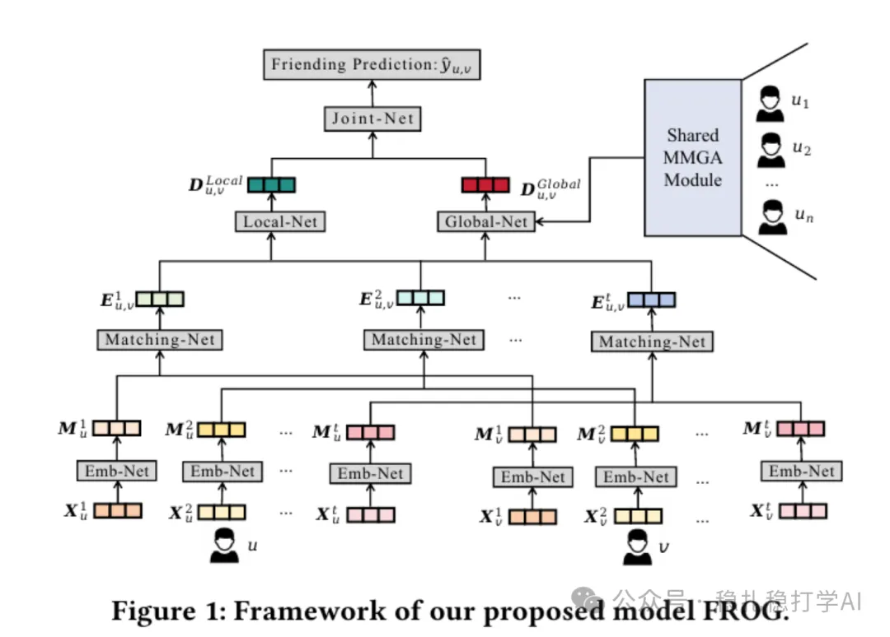

# 推荐算法(2025.4.15)：Meta FROG，用多模态图做好友推荐

> 原文：https://mp.weixin.qq.com/s?__biz=MzkzNDYyNjM1NA==&mid=2247484486&idx=1&sn=6687984fa2dd4d718ea0c55554f2747d&scene=21#wechat_redirect
> 作者：算法工程师刘明星（稳扎稳打学AI）| 发表于 2025-04-15（标题已修改；修改于 2025-04-15）
> 本文拆自《推荐算法(2025.4.15)：3篇大厂非大模型相关的论文》，同期 3 篇：[Meta URM 统一推荐模型](../deep-retrieval/2025-04-15-meta-urm-unified-model.md)、[Meta FROG 多模态好友推荐](../graph-recommendation/2025-04-15-meta-frog-friend-rec.md)、[Meta 无监督数据增强序列推荐](../behavior-sequence-modeling/2025-04-15-meta-unsupervised-seq-enhancement.md)。

关注我，每天为你精挑细选最优质、最新鲜的推荐算法paper，陪你一起保持进步、不断精进！

> [English version](2025-04-15-meta-frog-friend-rec.full.en.md)

FROG: A Friendly Multi-modal Graph for Friend Recommendation

网址：https://arxiv.org/pdf/2504.06617

公司：Meta

方向：多模态好友推荐

解读：

通过构建包含多模态（图像、文本、图结构）信息的图模型来实现好友推荐。核心架构：

（1）嵌入网络：将多模态用户数据（如图像、文本、图结构）转化为统一的嵌入表示（M）。它针对每种模态（图像用EfficientNet和MoCo，文本用Transformer，图用GraphSAGE）生成特定嵌入，并通过全连接层统一维度。

（2）匹配网络：使用跨注意力（Cross-Attention）和相关性（Correlation）等方法，对用户嵌入进行匹配。跨注意力模块通过计算源用户嵌入与目标用户嵌入之间的关系，生成跨用户嵌入。相关性计算则通过互相关计算，捕捉用户间的细粒度关联（如u对v的偏好与v对u的偏好可能不同）。

（3）Local-Net：基于用户-用户之间的相似性，生成局部偏好嵌入。通过结合用户嵌入与对方嵌入，计算最终的局部嵌入。

（4）Global-Net：利用全局用户嵌入来生成全局偏好，拼接模态嵌入并通过与 A的点积加权，高效整合全局信息，与Local-Net的局部偏好形成互补，最终在Joint-Net中融合以生成推荐概率。这种设计确保FROG模型既个性化又具有全局一致性。

（5）Joint-Net：将局部与全局偏好结合，通过多层感知机（MLP）融合信息，最终输出推荐概率。

心得：统一多模态信息的图模型，是一个很好的方向。

可信度：离线

推荐等级：推荐看看

Figure 1: Framework of our proposed model FROG.
