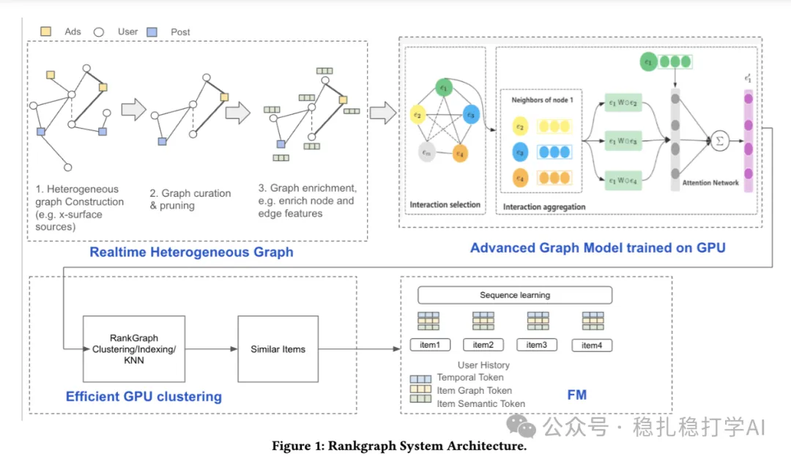

# Recommendation papers (2025.9.6): Meta uses graph embeddings for sequence modeling, with clear gains

> [中文版](2025-09-05-meta-rankgraph.md)

1 RankGraph: Cross-Domain Recommendation via Foundation Graph Embeddings

Link: https://arxiv.org/pdf/2509.02942

Company: Meta

Area: cross-domain + sequence modeling

Overview: the paper mainly describes how Meta uses graph embeddings for cross-domain sequence modeling. Specifically:

(1) Graph embedding

A graph model is used to model the user behavior sequence and get graph embeddings. Specifically: a graph model models the items in the user behavior sequence, giving a graph embedding for each item.

(2) Sequence modeling

The graph embeddings are fed into a sequence model to get the user's interest representation. Specifically: the graph embeddings are fed into a Transformer to get the user's interest representation.

(3) Cross-domain

Graph embeddings from different domains are mapped into a unified space through a mapping network. Specifically: graph embeddings from different domains are mapped into a unified space through a mapping network, which enables cross-domain recommendation.

A/B: CTR +0.92%, conversion rate +2.82%.

Takeaways: (1) The idea of the paper is very simple and direct: use graph embeddings for cross-domain sequence modeling. The benefit is that cross-domain recommendation improves without adding much compute. (2) The paper's graph learning approach is also well worth borrowing. Graph learning captures the graph structure of user behavior, which makes the model more expressive. For example, because graph learning is so large, it can only take a multi-stage approach.

Credibility: production

Recommendation: practically useful

