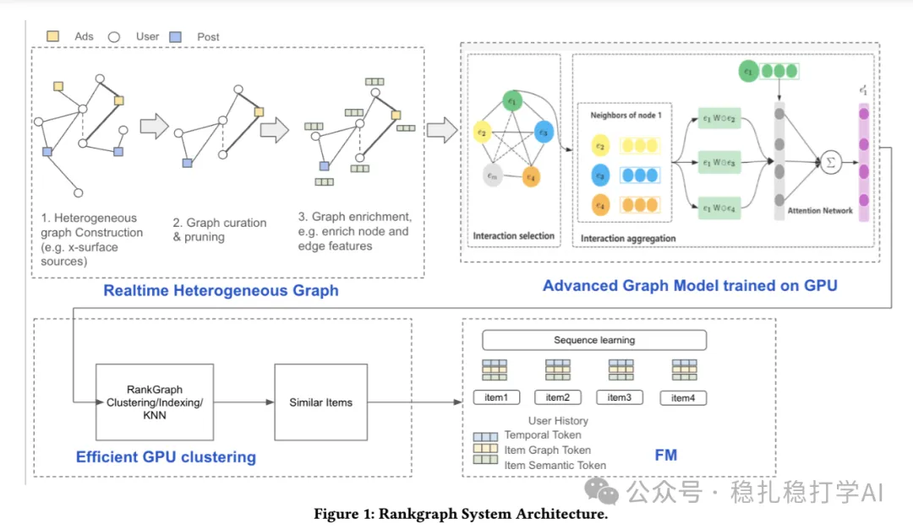

# 推荐算法(2025.9.6)：Meta将graph embed用做序列建模，有明显效果

> 原文：https://mp.weixin.qq.com/s/a8pS29JWIUe5kvI6wD3YIQ
> 作者：算法工程师刘明星（稳扎稳打学AI）| 发表于 2025-09-05

嘿，记得给“稳扎稳打学AI”添加星标

关注我，每天为你精挑细选最优质、最新鲜的推荐算法paper，陪你一起保持进步、不断精进！

> [English version](2025-09-05-meta-rankgraph.full.en.md)

👆 [本公众号paper推荐原则](https://mp.weixin.qq.com/s/BhVGu0qH5kTz9N5zpsD3KA)

1 RankGraph: Cross-Domain Recommendation via Foundation Graph Embeddings

网址：https://arxiv.org/pdf/2509.02942

公司：Meta

方向：跨域+序列建模

解读：本文主要介绍了Meta如何用graph embedding做跨域序列建模。具体的：

（1）graph embedding

用一个graph模型，对用户行为序列进行建模，得到graph embedding。具体的：用一个graph模型，对用户行为序列中的item进行建模，得到每个item的graph embedding。

（2）序列建模

将graph embedding输入到一个序列模型中，得到用户的兴趣表征。具体的：将graph embedding输入到一个Transformer模型中，得到用户的兴趣表征。

（3）跨域

将不同域的graph embedding，通过一个映射网络，映射到统一的空间中。具体的：将不同域的graph embedding，通过一个映射网络，映射到统一的空间中，从而实现跨域推荐。

AB效果：点击率提升 +0.92%，转化率提升 +2.82%。

心得：（1）本文的思路非常简单直接：用graph embedding做跨域序列建模。这种方法的好处是：可以在不增加太多计算量的情况下，提升跨域推荐的效果。（2）本文的graph learning方法也非常值得借鉴。graph learning可以捕捉到用户行为的图结构信息，从而提升模型的表达能力。比如，graph learning因为太过庞大，只能选择多stage方案。

可信度：生产

推荐等级：有实践价值

请帮忙点赞、转发，谢谢。您认为哪篇论文最有潜力应用到实际业务中？

## 欢迎干货投稿 \ 论文宣传 \ 合作交流

推荐您继续阅读：

■ [推荐算法(2025.9.3)：美团通过码本压缩长行为序列，有不错效果](https://mp.weixin.qq.com/s/i6mzrdDVh1kJXUh5g3nMVw)

■ [推荐算法(2025.9.2)：eBay个性化广告推荐：让商品embedding学会理解用户意图](https://mp.weixin.qq.com/s?__biz=MzkzNDYyNjM1NA==&mid=2247485051&idx=1&sn=2824a1ac2e2669a23513d673cb6bc8b0&scene=21#wechat_redirect)

历史文章索引：https://docs.qq.com/sheet/DYXZTZ0tseHRyZGtt?tab=BB08J2

请入微信群，群内我会给出更深入的解读，还可以共同讨论技术方案、发招聘广告、内推和交友等。

• 铁粉标准：关注一个月以上，且累计10次互动（评论、爱心、转发）、或投稿1次。

• 入群方法：请您加个人微信lmxhappy，我拉您入群，请备注（只我个人看，不公开）。

喜欢的话点个在看吧👇

个人观点，仅供参考
