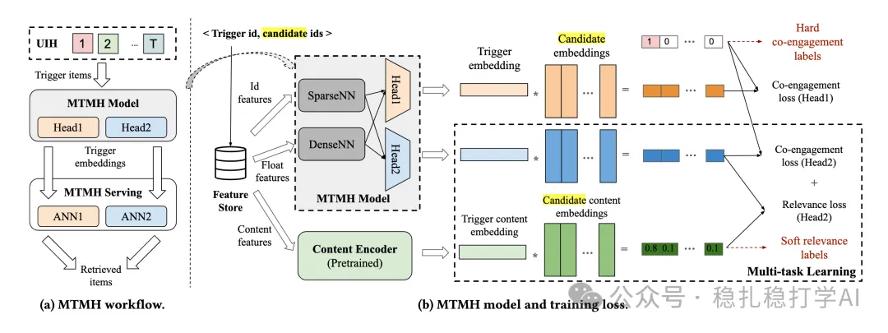

# Recommendation papers (2025.6.9): Meta's I2I method based on multimodal knowledge distillation

> [中文版](2025-06-09-meta-mtmh-i2i.md)

1 Optimizing Recall or Relevance? A Multi-Task Multi-Head Approach for Item-to-Item Retrieval in Recommendation

Link: https://arxiv.org/pdf/2506.06239

Company: Meta

Area: retrieval

Overview:

Item-to-item is currently the core retrieval method at large companies. The usual item-to-item approach is to represent items as vectors and then retrieve by approximate nearest neighbor (ANN) search. But the similarity between the trigger item and a candidate item can only be computed with an inner product, which cannot directly optimize both recall and relevance.

The paper's method, MTMH (Multi-Task Multi-Head), uses heads for several tasks to optimize recall and relevance at the same time.

How MTMH works:

(1) Engagement

Each training sample is one trigger item followed by a set of candidate items, with positives and negatives. Positives come from the user's history: the earlier item is the trigger item and the later one is the target item. Negatives are sampled items the user did not interact with.

(2) Similarity

Multimodal features go through a multimodal encoder to get embeddings, and the similarity between the trigger item and each candidate item is computed; this serves as the label for the similarity task and supervises the output of the similarity head. The trigger–candidate similarity is also an inner product. The loss is computed against these labels.

(3) Relevance

Head2's relevance results supervise Head1's retrieval results. Head2's relevance is the similarity between multimodal information (text, images) and the trigger item, while Head1's retrieval result is the similarity between the user behavior sequence embedding and the candidate item.

This way a single model optimizes both recall and relevance.

Takeaways:

(1) With Head1's retrieval results and Head2's relevance results, recall and relevance can be optimized at the same time.

(2) A single model can optimize both recall and relevance.

(3) Practically useful.

Credibility: production

Recommendation: practically useful

