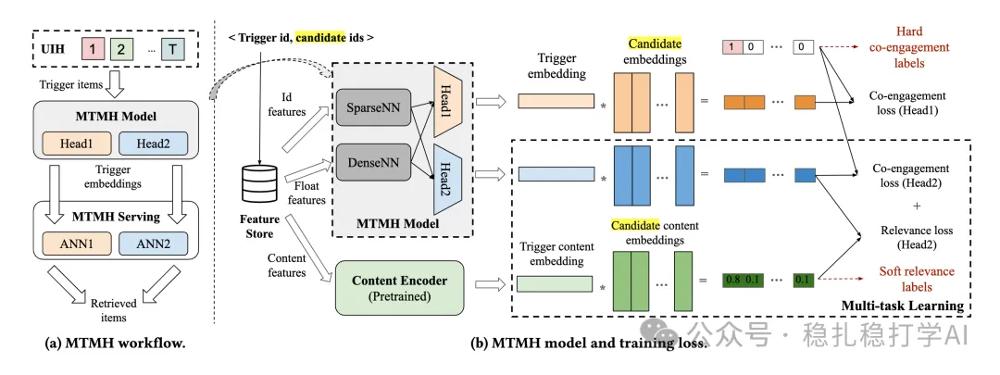

# 推荐算法(2025.6.9)：Meta的基于多模态知识蒸馏的I2I方法

> 原文：https://mp.weixin.qq.com/s?__biz=MzkzNDYyNjM1NA==&mid=2247484773&idx=1&sn=db2b0b912f649427e1e076a8293e301a&scene=21#wechat_redirect
> 作者：算法工程师刘明星（稳扎稳打学AI）| 发表于 2025-06-09（标题已修改；修改于 2025-06-09）

嘿，记得给“稳扎稳打学AI”添加星标

关注我，每天为你精挑细选最优质、最新鲜的推荐算法paper，陪你一起保持进步、不断精进！

> [English version](2025-06-09-meta-mtmh-i2i.full.en.md)

👆 [本公众号paper推荐原则](https://mp.weixin.qq.com/s?__biz=MzkzNDYyNjM1NA==&mid=2247484097&idx=1&sn=18322c279290b555eb030e12953b7c7f&scene=21#wechat_redirect)

1 Optimizing Recall or Relevance? A Multi-Task Multi-Head Approach for Item-to-Item Retrieval in Recommendation

网址：https://arxiv.org/pdf/2506.06239

公司：Meta

方向：召回

解读：

item2item是目前大厂召回的核心方法。常规的item2item是，先将item用向量表示，再通过最近邻（ANN）召回。但是，trigger item与candidate item的相似度计算只能使用内积，无法直接优化召回和相关性。

本文的方法，叫做MTMH（Multi-Task Multi-Head），就是通过多个任务的head，去同时优化召回和相关性。

MTMH的做法是，

（1）互动

构造的样本是一个trigger item跟着一堆candidate item，有正样本，负样本。正样本是该用户历史行为中，前面的是trigger item，后面的是target item；负样本是该用户未互动的sampling出来的item。

（2）相似

多模态特征用一个多模态encoder获取embedding，并计算trigger item的与candidate item的相似度，这个作为相似任务的label。监督相似head头的计算结果。trigger item与candidate item的相似计算也是计算内积。与这些label计算loss。

（3）相关性

用Head2的相关性结果监督Head1的召回结果，Head2的相关性是多模态信息（文本、图像）与trigger item的相似度，而Head1的召回结果是用户行为序列的embedding与candidate item的相似度。

这样，通过一个模型，就可以同时优化召回和相关性。

心得：

（1）通过Head1的召回结果和Head2的相关性结果，可以同时优化召回和相关性。

（2）通过一个模型，就可以同时优化召回和相关性。

（3）有实践价值。

可信度：生产

推荐等级：有实践价值

请帮忙点赞、转发，谢谢。您认为哪篇论文最有潜力应用到实际业务中？

## 欢迎干货投稿 \ 论文宣传 \ 合作交流

推荐您继续阅读：

■ [推荐算法(2025.6.6)：阿里的基于Transformer的推荐系统优化](https://mp.weixin.qq.com/s?__biz=MzkzNDYyNjM1NA==&mid=2247484767&idx=1&sn=6176061ab42a6bd181f669732c24b975&scene=21#wechat_redirect)

■ [推荐算法周报(2025.6.1)：AB效果炸裂的一周](https://mp.weixin.qq.com/s?__biz=MzkzNDYyNjM1NA==&mid=2247484755&idx=1&sn=4110a1a77d2e1b4ad2ebe2a6fe523f44&scene=21#wechat_redirect)

■ [推荐算法(2025.6.5)：京东广告的搜索词与竞价词匹配](https://mp.weixin.qq.com/s?__biz=MzkzNDYyNjM1NA==&mid=2247484761&idx=1&sn=955cdfc06c7f8647a585fedaa22eef6c&scene=21#wechat_redirect)

历史文章索引：https://docs.qq.com/sheet/DYXZTZ0tseHRyZGtt?tab=BB08J2

由于公众号试行乱序推送，您可能不再准时收到稳扎稳打学AI的推送。为了第一时间收到本号的干货内容， 请将本号设为星标，以及常点文末右下角的“在看”。

喜欢的话点个在看吧👇

个人观点，仅供参考

修改于2025年6月9日
