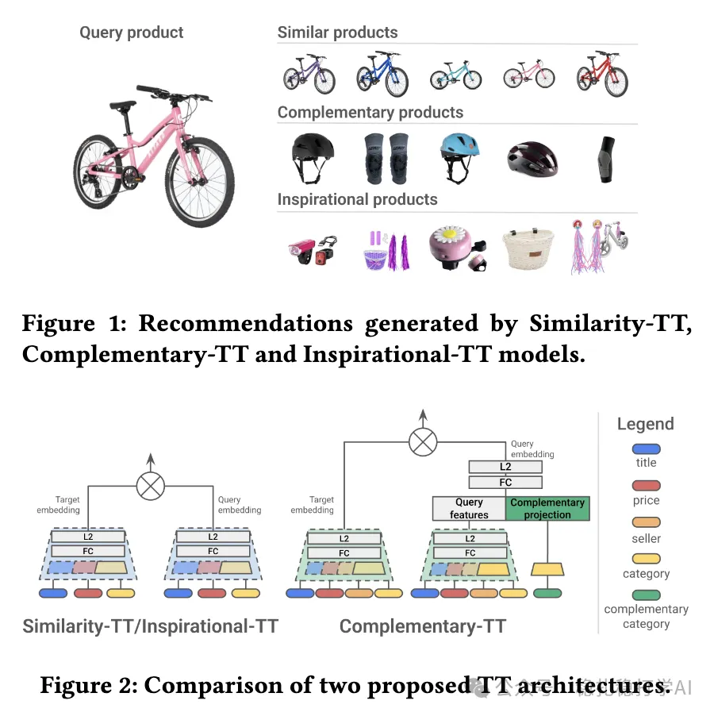

# Recommendation papers (2025.8.7): European e-commerce, two-tower retrieval, decent results

> [中文版](2025-08-07-europe-ecommerce-two-tower.md)

1 Similarity and Complementary Recommendations: A Two-Tower Framework for Product Recommendations

Link: https://arxiv.org/pdf/2508.04726

Company: a European e-commerce company

Area: retrieval + complementary retrieval

Overview:

(1) Similar-item recommendation

Co-viewed product pairs are used to train a Siamese two-tower network; both towers use

product content features (title, price, category, etc.) as input.

(2) Complementary recommendation

Co-purchased product pairs are used, transferring the Siamese network trained for similar-item recommendation. But a category — the "complementary type" — is added to the query tower, and its embedding space is shared with the category above. One query product's type maps to several complementary types; one complementary type is sampled and concatenated into the query tower. Note that this type is not the target item's category.

How complementary types are generated:

(1) From existing co-purchase data.

(2) From manually defined complementary rules.

For example: compute co-occurrence frequency between categories, e.g. the number of times products of category A and category B are bought together exceeds a threshold.

Inspirational recommendation:

Co-viewed product pairs are used, transferring the Siamese network trained for similar-item recommendation.

A/B:

(1) Relevance: CTA +3.12% to +4.15%, CVR +1.38% to +2.22%; bounce rate -4.09% to -5.74%, exit rate -1.66% to -1.82%.

(2) Diversity: CTA +3.12% to +4.15%, CVR +1.38% to +2.22%; bounce rate -4.09% to -5.74%, exit rate -1.66% to -1.82%.

Takeaways:

(1) A European e-commerce recommender doesn't need to be very complex; a simple two-tower model can deliver sizable gains.

(2) The authors use co-viewed product pairs, not co-occurrence / co-click in the traditional sense.

(3) There are relatively few papers in this area; this one is worth a look.

Credibility: production

Recommendation: practically useful

