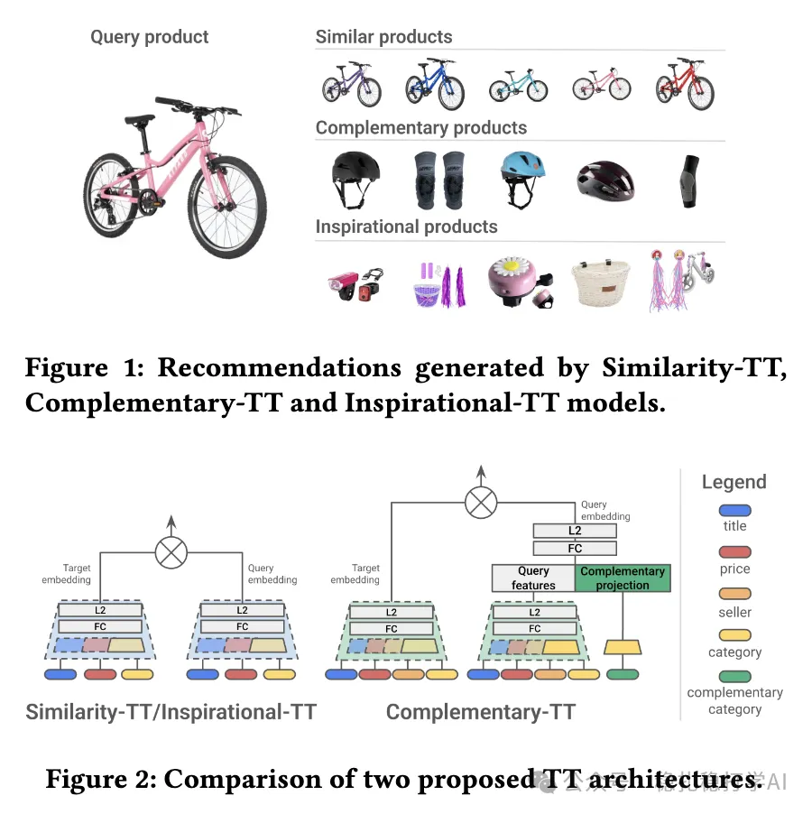

# 推荐算法(2025.8.7)：欧洲电商，双塔召回，效果还不错

> 原文：https://mp.weixin.qq.com/s/d1z5bxjKgH1wlfCoQSrFVQ
> 作者：算法工程师刘明星（稳扎稳打学AI）| 发表于 2025-08-07

嘿，记得给“稳扎稳打学AI”添加星标

关注我，每天为你精挑细选最优质、最新鲜的推荐算法paper，陪你一起保持进步、不断精进！

> [English version](2025-08-07-europe-ecommerce-two-tower.full.en.md)

👆 [本公众号paper推荐原则](https://mp.weixin.qq.com/s?__biz=MzkzNDYyNjM1NA==&mid=2247484097&idx=1&sn=18322c279290b555eb030e12953b7c7f&scene=21#wechat_redirect)

1 Similarity and Complementary Recommendations: A Two-Tower Framework for Product Recommendations

网址：https://arxiv.org/pdf/2508.04726

公司：欧洲电商

方向：召回+互补召回

解读：

（1）相关推荐

使用共view的product对，孪生网络双塔训练，都使用

使用产品内容特征（title、price、category等）作为输入。

（2）互补推荐

使用共购的product对，迁移相关推荐训练的孪生网络。但是在query塔上添加一个category——“互补类型”，它的embedding空间跟上面的category共享。一个query product的类型，对应多个互补类型，sample出来一个互补类型，拼接到query塔。注意，这个类型，不是target item的category。

互补类型的生成方式：

（1）根据已有的共购数据。

（2）人工定义的互补规则。

例如：计算类别间的共现频率：如 A 类别产品和 B 类别产品被共同购买的次数超过阈值。

灵感推荐：

使用共view的product对，迁移相关推荐训练的孪生网络。

AB：

（1）相关性：CTA +3.12%~+4.15%，CVR +1.38%~+2.22%；bounce rate -4.09%~-5.74%，exit rate -1.66%~-1.82%。

（2）多样性：CTA +3.12%~+4.15%，CVR +1.38%~+2.22%；bounce rate -4.09%~-5.74%，exit rate -1.66%~-1.82%。

心得：

（1）欧洲电商的推荐系统，不需要很复杂，简单的双塔，就能做出可观的效果。

（2）作者们使用的是共view的product对，而不是传统意义的共现/共点击。

（3）这个领域，论文相对少，这篇可以看看。

可信度：生产

推荐等级：有实践价值

请帮忙点赞、转发，谢谢。您认为哪篇论文最有潜力应用到实际业务中？

## 欢迎干货投稿 \ 论文宣传 \ 合作交流

推荐您继续阅读：

■ [推荐算法(2025.8.6)：eBay双塔，大小的LLM应用，开出大大的花](https://mp.weixin.qq.com/s/bRxQ16v9qLVRzcvamWGZ6A)

■ [推荐算法(2025.8.5)：淘宝的物料冷启动，使用“群组信息增强”取得巨大效果](https://mp.weixin.qq.com/s/92DARCpzTOZCX-UTgz29Eg)

■ [推荐算法(2025.8.4)：美团的大模型助力新颖性推荐，AB效果不错哈](https://mp.weixin.qq.com/s/BvdEgX02zTyB1RqnuWi3Xw)

历史文章索引：https://docs.qq.com/sheet/DYXZTZ0tseHRyZGtt?tab=BB08J2

请入微信群，群内我会给出更深入的解读，还可以共同讨论技术方案、发招聘广告、内推和交友等。

• 铁粉标准：关注一个月以上，且累计10次互动（评论、爱心、转发）、投稿1次。

• 入群方法：请您加个人微信lmxhappy，我拉您入群，请备注（只我个人看，不公开）。

由于公众号试行乱序推送，您可能不再准时收到稳扎稳打学AI的推送。为了第一时间收到本号的干货内容， 请将本号设为星标，以及常点文末右下角的“在看”。

喜欢的话点个在看吧👇

个人观点，仅供参考
