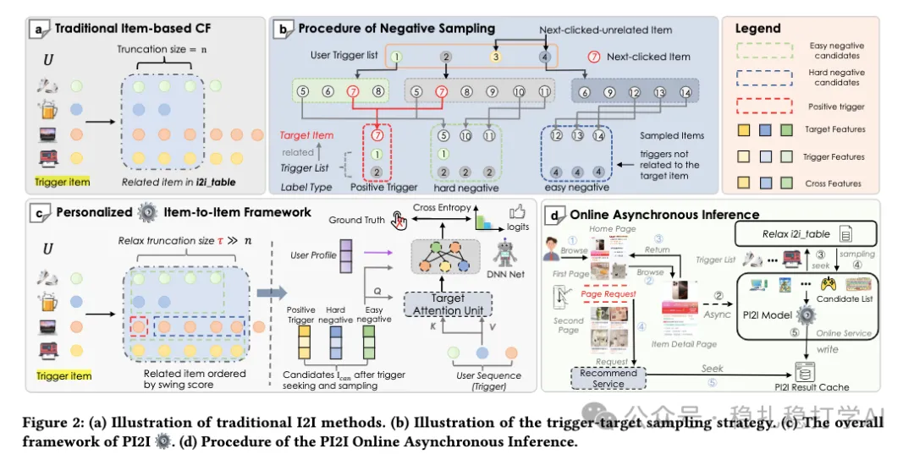

# Recommendation papers (2026.1.26): Alibaba actually uses a ranking model for post-click (trigger-induced) retrieval, conversion +1%

> [中文版](2026-01-26-ali-pi2i-i2i.md)

1 PI2I: A Personalized Item-Based Collaborative Filtering Retrieval Framework

Link: https://arxiv.org/pdf/2601.16815

Company: Alibaba

Idea: sample mining

Area: item-to-item + retrieval

Overview:

The paper proposes an item-to-item recommendation (retrieval) method. Its innovation is negative sample mining; everything else is existing common practice.

Problem definition for item-to-item recommendation: a user clicks a trigger item (this is given); for a target item, model the probability P(target item | user, trigger item).

The modeling: first model the user behavior sequence to get an interest vector, then concatenate it with other feature vectors (user profile representation, trigger item representation, target item representation, and the representation of their cross features) into one vector, and pass it through an MLP to get a scalar probability. — This is a very conventional procedure.

The behavior sequence modeling is Multi-Head Target Attention (MHA). Q is the concatenation of the trigger item representation, the target item representation and their cross-feature representation, followed by an MLP to get a vector. — This is a very conventional i2i procedure.

Positives are target items with positive interactions. Softmax cross-entropy is the loss, ensuring positives score higher than negatives (introduced next).

The highlight of the paper is negative mining. The common practice is to randomly sample from the whole item corpus as easy negatives and use exposed-but-not-clicked items as hard negatives. In contrast, the paper's negatives fall into two kinds:

(1) Hard

Items in the user behavior sequence that are related to the positive are called positive triggers. Sample randomly from the target items of the positive triggers (excluding the positive itself). Why these are "hard negatives": they are similar to the positive (because they come from the same trigger's target pool), forcing the model to learn subtle differences and improving robustness.

(2) Easy

Sample from the target items related to the historical items in the behavior sequence that are not positive triggers, choosing less related ones. Why: these are "easy negatives", weakly associated with the positive; they provide contrast and help the model quickly separate clearly irrelevant items.

Why not include exposed-but-not-clicked or random items?

At online inference, after the user clicks a trigger item, all items in the user behavior sequence are used as triggers, which never include exposed-but-not-clicked or random items. Training on exposure negatives (common in the full ranking stage) would cause distribution shift and hurt retrieval.

How is "related to the (positive) sample" determined? It relies on a precomputed i2i table. The method:

For each item i (as a trigger), compute s(i,j) for every other item j that has co-occurred with it, sort in descending order, and take the Top-T as the target list, forming the mapping: trigger → [target1, ..., targetT].

With this i2i table, given an item as the trigger item, you get its corresponding target item list.

A/B: Taobao "Guess You Like", online transaction rate +1.05%.

Figure 2: (a) Illustration of traditional I2I methods. (b) Illustration of the trigger-target sampling strategy. (c) The overall framework of the PI2I model. (d) Procedure of the PI2I Online Asynchronous Inference.

Takeaways:

(1) The negatives mined in the paper make training and inference consistent. Negative mining is an eternal topic in retrieval.

(2) Finding negatives through elements of the behavior sequence is quite innovative; traditionally, negatives are mined from items within the same request.

(3) Readers may wonder why retrieval scores with a ranking model — the latency surely won't work. The paper's solution is to call the method asynchronously when the user clicks the trigger item and cache the results.

Caveats:

(1) The paper presents building the i2i table as step one and the retrieval method as step two, which hurts readability. Building the i2i table is auxiliary and the retrieval method is the main body; the explanation should center on the main body, which would be easier for readers to follow.

Credibility: production

Recommendation: practically useful
