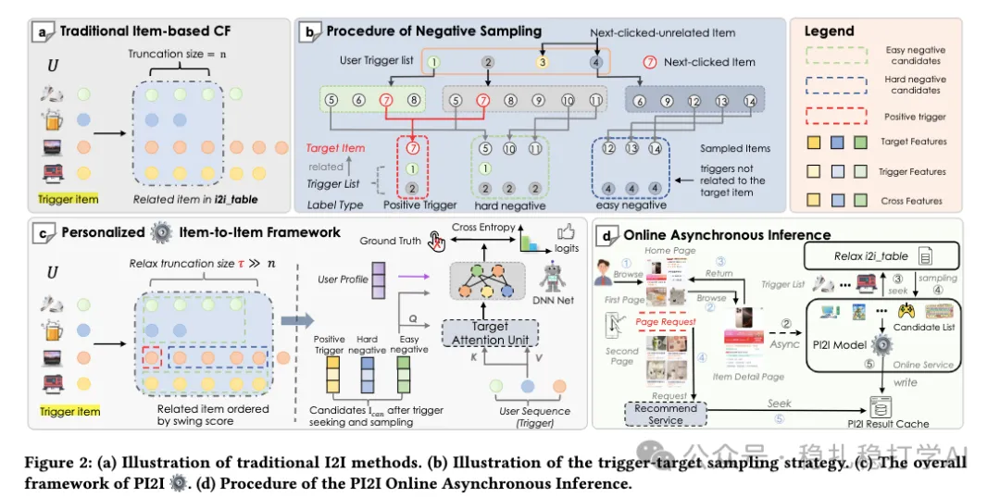

# 推荐算法(2026.1.26)：阿里，后推荐召回居然用上了排序模型，转化+1%

> 原文：https://mp.weixin.qq.com/s/aXnARzxBImS6HzhbJMnhGw
> 作者：算法工程师刘明星（稳扎稳打学AI）| 发表于 2026-01-26

嘿，记得给“稳扎稳打学AI”添加星标

关注我，每天为你精挑细选最优质、最新鲜的推荐算法paper，陪你一起保持进步、不断精进！

👆 [本公众号paper推荐原则](https://mp.weixin.qq.com/s/BhVGu0qH5kTz9N5zpsD3KA)

1 PI2I: A Personalized Item-Based Collaborative Filtering Retrieval Framework

网址：https://arxiv.org/pdf/2601.16815

公司：阿里

思想：挖掘样本

方向：item to item+召回

解读：

本文提出了一种item to item推荐（召回）。本文的创新是负样本的挖掘。其它的做法都是已有的常见做法。

item to item推荐的问题定义：一个user，从点击trigger item（这是确定的），对于一个target item，建模概率P(target item|user, trigger item)。

建模方法，就是先做用户行为序列建模获得一个兴趣向量，再与其它特征向量（user profile表征、trigger item表征、target item表征和两者交叉特征表征）拼接成一个向量，经过一个MLP就能获得一个scalar概率值。——这个过程是非常常规的做法。

其中，行为序列建模是Multi-Head Target Attention, MHA， Q是trigger item表征、target item表征和两者交叉特征表征拼接的向量，紧接着一个MLP获得的向量。——这个过程是i2i的非常常规的做法。

正样本就是有正向互动的target item。使用Softmax交叉熵作为损失函数，确保正样本分数高于负样本（马上介绍）。

本文的亮点是负样本的挖掘。常见的做法是全物料库随机抽样作为easy，曝光未点击作为hard。与之不同，本文的负样本分成两类：

（1）hard

与用户行为序列中那些与正样本相关的物品（称之为正触发）。从正触发的target items中随机采样（排除正样本本身）。为什么这些是“难负例”，与正样本相似（因为来自同一trigger的target池），迫使模型学习细微区别，提升鲁棒性。

（2）easy

从行为序列中非正触发的历史物品的相关的target items中采样。选较不相关的。为什么：这些是“易负例”，与正样本关联弱，提供对比，帮助模型快速区分明显无关物品。

为什么不包含曝光未点击或随机物品？

在线推理时，用户点击trigger item后，使用用户行为序列中的所有物品作为触发（triggers），不会包含曝光未点击或随机物品。如果训练用曝光负（常见于全量排序阶段），会导致分布偏移，影响检索效果。

是否与（正）样本相关，如何确定呢？就是要依靠提前计算的一个i2i表。方法是：

为每个物品item（作为trigger）计算所有与该物品有过共现关系的其他物品j的 s(i,j)，然后降序排序，取Top-T作为target列表，形成映射：trigger → [target1,..., targetT]。

通过这个i2i表就可以根据一个item作为trigger item时，相应的target item列表了。

AB：淘宝“猜你喜欢”，在线交易率+1.05%。

Figure 2: (a) Illustration of traditional I2I methods. (b) Illustration of the trigger-target sampling strategy. (c) The overall framework of PI2I 模型. (d) Procedure of the PI2I Online Asynchronous Inference.

心得：

（1）本文挖掘的负样本实现了训练和推理的一致。负样本挖掘是召回永恒的话题。

（2）本文通过行为序列元素找到negatives的做法很有创新性，传统做法都是在在同一个request里item挖掘负样本。

（3）读者可能会疑惑召回为什么用一个排序模型打分，耗时肯定不行。本文的解决办法是在用户点击trigger item的时候，就异步调用本文方法并将结果缓存。

愚见：

（1）在paper里，将i2i的创建作为第一步，将召回方法作为第二步，可读性不好，因为i2i的创建是辅助性的，召回方法才是主体，应该以主体作为讲解核心，读者更容易理解。

可信度：生产

推荐等级：有实践价值

请帮忙点赞、转发，谢谢。

## 欢迎干货投稿 \ 论文宣传 \ 合作交流

推荐您继续阅读：

历史文章索引：https://docs.qq.com/sheet/DYXZTZ0tseHRyZGtt?tab=BB08J2

请入微信群，群内我会给出更深入的解读，还可以共同讨论技术方案、发招聘广告、内推和交友等。

• 铁粉标准：关注公众号一个月以上，且在公众号上累计15次互动（评论、爱心、转发）、或投稿1次，只欢迎技术同学。

• 入群方法：请您加个人微信lmxhappy，我拉您入群，请备注（只我个人看，不公开）。

喜欢的话点个在看吧👇

个人观点，仅供参考
