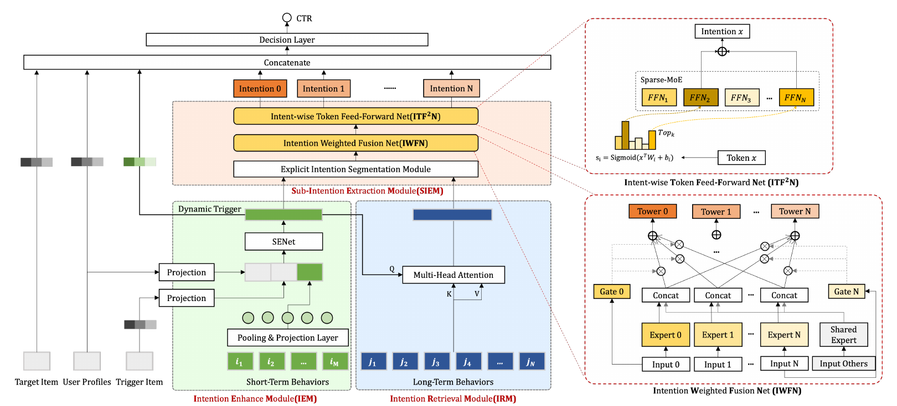

---

Lazada, detail-page recommendations: halfway down the feed, items from other categories convert better than items like the one the user clicked. Treating the clicked item as a moving target instead of a fixed anchor: orders +6.9%, GMV +7.7%.

Context-Aware User Intent Modeling for Relevant Recommendation in E-commerce (CIKM'26)
doi.org/10.1145/3799682.3839889

Setting: a user clicks an item (the trigger) and scrolls into the related-items feed on its detail page. Most trigger-aware rankers encode the trigger once and match everything against it. CAIM (Lazada) rewrites it per request, then splits intent by attribute. As checks for your own detail-page ranker:

1. Plot CTR and CVR by exposure position, split by same category as the trigger vs. not. In their feed, same-category items decay faster, and in the second half other categories overtake them on CVR. If yours look like this, a fixed trigger embedding goes stale before the user is halfway down.

2. Rewrite the trigger every request. Mean-pool the last 24h of clicks, project it, the user profile and the trigger into one space, and let an SENet assign one weight per segment. Output: a "dynamic trigger" whose mix of "what they clicked" vs. "what they've been doing" is personalized.

3. Query long-term history with the dynamic trigger, not the candidate. 4-head attention over a year of behavior (100 items) pulls out what matches the current intent, a kind of "long-term trigger". Because the query never sees the candidate, it runs once per request and the long sequence can be precomputed into a KV store. Steps 2+3 alone: orders +4.8%, GMV +4.4%.

4. Treat the trigger's category, brand, shop and price as four more triggers. A user may trust the brand but find it too pricey, or want the category and not care about the brand. Five paths (four attributes + one general path fed by the dynamic and long-term triggers) go through a PLE with per-path and shared experts, then a sparse MoE shared across paths that routes each path to its top-2 FFNs. This part alone: orders +2.0%, GMV +3.2%. In production, attribute splitting lifted CVR AUC to +0.78% over baseline, and PLE took it to +1.03%.

All together: orders +6.9%, GMV +7.7% over 14 days, beating the parts' sum.

What I'd take away:
- A trigger is an intent. The clicked item, its category, brand, shop and price are all triggers worth modeling separately.
- No bigger backbone. Offline, the attribute-split intent network (PLE + sparse MoE) matters most; online, the dynamic trigger plus retrieval brings the larger share.
- One gap: the candidate meets the trigger only in the final MLP. No target attention, no explicit trigger-target similarity. That's what makes it cheap, but if you adopt this, keep your trigger-target cross features (same brand, price ratio, category match).

Full breakdown:
https://github.com/lmxhappy/step-by-step-learning-ai/blob/main/item-to-item/alibaba-caim.full.en.md

#RecommenderSystems #Ecommerce #Lazada #Alibaba #MachineLearning
