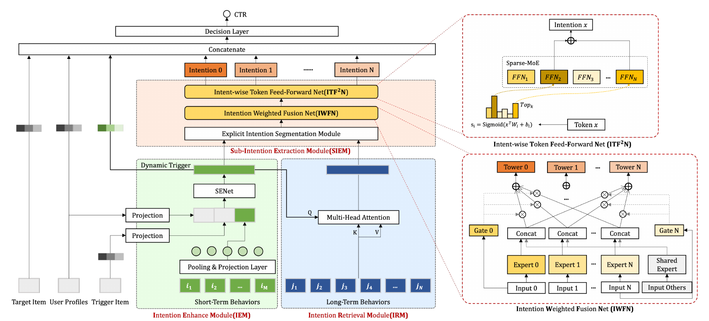

# Alibaba International, detail-page relevant recommendation, orders +7%, GMV +8%

> [中文版](alibaba-caim.md)

### Paper: Context-Aware User Intent Modeling for Relevant Recommendation in E-commerce (CIKM'26)
### Link: https://doi.org/10.1145/3799682.3839889
### Company: Lazada
### Idea: intent modeling, expansion (expanding the trigger)
### Area: i2i (the relevant-recommendation feed below an e-commerce product detail page, also called trigger-induced or post-click recommendation)

## Overview:
The paper proposes a CTR model for post-click recommendation. It first uses clicks from the last 24 hours and the user profile to rewrite the static trigger into a "dynamic trigger", then uses that to retrieve relevant interests from a year of long-term behavior, and finally splits intent into 5 sub-intent paths (category, brand, shop, price, and overall), which are concatenated with the candidate item and passed through an MLP to predict CTR.

### Two observations
**Intent drifts.** Looking at CTR and CVR by exposure position in the relevant-recommendation feed: the further down the user scrolls, the faster CTR and CVR fall for items in the same category as the trigger, compared with items from other categories. In the second half of the feed, other-category items overtake same-category items on CVR. Users arrive for the trigger, then drift into browsing other things. A fixed trigger representation can't follow that. The paper's fix: use recent clicks to rewrite the trigger into a "dynamic trigger" (IEM), then use it to retrieve from long-term behavior to get a "long-term trigger" (IRM).

**Intent is multi-dimensional.** One trigger carries category, brand, shop and price at the same time. A user may like the brand but find it too expensive, or want the category but not care about the brand. Blending all of this into one vector makes it impossible to tell which dimension the user actually cares about. The paper's fix: treat category, brand, shop and price as triggers too, and learn an intent for each.

### Model architecture
The behavior sequence is split in two: short-term is clicks in the last 24 hours (truncated to 30), long-term is behaviors over the past year (truncated to 100). Three modules address the two observations: IEM and IRM handle intent drift, producing the dynamic trigger and the long-term trigger, both of which serve as inputs to SIEM; SIEM handles multi-dimensional intent by splitting out sub-intents by attribute.

### (1) IEM: dynamic trigger
The short-term behaviors are mean-pooled; this, the user profile and the trigger each go through a small MLP into a shared space, and the 3 vectors of equal length are concatenated and fed to an SENet, which outputs a vector of the same length.

A quick recap of SENet: each of the 3 vectors is averaged into a scalar, then two small layers map the 3 dimensions to an intermediate size and back to 3, and a sigmoid gives 3 weights. This is the standard SENet in recommendation (FiBiNet), where each feature field is squeezed into one scalar. The 3 weights are multiplied onto their respective vectors. This long vector is the module's output.

The purpose is to let the model decide, per user, how much weight goes to the trigger itself versus recent behavior, so it is no longer limited to the "trigger item"; the user profile is an input so that this choice is personalized. Every later module uses it as its anchor.

### (2) IRM: long-sequence retrieval, producing the "long-term trigger"
The output of IEM, the dynamic trigger, is the query for a 4-head multi-head attention over the long-term behaviors, picking out the parts of a year of history that match the current intent and producing a "long-term interest vector", which we can call the "long-term trigger".

Note that the query does not include the candidate item, so the long-term sequence representations can be precomputed offline and stored in a KV store, and the whole IEM+IRM path runs once per request.

### (3) Sub-intent splitting (SIEM)
SIEM learns user intent. It learns 5 intent vectors along 5 paths: category, brand, shop and price each correspond to one attribute, and the 5th path uses the dynamic trigger and the long-term trigger. In effect, category, brand, shop and price are treated as 4 triggers: a trigger is an intent.

Two kinds of input (5 in total):
* Specific inputs: the trigger's category, brand, shop and price embeddings serve as 4 inputs. The paper doesn't say how these embeddings are obtained; most likely they come from an embedding layer.
* General input: Concat(dynamic trigger, long-term trigger) serves as one input.

The 5 inputs pass through the following 3 modules in order:
* Explicit Intention Segmentation: the paper doesn't describe the implementation; my guess is that each input goes into its own non-shared single dense layer.

* IWFN: the structure is a PLE. Each path has its own dedicated experts, plus 1 shared expert; each path uses its own gate to take a weighted sum of the dedicated and shared experts' outputs, giving that path's "intent token". The result is 5 intent tokens.

* ITF²N: the 5 intent tokens share one sparse MoE; each token picks its own top-k of N FFNs by gating score (k=2 online), weights them, and adds the result back to the input (residual), giving 5 "intent vectors".

### (4) Output layer
The user profile, dynamic trigger, candidate item and the 5 intent vectors are concatenated and passed through an MLP to predict CTR. In production it's a CTR+CVR multi-task model.

**Production iteration path**: the fusion network inside SIEM evolved step by step, with the CVR AUC gain over the production baseline going from +0.35% (combining tasks by vector concatenation instead of adding logits) to +0.78% (introducing sub-intent splitting by category/brand/shop), and then to +1.03% (switching sub-intent fusion from SENet to PLE); the last version shipped. In offline ablations, removing SIEM hurts the most.

### A/B results
Against the production sequence model as control: orders +6.9%, GMV +7.7%.

## Takeaways:
* In post-click recommendation the trigger shouldn't be static: rewrite it into a dynamic anchor using short-term behavior and the user profile, then use it to retrieve from the long sequence to get a long-term trigger.
* In effect, category, brand, shop and price are treated as 4 triggers: a trigger is an intent.
* The main gain of this model comes from upgrading the intent network architecture: PLE + sparse MoE.

## Caveats
* The paper doesn't explain how the category, brand, shop and price embeddings are obtained.
* The paper doesn't describe Explicit Intention Segmentation.
* There is no explicit trigger-target cross feature; in practice one would very likely be added.

## Credibility: production

## Recommendation: practically useful
