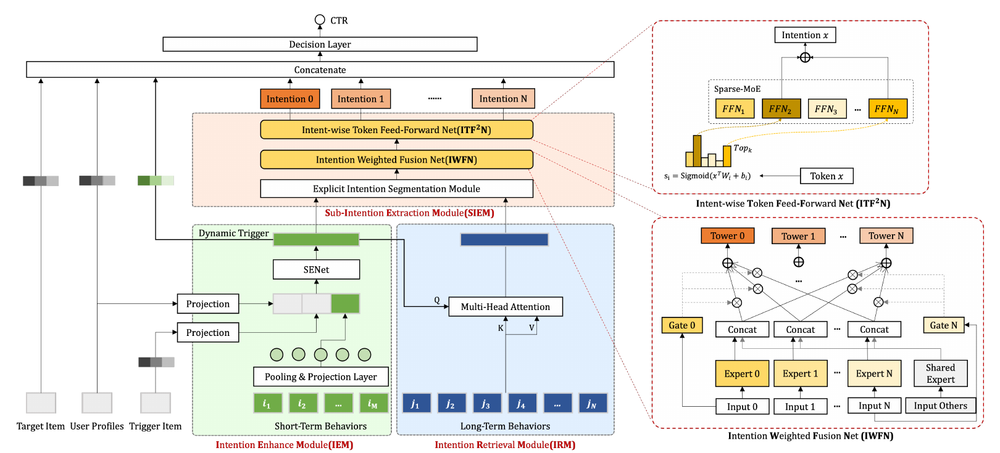

# 阿里国际，详情页相关推荐，订单+7%、GMV+8%

关注我，每天为你精挑细选最优质、最新鲜的推荐算法paper，陪你一起保持进步、不断精进！

> [English version](alibaba-caim.full.en.md)

### 论文：Context-Aware User Intent Modeling for Relevant Recommendation in E-commerce（CIKM'26）
### 网址：https://doi.org/10.1145/3799682.3839889
### 公司：Lazada
### 思想：意图建模、扩展（扩展trigger）
### 方向：i2i（电商详情页下方的相关推荐，也叫触发式推荐、后推荐）

## 解读：
本文提出后推荐的 CTR 模型。先用近 24 小时的点击和用户画像把静态 trigger 改写成「动态 trigger」，再拿它去一年的长期行为里检索出相关兴趣，最后按类目、品牌、店铺、价格和整体拆成 5 路子意图，和候选商品拼接，通过一个MLP网络预测CTR。

### 两个观察
**意图会漂移。** 统计相关推荐流里不同曝光位置的点击率和转化率：用户越往下滑，和 trigger 同类目商品的 CTR、CVR 掉得比异类目商品更快，滑到后半段，异类目商品的 CVR 反超同类目。也就是说用户一开始冲着 trigger 来，看着看着就转向逛别的。trigger 的表征如果是固定的，就跟不上这种变化。本文的解决办法：用最近的点击把 trigger 改写成「动态 trigger」（IEM），再拿它去长期行为里检索获得“长期trigger”（IRM）。

**意图是多维的。** 一个 trigger 同时带着类目、品牌、店铺、价格几种属性，用户可能认这个品牌但嫌贵，也可能要这个类目但不在乎品牌。把它们揉成一个向量，就分不清用户到底在意哪个维度。本文的解决办法：把类目、品牌、店铺、价格也当作trigger，分别学习意图。

### 模型结构
行为序列拆成两段：短期是近 24 小时的点击（截断 30 条），长期是近一年的行为（截断 100 条）。三个模块对应上面两个观察：IEM 和 IRM 解决意图漂移，分别产出动态 trigger 和长期 trigger，都是为 SIEM 准备输入；SIEM 解决意图多维，按属性拆出子意图。

### （1） IEM模块——动态 trigger
短期行为做平均池化，和用户画像、trigger 各自过一个小 MLP 投影到同一空间，同长度的3个向量拼起来，送进 SENet，获得同长度的向量。

回忆一下SENet：3个向量各自求平均得到 3 个scalar，之后两层小网络把 3 维先变换到一个中间维度再变回 3 维，过 sigmoid 得到 3 个权重。推荐里 SENet 的标准做法（FiBiNet）就是这样，每个特征域压成一个标量。3 个权重分别乘到各自向量上。这个长向量就是该模块的输出。

目的是，按用户自动决定 trigger 本身和最近行为各占多少分量，不再局限在“trigger item”，用户画像作为输入是为了个性化这个选择。后面所有模块都拿它当锚点。

### （2） IRM模块——长序列检索，获得“长期trigger”
用IEM模块的输出“动态trigger”当 query，对长期行为做 4 头的multi-head attention，从一年的行为里挑出和当前意图相关的部分，得到“长期兴趣向量”，可以称呼为“长期 trigger”。

注意，这里的 query 不含候选商品，所以长期序列的表征可以离线算好放进 KV 存储，整个 IEM+IRM 每个请求只算一次。

### （3） 子意图拆分（SIEM）
学习用户意图。分 5 路分别学 5 个意图向量：类目、品牌、店铺、价格 4 路各对应一个属性，第 5 路用动态 trigger 和长期 trigger。可见，将类目、品牌、店铺、价格当作了4个trigger，trigger即意图。

两类（5个）输入：
* 具体输入：trigger 的类目、品牌、店铺、价格 4 个 embedding 作为 4 个输入。论文没交代这些 embedding 怎么来，大概率是embed layer获得的。
* 通用输入：Concat(动态 trigger, 长期trigger)作为一个输入。

5个输入，依次通过下面3个顺序模块：
* 显式意图切分（Explicit Intention Segmentation）：论文没讲实现，我猜每个输入接入一个非共享的一层dense层。

* IWFN：结构就是 PLE。每一路有专属专家，另有 1 个共享专家；每一路用自己的门控给专属专家和共享专家的输出加权求和，得到这一路的「意图 token」。最终得到 5 个意图 token。

* ITF²N：5 个意图 token 共用同一个稀疏 MoE，每个 token 各自从 N 个 FFN 里挑门控打分最高的 k 个（线上 k=2）加权，再加回输入（残差），得到 5 个「意图向量」。

### （4） 输出层
用户画像、动态 trigger、候选商品、5 个意图向量拼接后过 MLP 预测 CTR。线上实际是 CTR+CVR 多任务。

**线上迭代路径**：SIEM 里的融合网络是一步步演进的，相对线上基线的 CVR AUC 提升从 +0.35%（多任务之间从 logit 相加改成向量拼接）到 +0.78%（引入按类目/品牌/店铺拆子意图），再到 +1.03%（子意图融合从 SENet 换成 PLE），最后一版上线。离线消融里去掉 SIEM 掉得最多。

### A/B效果
对照是线上的序列模型，订单 +6.9%，GMV +7.7%。

## 心得：
* 后推荐里 trigger 不该是静态的：用短期行为和用户画像把它改写成动态锚点，再拿它去长序列里检索获得一个长期trigger。
* 可见，将类目、品牌、店铺、价格当作了4个trigger，trigger即意图。
* 本文模型的主要收益是意图网络架构的更新——PLE+sparseMoE。

## 愚见
* 没有讲清楚类目、品牌、店铺、价格等的embedding是如何获得的。
* 没有讲显式意图切分（Explicit Intention Segmentation）。
* 没有做trigger-target的显式交叉特征，实际中大概率会做。

## 可信度：生产

## 推荐等级：有实践价值

**请帮忙点赞、转发，谢谢。欢迎干货投稿 \ 论文宣传\ 合作交流**

### 【铁粉】请入微信群，群内我会给出更深入的解读，还可以共同讨论技术方案、发招聘广告、内推和交友等。
* 铁粉标准：关注公众号一个月以上，且在公众号上累计15次互动（评论、爱心、转发）、或投稿1次，只欢迎技术同学。
* 入群方法：请您加个人微信lmxhappy，我拉您入群，请备注【公司】（只我个人看，不公开）。

## 推荐您继续阅读：
