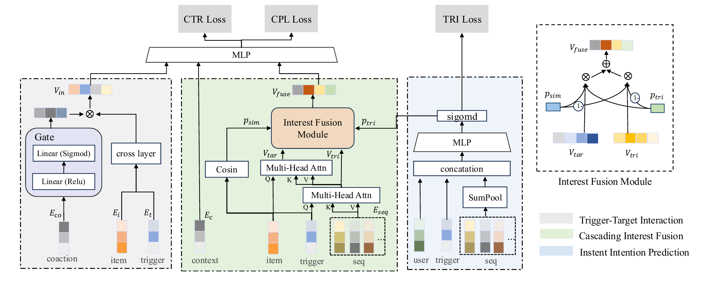

# Alibaba Tmall, trigger-induced recommendation: CTR +3.9%, off-category share down from 52% to 11%

> [中文版](alibaba-crrn.md)

### Paper: Cascading Relevance-driven Recommendation Network for CTR Prediction in Trigger-Introduced Recommendation (ICDE 2026)
### Link: https://arxiv.org/abs/2608.22973
### Company: Alibaba (Taobao & Tmall Group)
### Idea: trigger-target relevance, intent
### Area: i2i (trigger-induced recommendation: the user clicks an item on the Tmall homepage and enters an immersive feed built around that item, the trigger)

## Overview:
The paper proposes CRRN, a CTR model for trigger-induced recommendation. Its core idea is to put trigger-target relevance explicitly into three places in the model: feature interaction, interest fusion and the loss. For feature interaction, trigger-target relation features (same category, same brand, etc.) act as a gate that weights the element-wise product of the two items. For interest fusion, the model first predicts whether the user wants trigger-related items on this page, then combines that with the trigger-target cosine similarity to decide whether to lean on the "trigger-side interest" or the "target-side interest". For the loss, a pairwise loss ordered by category pushes same-category items to the top.

### Observation
The authors plot average CTR by (trigger category, target category) as a heatmap. The diagonal (same category) is clearly higher than the other cells. Users click the trigger and come in because they want things related to it. Yet in the online baseline (DIN + trigger features), 52% of recommended items were from a category different from the trigger's: relevance was not being learned well.

### Model architecture
Five feature groups go in: user profile, behavior sequence (clicks and purchases, truncated to 100), trigger features, target features, and context (time, browsing position). There is also a set of trigger-target relation features, such as same category, same brand and same price tier. The three blocks below run in parallel, and their outputs are concatenated into an MLP that predicts CTR.

#### Trigger-target interaction layer
The trigger embedding and the target embedding are multiplied element-wise to get a "what they have in common" vector. The relation features go through a two-layer gating network (ReLU, then sigmoid) that outputs weights of the same dimension as that vector, which are multiplied in element-wise to give the interaction vector. When the two items share a category or brand, the corresponding dimensions of the common vector get amplified.

#### Cascading interest fusion
**Instant intent prediction.** User profile, trigger, and the sum-pooled behavior sequence are concatenated and passed through an MLP and a sigmoid, giving a score: the probability that the user wants trigger-related items on this page. The label is page-level: it is 1 if any click on the page is in the same category as the trigger. It is trained with cross-entropy, loss weight 0.2. The target is not an input, so it is computed once per request.

**Cascading attention.** Two multi-head attention layers are chained. The first uses the trigger as the query over the behavior sequence, giving the "trigger-related interest". The second uses the target as the query over the per-position outputs of the first layer, giving the "target-related interest". In other words, the trigger first filters the behavior sequence, then the model checks how well the target matches the filtered sequence.

**Fusion.** The model also computes the cosine similarity between the trigger and target embeddings. The fused vector = intent score × similarity × trigger-related interest + (1 − intent score) × (1 − similarity) × target-related interest. So if the user wants trigger-related items on this page and this target looks like the trigger, the model leans more on the trigger-related interest; otherwise it leans more on the target-related interest.

#### Category-assisted pairwise loss
A standard pairwise loss only requires "clicked > exposed but not clicked". The paper adds whether the item shares the trigger's category, giving four tiers: same-category click > other-category click > same-category exposure without click > other-category exposure without click. Samples are paired up, the tiers decide which one should rank higher, and a cross-entropy term constrains the difference between their predicted CTRs. Loss weight 0.5.

**Total loss** = CTR loss + 0.2 × intent loss + 0.5 × pairwise loss.

In the offline ablation all three blocks contribute, with cascading interest fusion contributing the most. Defining the intent label by "same category" works better than same brand, same shop or same price tier.

### A/B results
Tmall trigger-induced recommendation, April 10 to 17, against the online DIN + trigger attention model: CTR +3.87%, clicks per user +5.75%, items browsed per user +3.25%. Among recommended items, the share in the trigger's category rose from 40.5% to 67.5%, related categories rose from 7.2% to 21.3%, and unrelated categories fell from 52.3% to 11.2%. Online latency went from 42ms to 45ms.

## Takeaways:
* In trigger-induced recommendation, trigger-target relevance deserves explicit modeling in features, architecture and loss at the same time; leaving it to attention to learn implicitly is not enough.
* "Does the user want trigger-related items on this page" can be predicted on its own, then used as a soft switch between trigger-side interest and personalized interest.
* Writing a business preference (same category first) into the tiers of a pairwise loss is cheap and easy to transfer.

## My take
* In the baseline, 52% of recommendations were from unrelated categories, which is already too scattered, so a good share of the +3.87% CTR comes from pulling relevance back to a normal level. Other teams have observed that users drift away from the trigger's category the further they scroll; in that case whether a 67% same-category share is too high depends on how deep users scroll in the specific scenario.
* The text says target attention comes first and trigger attention second, but the architecture figure and the formula use the trigger as the first query. This write-up follows the figure.
* In the fusion, the two interest weights don't sum to 1. When the intent score and the similarity agree, the sum is close to 1; when they conflict (e.g. intent score 0.9, similarity 0.1), it drops to 0.1 and the fused vector collapses toward zero. A negative cosine even makes a weight negative. The paper doesn't explain this, and doesn't compare against a normalized version.
* The pairwise loss as written takes the log of the raw difference between two predicted CTRs, which can be negative. The actual implementation most likely passes the difference through a sigmoid.

## Credibility: production

## Recommendation level: practical value
