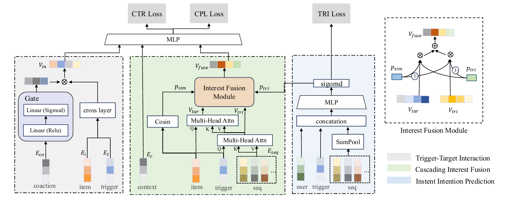

# 阿里天猫，后推荐 CTR+3.9%，不相关类目占比从 52% 降到 11%

关注我，每天为你精挑细选最优质、最新鲜的推荐算法paper，陪你一起保持进步、不断精进！

> [English version](alibaba-crrn.full.en.md)

### 论文：Cascading Relevance-driven Recommendation Network for CTR Prediction in Trigger-Introduced Recommendation（ICDE 2026）
### 网址：https://arxiv.org/abs/2608.22973
### 公司：阿里
### 思想：意图建模
### 方向：i2i

## 解读：
本文提出后推荐场景的 CTR 新模型，核心是把「trigger 和 target 的相关性」显式地塞进模型的三个地方：特征交叉、兴趣融合和损失函数。特征交叉上，用 trigger-target 的关系特征（是否同类目、同品牌等）当门控，给两者的逐元素乘积加权；兴趣融合上，先预测用户这一页想不想看 trigger 相关的东西，再结合 trigger-target 余弦相似度，决定偏向「trigger 侧兴趣」还是「target 侧兴趣」；损失上，加一个按类目排序的 pairwise 损失，让同类目的商品排在前面。

### 观察
按（trigger 类目，target 类目）统计平均 CTR，画成热力图，对角线（同类目）明显高于其它格子。用户点了 trigger 进来，就是冲着和它相关的东西来的；而线上基线（DIN + trigger 特征）推出的商品里，和 trigger 不同类目的占了 52%，相关性没学到位。

### 模型结构
输入五类特征：用户画像、行为序列（点击和购买，截断 100 条）、trigger 特征、target 特征、上下文（时间、浏览位置）。另有一组 trigger-target 关系特征，如是否同类目、同品牌、同价格档。下面三块并列，输出最后拼接进 MLP 预测 CTR。

#### Trigger-Target 交叉层
trigger embedding 和 target embedding 逐元素相乘，得到两者的「共性」向量。关系特征过一个两层门控网络（ReLU 后接 sigmoid），输出和共性向量同维的权重，逐元素乘上去，得到交叉向量。这样同类目、同品牌时，共性向量里对应的维度会被放大。

#### 级联兴趣融合
**即时意图预测。** 用户画像、trigger、sum pooling 后的行为序列拼接，过 MLP 和 sigmoid，得到一个分数：用户这一页想看 trigger 相关商品的概率。标签是页面级的：这一页上只要有一次点击和 trigger 同类目，就记为 1。用交叉熵训练，损失权重 0.2。输入里没有 target，所以每个请求只算一次。

**级联 attention。** 两层 multi-head attention 串起来。第一层用 trigger 当 query，对行为序列做 attention，得到「trigger 相关兴趣」；第二层用 target 当 query，对第一层的逐位置输出再做一次 attention，得到「target 相关兴趣」。也就是先用 trigger 把行为序列筛一遍，再看 target 和筛过的序列匹配不匹配。

**融合。** 再算 trigger 和 target embedding 的余弦相似度。融合向量 = 意图分 × 相似度 × trigger 相关兴趣 + (1 − 意图分) × (1 − 相似度) × target 相关兴趣。意思是：用户这一页想看 trigger 相关的、且这个 target 和 trigger 很像，就更多参考 trigger 相关兴趣；反之更多参考 target 相关兴趣。

#### 类目辅助的 pairwise 损失
常规 pairwise 损失只要求「点击 > 曝光未点击」。本文把是否和 trigger 同类目也加进来，排成四档：同类目点击 > 不同类目点击 > 同类目曝光未点击 > 不同类目曝光未点击。样本两两组对，按档位定谁该排前面，用交叉熵约束两者 CTR 预测值的差。损失权重 0.5。

**总损失** = CTR 损失 + 0.2 × 意图损失 + 0.5 × pairwise 损失。

离线消融里三块都有贡献，级联兴趣融合最大；意图标签用「同类目」定义比用同品牌、同店铺、同价格档都好。

### A/B效果
天猫后推荐，对照是线上 DIN + trigger attention：CTR +3.87%，人均点击 +5.75%，人均浏览 +3.25%。

## 心得：
* 后推荐里 trigger-target 相关性值得在特征、结构、损失三处同时显式建模，光靠 attention 隐式学不够。
* 「用户这一页想不想看 trigger 相关」可以单独预测，再用它在 trigger 侧兴趣和个性化兴趣之间做软切换。
* 把业务偏好（同类目优先）写进 pairwise 损失的档位里，是一个低成本、易迁移的做法。

## 愚见
* 基线推荐里不相关类目占 52%，本身就过度发散了，CTR +3.87% 有相当一部分是把相关性拉回正常水平的收益。也有团队观察到用户越往下滑越偏离 trigger 类目，这时同类目占比 67% 是否过高，要看具体场景的下滑深度。
* 文字说先做 target attention 再做 trigger attention，架构图和公式却是先用 trigger 当 query，本文按图解读。
* 融合时两路兴趣的权重之和不等于 1：意图分和相似度一致时接近 1，矛盾时（比如意图分 0.9、相似度 0.1）只剩 0.1，融合向量塌向零；余弦为负时权重还会变负。论文没解释，也没和归一化版本做对比。
* pairwise 损失原文写的是对两个 CTR 预测值之差直接取 log，差值可能为负，实际实现大概率是对差值过 sigmoid。

## 可信度：生产

## 推荐等级：有实践价值

**请帮忙点赞、转发，谢谢。欢迎干货投稿 \ 论文宣传\ 合作交流**

### 【铁粉】请入微信群，群内我会给出更深入的解读，还可以共同讨论技术方案、发招聘广告、内推和交友等。
* 铁粉标准：关注公众号一个月以上，且在公众号上累计15次互动（评论、爱心、转发）、或投稿1次，只欢迎技术同学。
* 入群方法：请您加个人微信lmxhappy，我拉您入群，请备注【公司】（只我个人看，不公开）。

## 推荐您继续阅读：
