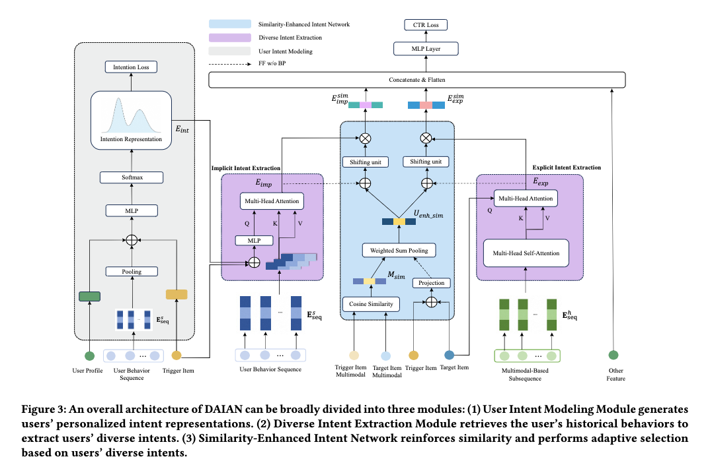

# Alibaba, detail-page recommendation, GMV +2%

> [中文版](alibaba-daian.md)

### Paper: DAIAN: Deep Adaptive Intent-Aware Network for CTR Predictionin Trigger-Induced Recommendation
### Link: https://arxiv.org/pdf/2602.13971v1
### Company: Alibaba
### Idea: intent
### Area: i2i

## Overview:
The paper proposes an item-to-item model based on intent modeling. This is also called trigger-induced recommendation; colloquially, detail-page recommendation or post-click recommendation.

First, be clear about what "intent" really means here: after the user clicks the trigger, within the current request, the probability distribution of the user's preference over "different similarity levels between target and trigger". Similarity levels are, for example, strongly related items, weakly related items, and unrelated items.

On the implementation side, the implicit intent representation and the trigger–target similarity go through PepNet's gating network + a multi-layer MLP to get implicit weights, which are multiplied element-wise (Hadamard product) with the implicit intent representation to get a weighted implicit intent representation. Similarly, the explicit intent representation and the trigger–target similarity go through the same kind of network to get a weighted explicit intent representation. Finally, these two representations are concatenated with user, trigger, target and other features and fed to the CTR prediction head (the MLP of the base model DIN).

Below is how the user's implicit intent representation, explicit intent representation, and the trigger–target similarity are computed:
### (1) User implicit intent modeling
Concatenate the trigger with the user's intent distribution after consuming that trigger (an n-dimensional vector, computed as described later), and fuse them through an MLP into an "intent-enhanced vector". It serves as the Query in Multi-Head Target Attention, producing the user's implicit intent representation.
### (2) User explicit intent modeling
Use the trigger to filter the behavior sequence, keeping only behaviors whose multimodal similarity exceeds a threshold, giving a subsequence. It first goes through Multi-Head Self-Attention (MHSA), then Multi-Head Target Attention aligns it to the target item, giving the explicit intent representation.
### (3) Trigger–target similarity
The target ID representation and the trigger ID representation go through a multi-layer MLP to get a high-dimensional ID similarity. The cosine between the target's and trigger's multimodal representations is computed, the scalar similarity is bucketized and passed through an embedding layer to get a vector — the multimodal similarity.
These two similarities of the same dimension are normalized by their norms and used as weights for a weighted sum, giving the final similarity between the two. Note: gradients are stopped on the ID similarity.

### Predicting the **user intent distribution** after consuming a given trigger
Inputs: (1) user profile such as user_id, gender, city; (2) a user history behavior sequence of length 50, pooled with target attention or another pooling method into an interest representation; (3) trigger item features.
The embeddings of these three are concatenated, passed through an MLP and a softmax to predict the user's personalized intent distribution. Trained with KL divergence loss.
Labels: use the Qwen-VL multimodal pretrained model (vision + text) to compute the cosine similarity between the trigger and all items the user clicked within the current request, bucketize the similarities with equal width into n levels, and count the click share of each bucket to get an n-dimensional intent distribution. This is the intent distribution of the request under that trigger, used as the supervision signal.

### **Training trick**: first train the network for "predicting the user intent distribution after consuming a given trigger" (UIM) on its own. Then train the rest of the network, but note it uses the true intent labels as a "teacher signal" instead of UIM's predicted intent. Finally, train the whole network together.

### **A/B**: Xianyu, CTR +1.59%, recommendation diversity +1.73%, GMV +2.37%

## Takeaways:
* Intent modeling has been the mainstream approach for post-click recommendation in recent years.
* Intent modeling should be combined with LLMs; LLMs have a big advantage on intent.

## Caveats
The paper explains the network modules one after another, without a sense of hierarchy, which lowers readability.

## Credibility: production

## Recommendation: practically useful

