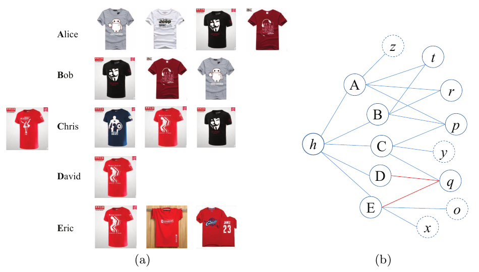

# Taobao Swing: a co-click only counts when two users both made it, and the more items that pair shares, the less each one counts; Surprise uses categories and clusters to fill sparse complementary signals

> [中文版](alibaba-swing.md)

### Paper: Large Scale Product Graph Construction for Recommendation in E-commerce
### Link: https://arxiv.org/abs/2010.05525
### Institution: Alibaba (Taobao), University of California, Santa Cruz
### Ideas: user-pair structure (swing), active-user down-weighting, category relevance cutoff, label-propagation clustering, time decay
### Area: i2i retrieval (similar items, complementary items)

## Breakdown:
**Swing doesn't look at single users' co-clicks but at "two users both clicked these two items"; the more focused that pair's tastes, the more trustworthy the co-occurrence.**

The scenario is Taobao's i2i index: given a seed item, return a ranked list of items for the downstream ranking modules. Two graphs are needed: before a user orders, recommend similar items to compare (built from clicks); after ordering, recommend complementary items (bought a T-shirt, recommend trousers; built from purchases). ItemCF with cosine similarity has two problems. First, clicks contain lots of accidental and casual clicks; cosine only looks at the number of common clickers and each item's own click count, so rarely clicked items have small denominators and get ranked up easily. Second, purchase data is very sparse, and complementarity has a direction (recommending a power bank after a phone makes sense, the reverse doesn't).

The paper proposes two training-free scoring formulas: Swing builds the similarity graph from clicks and is used before purchase: while the user is still choosing, it recommends items similar to the ones they clicked, for comparison. Surprise builds the complementary graph from purchases and is used after purchase: once the user orders, it recommends items that go with the ones in the order (bought a phone, recommend a phone case). Surprise also reuses Swing's similarity graph for clustering. Both graphs are precomputed offline on MapReduce and looked up by seed item online.

### Swing: scoring similarity between item pairs

On the left of the figure are the T-shirts each of five users clicked; on the right is the corresponding user–item bipartite graph, with seed item h.

**Scoring.** For seed item i and candidate j, find all users who clicked both i and j and pair them up. Each user pair (u, v) contributes 1 / (α + the number of items u and v both clicked), and the swing score is the sum over all pairs. If only one user clicked both i and j, no pair can be formed and the swing score is 0 (ItemCF would still give a score); scoring starts only once at least two people have clicked both.

**Why it's designed this way.** If two people both clicked h and q and share only this one item, their tastes happen to agree on it, which is a strong signal. If the two already share a pile of T-shirts (both browse widely), each shared click carries less weight.

**Active-user down-weighting.** Each user is also multiplied by 1/√(number of items they clicked), so heavier clickers get less weight, the same idea as Adamic/Adar.

**Example.** Ranking h's neighbors by cosine gives t > z > p > q. z was clicked by only 4 people, so its small denominator ranks it high, though it isn't really like h. With Swing (α=1), C, D and E all clicked q pairwise and each pair shares only q, so each of the three pairs contributes 1/2 and q scores 1.5, ranking first. Only Alice clicked both h and z, so z scores 0. q is in fact a red Michael Jackson T-shirt of the same brand as h.

**Cost.** Complexity rises from ItemCF's O(T·N·M) to O(T·N²·M), where T is the number of items and N, M the average degrees of items and users. One offline run takes about 3.5 hours, versus about 2 hours for ItemCF.

**Output: the similarity graph.** Each seed item keeps its top items by swing score, and all items' lists together form an item–item similarity graph: nodes are items, each seed item is linked to each of its similar items, and the edge weight is the swing score. Pre-purchase recommendation looks up this graph by seed item directly, and step (3) of Surprise also uses it for clustering.

### Surprise: scoring complementarity between item pairs
First narrow down related categories at the category level, then score at the item level, then fill sparsity at the cluster level, and finally combine the two scores.

#### (1) Category level: narrow down related categories
First, every pair of categories is scored: θ(c_i → c_j) = number of times c_j is bought after c_i / total purchases of c_j. Then, for each category c_i, the other categories are sorted by θ in descending order into a list, the relative drop between neighbors is computed, and the list is cut at the largest drop; what comes before it are c_i's related categories. A fixed top count isn't used because categories differ greatly. Men's T-shirts get 8 related categories (casual pants, jeans, jackets, etc.); phones get only 3 (phone cases, screen protectors, power banks).

#### (2) Item level: co-purchase with time decay
i is the trigger (online, the item the user just bought) and j is the candidate. Candidates j are not all items in the related categories, only those in related categories that someone bought after buying i, with the number of such users above a threshold γ. For scoring, each user who bought i and then j gets a score of 1 / (1 + the time gap between the two purchases); these scores are summed and divided by the product of the square roots of each item's buyer count (the same denominator as cosine similarity). The longer the gap, the weaker the relation.

#### (3) Cluster level: group similar items into clusters and count sequential purchases between clusters
**Why cluster.** Step (2) requires the number of users who bought i and then j to exceed a threshold γ, but purchase data is sparse, so many genuine pairings don't reach it. For example, Bob buys jeans j after T-shirt i, and David buys jeans k after i; j and k are the same blue Levi's style, each with only one purchase, and neither passes the threshold. If j and k are grouped into one cluster, it becomes two purchases of "i → this cluster of jeans", which is enough signal.

* **Clustering.** Label propagation runs on the similarity graph produced by Swing. A label means "which cluster it belongs to"; at the start each item is its own cluster, with its own item ID as the label; each round it looks at the current labels of all its similar neighbors, takes a vote weighted by swing score, and adopts the label with the most votes. It converges in about 10 rounds, billions of items are clustered in 15 minutes, and items with the same label form a cluster.
* **Cluster-level score.** Replace both i and j with their clusters and apply the formula from (2) between the two clusters; the result is the cluster-level score of (i, j). Purchases of similar T-shirts and similar jeans are all pooled in.

#### (4) Combining
Final score = 0.8 × item-level score + 0.2 × cluster-level score.

### Results
The data is Taobao behavior from December 16 to 30, 2015 (400 million users, 500 million items). Offline, with actual behavior on the 31st as ground truth, Swing beats cosine ItemCF with active-user down-weighting by 67.6% in Precision and 46.1% in Recall. Online A/B tests ran for a week in the Taobao mobile app:
* **Swing (pre-purchase).** Versus click ItemCF: CTR +9.3%, CVR +17.6%, PPM (payment per thousand impressions) +20.3%, p < 0.05.
* **Surprise (post-purchase).** Versus purchase ItemCF: PPM +183%. Versus the version without the cluster-level score: CTR +27.9%, PPM +35%, CVR about the same.
* **Both graphs together.** Recommending similar items for past clicks and complementary items for the current order, versus ItemCF for both: CTR +33.2%, CVR +26.7%, PPM +62.9%.

## Takeaways
* The credibility of a co-occurrence can be judged by "how many people together" rather than just "how many times": counting only when two focused users both clicked suppresses lots of accidental clicks.
* For complementary items, narrowing down at the category level before scoring at the item level makes both sparsity and direction much easier to handle.
* When purchase data is sparse, co-purchases can be aggregated over clusters derived from click data.

## Caveats
* Swing uses only click data, so what it computes is "clicked by the same people" similarity. The paper calls it a substitute relation, but doesn't check whether the results are substitutes, and evaluation only measures hits on future clicks.
* Swing has no popularity normalization on the candidate item (cosine has a denominator); the more people co-click, the more user pairs, growing quadratically, so popular items may be favored. The paper criticizes cosine for favoring rarely clicked items, but doesn't analyze Swing's popularity bias or coverage. Complexity is quadratic in item degree, and popular items easily have millions of clickers; the paper doesn't say whether it truncates or samples.
* Surprise's +183% PPM is against purchase ItemCF without category filtering, purchase order or time decay, so four changes (category cutoff, purchase order, time decay, clustering) are mixed together, and only clustering is ablated on its own.
* Read literally, "the number of items u and v both clicked" in the formula includes the seed item h, but the worked example leaves h out ([A, B] is counted as 3, not 4). It doesn't change the conclusions, but matters when implementing.

## Credibility: production

## Recommendation level: practical value
