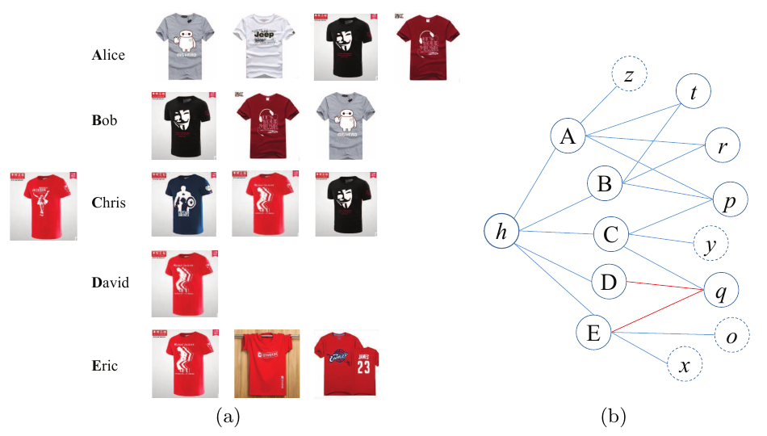

# 淘宝 Swing：两个用户都点过的商品才算数，这对用户共同点过的越多、每件分得越少；Surprise 用类目和聚类补互补品的稀疏

关注我，每天为你精挑细选最优质、最新鲜的推荐算法paper，陪你一起保持进步、不断精进！

> [English version](alibaba-swing.full.en.md)

### 论文：Large Scale Product Graph Construction for Recommendation in E-commerce
### 网址：https://arxiv.org/abs/2010.05525
### 公司：阿里巴巴（淘宝）、加州大学圣克鲁兹分校
### 思想：用户对结构（swing）、活跃用户降权、类目相关性截断、标签传播聚类、时间衰减
### 方向：i2i 召回（相似品、互补品）

## 解读：
**Swing 不看单个用户的共同点击，而看「两个用户都点了这两件商品」，这对用户口味越专一、这次共现越可信。**

本文提出两个不用训练的打分公式。Swing 用点击数据建相似图，用在购前，用户还在挑的时候，按他点过的商品推相似品供比较；Surprise 用购买数据建互补图，用在购后，用户下单后按订单里的商品推搭配的商品（买了手机推手机壳）。Swing 的相似图还被 Surprise 拿去聚类。两张图都在 MapReduce 上离线算好，线上按种子商品直接查表。

场景是淘宝的 i2i 索引。给一个种子商品，返回一串排好序的商品，供后面的排序模块使用。需要两张图：用户还没下单时推相似品供比较（用点击数据），下单后推互补品（买了 T 恤推裤子，用购买数据）。

### Swing：给商品对算相似度

上图左边是五个用户各自点过的 T 恤，右边是对应的用户–商品二部图，种子商品是 h。

**打分方式。** 对种子商品 i 和候选商品 j，找出所有同时点过 i 和 j 的用户，两两配对。每一对用户 (u, v) 贡献 1 / (α + u 和 v 共同点过的商品数)，所有用户对的贡献加起来就是 swing 分。如果只有一个用户同时点过 i 和 j，凑不出用户对，swing 分就是 0（ItemCF 这时仍会给分），至少要两个人都点过才开始有分。

**为什么这样设计。** 如果两个人都点过 h 和 q，而他们共同点过的也只有这一件，说明两人口味在这件商品上恰好一致，信号很强。如果两人本来就共同点过一大堆 T 恤（都是到处逛的人），每一件共同点击的分量就被摊薄了。

**活跃用户降权。** 每个用户再乘一个权重 1/√(他点过的商品数)，点得越多权重越小，思路和 Adamic/Adar 一样。

**例子。** 用余弦相似度给 h 找邻居，排序是 t > z > p > q。z 只有 4 个人点过，分母小所以排得高，其实和 h 不像。用 Swing（α=1），C、D、E 三人两两都点过 q，而且每对共同点过的只有 q，三对各贡献 1/2，q 得 1.5，排第一。z 只有 Alice 一个人同时点过，得 0。q 恰好是和 h 同品牌、同为红色的迈克尔·杰克逊 T 恤。

**代价。** 复杂度从 ItemCF 的 O(T·N·M) 升到 O(T·N²·M)，T 是商品数，N、M 是商品和用户的平均度数。离线算一次约 3.5 小时，ItemCF 约 2 小时。

**产出：相似图。** 每个种子商品按 swing 分取前若干个商品，所有商品的这些列表合起来就是一张商品–商品的相似图。节点是商品，种子商品和它的每个相似商品之间连一条边，边权是 swing 分。购前推荐直接按种子商品查这张图，Surprise 第（3）步也拿它来聚类。

### Surprise：给商品对算互补度
先在类目层面圈出相关类目，再在商品层面打分，再在聚类层面补稀疏，最后把两个分合起来。

#### （1）类目级：圈出相关类目
先给类目两两打分，θ(c_i → c_j) = 先买 c_i 后买 c_j 的次数 / c_j 的总购买次数。再针对每个类目 c_i，把其他类目按 θ 从高到低排成一个列表，算相邻两个的相对跌幅，在跌幅最大处截断，前面的就是 c_i 的相关类目。不固定取前几个，是因为各类目差别很大。男 T 恤得到 8 个相关类目（休闲裤、牛仔裤、夹克等），手机只得到 3 个（手机壳、手机膜、充电宝）。

#### （2）商品级：带时间衰减的共同购买
i 是 trigger（线上就是用户刚买的那件商品），j 是候选。候选 j 不是相关类目里的全部商品，而是相关类目里、有人先买了 i 再买了 j 的商品，且这样的人数要超过阈值 γ。打分时，每个先买 i 后买 j 的用户按两次购买的时间差算一个分 1 / (1 + 时间差)，把这些分加起来，再除以两件商品各自购买人数的平方根之积（和余弦相似度的分母一样）。可见，间隔越久，关系越弱。

#### （3）聚类级：把相似商品归成簇，在簇上统计先后购买
**为什么要聚类。** （2）要求先买 i 后买 j 的人数超过阈值 γ，可购买数据很稀疏，很多真实的搭配凑不够人数。比如 Bob 买了 T 恤 i 后买了牛仔裤 j，David 买了 i 后买了牛仔裤 k。j 和 k 是同款蓝色李维斯，各只有一次，都过不了阈值。如果把 j 和 k 归成一簇，就变成「i → 这一簇牛仔裤」有两次，信号就够了。

* **聚类。** 在 Swing 产出的相似图上做标签传播。标签就是「属于哪一簇」，一开始每个商品自成一簇，用自己的商品 ID 当标签；每轮看所有相似邻居当前的标签，按 swing 分加权投票，取票数最多的标签作为自己的新标签。约 10 轮收敛，几十亿商品 15 分钟聚完，标签相同的商品归为一簇。
* **簇级分数。** 把 i 和 j 都换成各自所在的簇，用（2）的公式算两个簇之间的先后购买分数，作为 (i, j) 的簇级分数。相似的 T 恤、相似的牛仔裤的购买都会合并进来。

#### （4）合分
最终分 = 0.8 × 商品级分 + 0.2 × 簇级分。

### 效果
数据是 2015 年 12 月 16 到 30 日的淘宝行为（4 亿用户、5 亿商品）。离线用 31 日的真实行为当答案，Swing 比加了活跃用户降权的余弦 ItemCF，Precision 高 67.6%，Recall 高 46.1%。线上 A/B 在手机淘宝做了一周：
* **Swing（购前场景）。** 对比点击 ItemCF，CTR +9.3%，CVR +17.6%，PPM（千次曝光成交额）+20.3%，p < 0.05。
* **Surprise（购后场景）。** 对比购买 ItemCF，PPM +183%。对比去掉簇级分的版本，CTR +27.9%，PPM +35%，CVR 差不多。
* **两张图一起用。** 按过往点击推相似品、按当前订单推互补品，对比两路都用 ItemCF，CTR +33.2%，CVR +26.7%，PPM +62.9%。

## 心得

## 愚见

## 可信度：生产

## 推荐等级：有实践价值

**请帮忙点赞、转发，谢谢。欢迎干货投稿 \ 论文宣传\ 合作交流**

### 【铁粉】请入微信群，群内我会给出更深入的解读，还可以共同讨论技术方案、发招聘广告、内推和交友等。
* 铁粉标准：关注公众号一个月以上，且在公众号上累计15次互动（评论、爱心、转发）、或投稿1次，只欢迎技术同学。
* 入群方法：请您加个人微信lmxhappy，我拉您入群，请备注【公司】（只我个人看，不公开）。

## 推荐您继续阅读：
