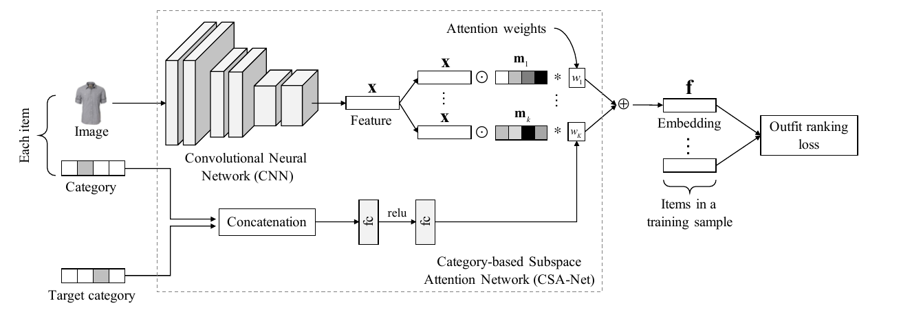

# Outfit completion retrieval: subspace weights depend only on the "source category → target category" pair, every candidate is stored once per possible source category, and the missing item is retrieved item by item and fused by averaging

> [中文版](amazon-csa-net.md)

### Paper: Fashion Outfit Complementary Item Retrieval (CVPR 2020)
### Link: https://arxiv.org/abs/1912.08967
### Institution: Amazon
### Ideas: category-conditioned subspace attention, shared learnable parameter vectors (masks), per-category-pair indexing, outfit ranking loss, hardest-negative aggregation, average score fusion, ANN retrieval
### Area: i2i (complementary recommendation, outfit completion)

## Breakdown:
Given an outfit that is missing one item (e.g., it has a top, a skirt and a bag but no shoes), retrieve shoes from the catalog that go with it. The paper uses one shared image-encoding network to produce a vector for every item; the vector depends on the image features and on a pair of categories (the item's own category and the target category being searched for). Offline, every candidate gets one vector per possible source category and these are put into an ANN index; at query time, each item in the outfit runs its own search, and the scores are fused by averaging.

Most existing outfit models score "does this whole outfit go together" and were not designed for retrieval. The strongest one, SCE-Net, uses a pair of images to decide which subspace to compare in, so a candidate's vector depends on the query image and cannot be indexed in advance; every pair has to be scored. Type-aware learns a separate subspace for each of 66 category pairs, which means many models. A triplet loss takes only one random item of the outfit as the anchor, ignoring that the candidate has to go with every item in the outfit.

### Method
There is a single encoding network (the paper calls it CSA-Net, a category-based subspace attention network), trained end to end with an outfit-level ranking loss; after training, candidates are indexed offline, and at inference each outfit item retrieves separately before the results are fused.

#### Encoding network
The input is one image, its own category (the source category) and the category being searched for (the target category); the output is a 64-dim vector. Items already in the outfit and candidate items go through this same network.
* **Image features.** An ImageNet-pretrained ResNet18 extracts image features. Only images are used, no text.
* **Subspaces.** The item's representation from ResNet18 is multiplied element-wise by each of 5 learnable parameter vectors of the same dimensionality (the paper calls them masks), giving 5 subspace vectors.
* **Weighting the subspaces by category pair.** The 5 weights come from a weight network. The item's own category and the target category (out of Polyvore's 11 high-level categories) each go through an embedding layer; the two vectors are added, passed through a ReLU, then one fully connected layer and a softmax, giving 5 weights (the paper describes this as the two one-hot vectors concatenated and passed through two fully connected layers, which is equivalent). The final vector is the weighted sum of the 5 subspace vectors.
* **Both sides aligned.** When a top is compared with a pair of shoes, both sides get the same category pair (source = top, target = shoes). The top's vector comes from the top image plus this pair, and the shoes' vector from the shoes image plus the same pair, so both sides get the same weights and are compared in the same weighted subspace. The distance between the two items' vectors (the paper does not say which distance) is their compatibility score, with no learned scoring network; a candidate's score against a whole outfit is the average of its distances to each item in the outfit (see the loss and inference below).

**What the subspaces are meant for.** The authors intend each subspace to capture one compatibility dimension (color, pattern, material, occasion, etc.); the paper does not check what each one actually captures.

**Why the weights look only at categories.** The weights depend only on the category pair and not on the image, so every "top → shoes" pair uses the same weights; this amounts to learning one set of per-dimension weights per category pair, applied to shared image features. If the weights depended on the query image (as in SCE-Net), a candidate's vector could only be computed once the query arrives; with categories only, all candidate vectors can be precomputed offline. The 5 subspaces are shared by all category pairs, which needs fewer parameters than one subspace per pair (Type-aware's 66).

**Loss (outfit ranking loss).** The goal is for the positive's distance to the outfit to be at least 0.3 smaller than the hardest negative's. Take an outfit of a top, a skirt, a bag and shoes as the example; there are four steps.
* **Take samples.** The shoes are held out as the positive, and the top, skirt and bag form the partial outfit. A set of other shoes is sampled at random as negatives (the paper does not give how many).
* **Compute each pair of shoes' distance to the outfit.** A pair of shoes' distance to the outfit is the average of its distances to the top, the skirt and the bag. For shoes–top, both sides are encoded with the weights of the (top, shoes) category pair; for shoes–skirt, with (skirt, shoes); and so on, so the same pair of shoes has three vectors within this outfit. This is done for the positive and for every negative.
* **Select the negative.** Only semi-hard negatives are kept (farther from the outfit than the positive, but by less than 0.3), and the one closest to the outfit among them gives the negative distance.
* **Hinge.** The loss is max(0, positive distance − negative distance + 0.3): the positive must be at least 0.3 closer than this negative, or a loss is incurred.

**Training setup.** Batch size 96, Adam, learning rate 5e-5 decayed linearly to 0; each image's 5 subspace vectors are computed once, and for each pair only the weights and the weighted sum are recomputed.

**Why an outfit-level distance.** A triplet only requires the candidate to go with one random item of the outfit; the outfit distance requires it to go with every item, which matches the average fusion used at inference.

### Inference
* **Indexing.** Every candidate gets one vector for each of the 11 possible source categories (shoes paired with tops, shoes paired with skirts, shoes paired with bags, …), so storage is the number of items times the number of high-level categories; hnswlib is used for nearest-neighbor search. One copy per source category is necessary because the same pair of shoes gets a different vector for each source category (different weights), and a query item can come from any category.
* **Item-by-item retrieval.** Each item in the partial outfit is encoded with (its own category, the target category) and searches the matching copy of candidate vectors; e.g., the top only searches the "shoes paired with tops" copy. The target category must be given in advance.
* **Fusion.** The retrieval scores from the different outfit items are averaged to get the final ranking (average fusion). The paper does not say whether the score is a distance or a rank, or how many results are taken per item before fusing.

### Data and results
The Polyvore Outfits dataset in two versions (non-disjoint: 53,306 training and 10,000 test outfits; disjoint: 16,995 training and 15,145 test outfits, where test outfits share no items with training). There are three evaluation tasks: outfit compatibility scoring (AUC), four-way fill-in-the-blank (FITB, where the distractors are of the same category as the answer), and a retrieval task built by the authors (FITB test outfits serve as queries and the missing item is the only positive; ranking is restricted to items of the positive's fine-grained category; since the test images are too few, training images are added as distractors, and only fine-grained categories with more than 3000 images are kept, 3000 images each, 27 categories for non-disjoint and 16 for disjoint), measured by recall@k. The retrieval baselines are versions the authors modified to support indexing. Offline experiments only.
* **Retrieval.** On non-disjoint, recall@10/30/50 is 8.27%/15.67%/20.91%, versus 5.10%/11.20%/15.93% for the strongest baseline, SCE-Net average (which averages the outputs of all condition subspaces so that single images can be indexed). On disjoint, 5.93%/12.31%/17.85% versus 4.41%/9.85%/13.87%.
* **FITB and compatibility.** On non-disjoint, FITB is 63.73% and AUC 0.91, above the original pair-input SCE-Net (61.6%, 0.91). This method uses images only, while both baselines also use text.
* **Outfit ranking loss vs. triplet.** With the same network, FITB rises from 56.17%/60.91% to 59.26%/63.73% (disjoint/non-disjoint).
* **Hardest vs. average negative.** Averaging the negatives gives FITB 56.19%/60%; taking the minimum gives 59.26%/63.73%. Swapping the order of the two category inputs during training brought no improvement.

## Takeaways
* Making the conditioning depend only on categories, not on the query image, is what turns a pairwise compatibility model into something that can be precomputed and served from an ANN index.
* The cost is one stored vector per candidate per possible source category, which stays cheap when the number of high-level categories is small (11 here).
* Averaging the candidate's distance over every outfit item in training mirrors the per-item retrieval with average fusion at serving time.

## Caveats
* The retrieval baselines are the authors' modifications of compatibility models (e.g., SCE-Net with its condition subspaces averaged rather than selected), so the retrieval comparison is against adapted versions rather than methods designed for retrieval.
* The retrieval benchmark has one annotated positive per query and ranks it only among 3000 images of the same fine-grained category, which is a much smaller and easier pool than a full catalog; the authors acknowledge that unannotated compatible items in the pool depress recall.
* There is no ablation of the category-pair weighting itself under the same loss (e.g., fixed equal weights over the 5 parameter vectors); the triplet-loss version of CSA-Net already reaches 60.91% FITB on non-disjoint, above the baselines, so it is not separated how much comes from the attention versus the multiple negatives with hardest-negative selection in the new loss.
* Several details needed to reproduce retrieval are not given (the distance function, the number of negatives, what score is fused and how many results per query item), no online result is reported, and no official code was found (only unofficial reimplementations).

## Credibility: offline

## Recommendation level: worth a look if you have time
