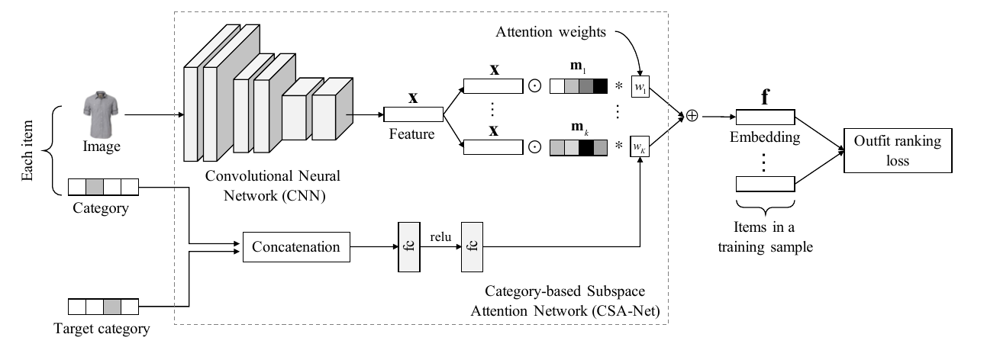

# 穿搭补全召回：子空间权重只由「源类目→目标类目」决定，候选按每个可能的源类目各存一份向量，缺的那件逐件检索再平均融合

关注我，每天为你精挑细选最优质、最新鲜的推荐算法paper，陪你一起保持进步、不断精进！

> [English version](amazon-csa-net.full.en.md)

### 论文：Fashion Outfit Complementary Item Retrieval
### 网址：https://arxiv.org/abs/1912.08967
### 公司：亚马逊
### 思想：
### 方向：i2i（互补推荐、穿搭补全）

## 解读：
给定一套还缺一件的穿搭（比如已有上衣、半身裙、包，缺鞋），从商品库里召回能搭上的鞋。本文用一个共享的图像编码网络给每件单品出向量，向量由图片特征和一对类目（这件单品自己的类目、要找的目标类目）共同决定；候选商品离线按每个可能的源类目各算一份向量建 ANN 索引，查询时套里每件单品各检索一次，再把分数平均融合。

已有的穿搭模型大多做「整套搭不搭」的打分，不是为检索设计的。效果最好的 SCE-Net 用一对图片决定在哪个子空间里比较，候选的向量依赖查询图片，没法事先建索引，只能逐对算；Type-aware 给 66 对类目各学一个子空间，模型多。三元组损失每次只拿套里随机一件当锚点，没有考虑候选和整套里每件单品都要搭。

### 方法
只有一个编码网络（论文叫 CSA-Net，类目子空间注意力网络），用整套级的排序损失端到端训练；训好后离线给候选建索引，推理时逐件检索再融合。

#### 编码网络
输入一张图、它自己的类目（源类目）、要找的类目（目标类目），输出一个 64 维向量，已选单品和候选单品都过这同一个网络。
* **图像特征。** ImageNet 预训练的 ResNet18 抽图像特征，只用图片，不用文本。
* **子空间。** 单品经 ResNet18 得到的表征，跟 5 个同维度的可学习参数向量（论文叫掩码，mask）分别做逐元素相乘，得到 5 个子空间向量。
* **按类目对给子空间加权。** 5 个权重由一个权重网络给出。单品自己的类目和目标类目（Polyvore 的 11 个大类）各经一个 embedding 层得到向量，两个向量相加后过 ReLU，再过一层全连接和 softmax，输出 5 个权重（论文写的是两个 one-hot 拼接后过两层全连接，二者等价）。最终向量是 5 个子空间向量的加权和。
* **两侧对齐。** 比较上衣和鞋时，两边输入同一对类目（源=上衣、目标=鞋）。上衣向量由上衣图片加这对类目得到，鞋的向量由鞋图片加同一对类目得到，两边拿到同一组权重，在同一个加权子空间里比距离。两件单品的向量之间的距离（论文没说是哪种）就是它们的搭配分，没有学习出来的打分网络；一件候选和整套的分数，是它和套里每件的距离取平均（见下面的损失和推理）。

**子空间的用意。** 作者希望每个子空间对应一种搭配维度（颜色、图案、材质、场合等），论文没有验证具体对应什么。

**为什么权重只看类目。** 权重只由类目对决定、与图片内容无关，所有「上衣→鞋」都用同一组权重，相当于每对类目学一组专属的逐维权重，作用在共享的图像特征上。权重若依赖查询图片（SCE-Net），候选向量要等查询来了才能算；只看类目，候选的所有向量都能离线算好。5 个子空间由所有类目对共享，比每对类目一个子空间（Type-aware 的 66 个）省参数。

**损失（整套排序损失）。** 目标是让正样本到整套的距离，比最难的负样本至少小 0.3。以一套「上衣、裙子、包、鞋」为例，分四步。
* **取样本。** 留出鞋当正样本，上衣、裙子、包组成部分穿搭。再从鞋类里随机采一组别的鞋当负样本（个数论文没写）。
* **算每双鞋到整套的距离。** 一双鞋到整套的距离，是它和上衣、裙子、包三件的距离取平均。算「鞋–上衣」时，两边都用（上衣，鞋）这对类目的权重编码；算「鞋–裙子」用（裙子，鞋），依此类推，所以同一双鞋在这一套里有三个向量。正样本和每个负样本都这样算。
* **挑负样本。** 只留半难的负样本（比正样本离整套远，但远得不到 0.3），再取其中离整套最近的一个，作为负样本距离。
* **铰链。** 损失为 max(0, 正样本距离 − 负样本距离 + 0.3)，即正样本要比这个负样本至少近 0.3，否则产生损失。

**训练设置。** batch 96，Adam，学习率 5e-5 线性降到 0；每张图的 5 个子空间向量只算一次，各对之间只重算权重和加权和。

**为什么用整套距离。** 三元组只要求候选和套里随机一件搭，整套距离要求它和每件都搭，和推理时的平均融合一致。

### 推理
* **建索引。** 每件候选按 11 个可能的源类目各算一份向量（鞋配上衣、鞋配裙子、鞋配包……），所以存储量是商品数乘以大类数；用 hnswlib 做近邻检索。必须各存一份，是因为同一双鞋的向量随源类目变（权重不同），而查询单品可能来自任何类目。
* **逐件检索。** 部分穿搭里每件单品用（自己的类目，目标类目）编码，各自去对应那份候选向量里做近邻检索，比如上衣只查「鞋配上衣」那份。目标类目要事先给定。
* **融合。** 各件单品的检索分数取平均得到最终排序（平均融合）。分数是距离还是名次、每件单品取多少条结果再融合，论文没说清。

### 数据与效果
Polyvore Outfits 数据集，分两版（非隔离版 53,306 套训练、10,000 套测试；隔离版 16,995 套训练、15,145 套测试，测试套里的商品不在训练集出现）。评测有三个任务，整套搭配打分（AUC）、四选一填空（FITB，干扰项与答案同类目）、作者新建的检索任务（拿 FITB 测试套当查询，缺的那件是唯一正样本，只在与它同细类目的商品里排序，测试图片不够，加入训练集图片当干扰项，只选图片超过 3000 张的细类目、每个取 3000 张，非隔离版 27 个、隔离版 16 个），指标 recall@k。检索基线是作者改成可建索引的版本。只有离线实验。
* **检索。** 非隔离版 recall@10/30/50 为 8.27%/15.67%/20.91%，最强基线 SCE-Net 平均版（把各条件子空间的输出取平均，以便单图建索引）为 5.10%/11.20%/15.93%；隔离版 5.93%/12.31%/17.85%，对比 4.41%/9.85%/13.87%。
* **FITB 与打分。** 非隔离版 FITB 63.73%、AUC 0.91，高于需要成对输入的原版 SCE-Net（61.6%、0.91）；本文只用图片，两个基线还用了文本。
* **整套损失对比三元组。** 同一网络下 FITB 从 56.17%/60.91% 升到 59.26%/63.73%（隔离版/非隔离版）。
* **负样本取最小对比取平均。** 取平均时 FITB 为 56.19%/60%，取最小 59.26%/63.73%。训练时交换两个类目的输入顺序没有带来提升。

## 心得：

## 愚见

## 可信度：离线

## 推荐等级：有时间看看

**请帮忙点赞、转发，谢谢。欢迎干货投稿 \ 论文宣传\ 合作交流**

### 【铁粉】请入微信群，群内我会给出更深入的解读，还可以共同讨论技术方案、发招聘广告、内推和交友等。
* 铁粉标准：关注公众号一个月以上，且在公众号上累计15次互动（评论、爱心、转发）、或投稿1次，只欢迎技术同学。
* 入群方法：请您加个人微信lmxhappy，我拉您入群，请备注【公司】（只我个人看，不公开）。

## 推荐您继续阅读：
