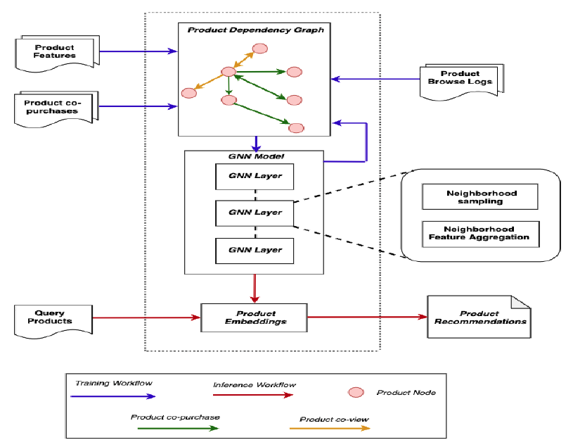

# Directional related-product recommendation: two vectors per product ("as query" and "as recommendation"), co-view edges against selection bias, new products attached to the graph by content

> [中文版](amazon-daemon.md)

### Paper: Recommending Related Products Using Graph Neural Networks in Directed Graphs (DAEMON, ECML PKDD 2022)
### Link: https://arxiv.org/abs/2211.11583
### Institution: Amazon
### Ideas: directed product graph, dual source/target embeddings, asymmetric loss, co-view edges for selection bias, cold-start via content neighbors
### Area: i2i (related product recommendation)

## Breakdown:
Given a product, recommend products likely to be bought with it. This relation has a direction: recommending a phone case for a phone makes sense, but recommending a phone for a phone case doesn't. The paper learns two vectors per product: the source vector says "what it wants when it is the query", and the target vector says "whom it suits when it is recommended"; recommendation retrieves other products' target vectors with the query's source vector. Both vectors are computed by a GNN on a directed product graph; co-view edges are added to the graph to ease selection bias, and a new product gets its vectors once it is attached to the graph by content.

The authors see three difficulties.
* **Direction.** a being bought with b doesn't mean the reverse holds.
* **Selection bias.** Purchase history is shaped by price, availability and what was shown. For example, there is a phone P and four phone cases PC, PC1, PC2 and PC3. Three customers who bought P each saw PC plus only one of PC1, PC2 and PC3 when choosing a case, and all ended up buying PC. Looking only at co-purchases, P gets only PC recommended; yet PC1 to PC3 were all co-viewed with PC and arguably should be recommended for P too.
* **New products.** A newly launched product has no purchase records.

### Method
First build a directed product graph, then use a GNN to compute a source and a target vector for each product; inference is nearest-neighbor search.

#### (1) Building the graph
* **Nodes.** One per product; the feature is a vector encoded from catalog information such as name, description and type.
* **Co-purchase edges.** If a and b were bought together, a → b is added, with a direction.
* **Co-view edges.** From browse logs, meaning the two products are similar and substitutable; bidirectional.

#### (2) GNN computes two vectors
The key is cross-collection along edge direction: a source vector collects targets from the products it points to, and a target vector collects sources from the products pointing to it. Take the co-purchase edge "phone P → phone case PC" as an example.
* **P's source vector (what it wants).** Collects the target vectors of the products P points to (such as PC's), plus the source vectors of similar phones.
* **PC's target vector (whom it suits).** Collects the source vectors of the products pointing to PC (such as P's), plus the target vectors of similar phone cases.

The initial vectors are the product features. Each layer collects neighbors once (sum, multiply by weights, ReLU, normalize), sampling only 20 or 10 neighbors per layer, for 3 layers, with 64-dimensional output.

**Loss.** Positives are the graph's edges, and negatives are sampled at random.
* **Co-purchase a → b.** The inner product of a's source and b's target should be large, and that with a random product's target small.
* **One-way edges.** The reverse direction (b's source with a's target) should also be small.
* **Co-viewed a and b.** Their source vectors should be alike, and so should their target vectors.

**Why this eases selection bias.** P → PC is a co-purchase and PC and PC1 are co-viewed, so PC1's target is pulled toward PC's target and thus close to P's source, and PC1 can be recommended for P.

#### Inference
* **Related products.** The query's source is dotted with every product's target, and FAISS returns the top k.
* **Similar products.** Using source with source instead gives similar products. For example, for an OPPO Reno 6 Pro (12GB), the related recommendation is a case for it, and the similar recommendation is a Reno 6 (8GB).
* **New products.** A few similar existing products are found by product features and connected to the new product in the graph (the paper doesn't say which edge type; by meaning, it acts like co-view), and one pass of the trained GNN gives its two vectors, with no retraining.

### Data and results
The two datasets are sampled from two emerging Amazon marketplaces, with 1.98M products and 14.1M edges, and 5.5M products and 31.7M edges; about 75% to 80% of edges are one-way. Offline results are given only as relative multiples for confidentiality.
* **Offline.** Using only co-purchase edges and comparing with directed-graph methods, HitRate and MRR improve by about 29% to 43% on the smaller dataset and about 155% to 194% on the larger one. The cold-start and selection-bias experiments are run only on the smaller dataset, against R-GCN only.
* **Online A/B.** Four weeks in each of two marketplaces; control is the incumbent co-purchase-based recommendation, treatment is DAEMON: sales +170%, profit +190%, p < 0.05.

## Takeaways
* Directional i2i relations can be expressed with two vectors per product plus inner product: scores are asymmetric, and ANN retrieval still works directly.
* Adding co-view edges as similarity relations lets transitivity surface products that were "viewed but not bought", offsetting the selection bias in co-purchases.
* A new product is first attached to similar existing products by content, then the trained GNN computes its vectors directly, without retraining.

## Caveats
* All offline results are relative multiples, but in Table 3 NERD's HitRate@20 on the smaller dataset is given as 0.0314, which looks like an absolute value left unconverted; Table 4's AUC is also given as multiples, which is hard to reconcile with the abstract's "4–16% AUC gains".
* The proof of Lemma 2 writes the inner product of a's source and c's target as the product of two inner products; this equality doesn't hold, so it can only be read as intuition.
* The cold-start and selection-bias experiments compare only with R-GCN on one dataset, with gaps of tens of times (about 98x on MRR@5), so R-GCN's setup is worth checking. The paper also doesn't explain how co-purchase edge direction is decided, or how leaving out a node's own vector in aggregation affects new products.
* Online sales +170% and profit +190% are very large, and the paper doesn't give the traffic split, the placement, or details of the control method.

## Credibility: production

## Recommendation level: practical value
