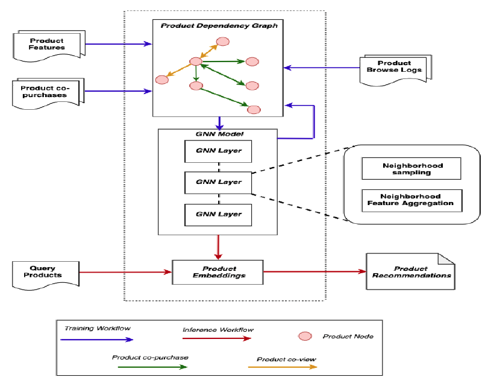

# 有方向的相关商品推荐：每个商品学「查询方」「被推荐方」两个向量，共同浏览边补选择偏差，新品按内容接进图

关注我，每天为你精挑细选最优质、最新鲜的推荐算法paper，陪你一起保持进步、不断精进！

> [English version](amazon-daemon.full.en.md)

### 论文：Recommending Related Products Using Graph Neural Networks in Directed Graphs（DAEMON）
### 网址：https://arxiv.org/abs/2211.11583
### 公司：Amazon
### 思想：
### 方向：i2i（相关商品推荐）

## 解读：
给定一件商品，做相关商品的推荐，本文在商品图上训练一个 GNN，给每件商品一个 source 向量和一个 target 向量。

图的节点带有商品目录文本的特征；边是有向的共同购买边，外加为减轻购买数据的选择偏差而加入的无向共同浏览边。每一层，一件商品的 source 向量由它指向的商品的 target 向量构成，target 向量由指向它的商品的 source 向量构成；共同浏览的商品则提供同一种向量。训练损失要求每条共同购买边的分数高于随机商品；对只有单向的边，还要高于它的反方向；共同浏览的商品，向量要彼此拉近。

推理时，相关推荐按触发物品的 source 向量与各商品 target 向量的内积排序，相似推荐按它与各商品 source 向量的内积排序；新商品先与内容相似的商品连上边，再直接算出向量，不需要重新训练。

作者认为难点有三个。
* **方向性。** a 和 b 一起买，不代表反过来也成立。
* **选择偏差。** 历史购买受价格、库存、展示位置影响。比如有一部手机 P 和四个手机壳 PC、PC1、PC2、PC3。三个买了 P 的用户挑手机壳时，看到的都有 PC，另外各自只看到了 PC1、PC2、PC3 中的一个，最后都买了 PC。只看共同购买，给 P 只会推 PC；但 PC1 到 PC3 都和 PC 被共同浏览过，其实也该推给 P。
* **新品。** 刚上架的商品没有购买记录。

### 方法
先建一张商品有向图，再用 GNN 给每个商品算出 source、target 两个向量，推理时做最近邻检索。

#### （1）建图
* **节点。** 每个商品一个，特征是商品名、描述、类型等目录信息编码成的向量。
* **共同购买边。** a 和 b 被一起买过，连 a → b，有方向。
* **共同浏览边。** 来自浏览日志，表示两件商品相似、可替代，双向。

#### （2）GNN 算两个向量
重点是顺着边的方向交叉收集：source 从它指向的商品那里收 target，target 从指向它的商品那里收 source。以共同购买边「手机 P → 手机壳 PC」为例。
* **P 的 source 向量（想要什么）。** 收集 P 指向的商品的 target 向量（如 PC 的），再加上相似手机的 source 向量。
* **PC 的 target 向量（适合谁）。** 收集指向 PC 的商品的 source 向量（如 P 的），再加上相似手机壳的 target 向量。

初始向量就是商品特征。每层收集一次邻居（求和、乘权重、过 ReLU、归一化），每层只采 20 或 10 个邻居，共 3 层，输出 64 维。

**损失。** 正样本就是图里的边，负样本随机采。
* **共同购买 a → b。** a 的 source 和 b 的 target 内积要大，和随机商品的 target 内积要小。
* **单向边。** 再要求反方向（b 的 source 和 a 的 target）内积要小。
* **共同浏览的 a、b。** 两者的 source 要像，target 也要像。

**为什么能缓解选择偏差。** P → PC 是共同购买，PC 和 PC1 被共同浏览，PC1 的 target 被拉向 PC 的 target，也就靠近了 P 的 source，PC1 就能推给 P。

#### 推理
* **相关推荐。** 查询商品的 source 和所有商品的 target 算内积，用 FAISS 取前 k 个。
* **相似推荐。** 换成 source 和 source 算内积，推出来的是相似品。比如查询 OPPO Reno 6 Pro（12GB），相关推荐是它的保护壳，相似推荐是 Reno 6（8GB）。
* **新品。** 按商品特征找几件相似老品，在图里连上边（论文没说哪种边，按含义相当于共同浏览），用训练好的 GNN 跑一遍就得到两个向量，不用重新训练。

### 数据与效果
两个数据集采样自 Amazon 的两个新兴站点，分别有 198 万商品、1,410 万条边和 550 万商品、3,170 万条边，约 75% 到 80% 的边是单向的。离线结果因为保密，只给了相对倍数。
* **离线。** 只用共同购买边、和有向图方法比，HitRate、MRR 在小数据集上提升约 29% 到 43%，在大数据集上提升约 155% 到 194%。新品和选择偏差两个实验只在小数据集上做，只和 R-GCN 比。
* **线上 A/B。** 两个站点各做 4 周，对照组是原来基于共同购买的推荐，实验组换成 DAEMON：销量 +170%，利润 +190%，p < 0.05。

## 心得：

## 愚见

## 可信度：生产

## 推荐等级：有实践价值

**请帮忙点赞、转发，谢谢。欢迎干货投稿 \ 论文宣传\ 合作交流**

### 【铁粉】请入微信群，群内我会给出更深入的解读，还可以共同讨论技术方案、发招聘广告、内推和交友等。
* 铁粉标准：关注公众号一个月以上，且在公众号上累计15次互动（评论、爱心、转发）、或投稿1次，只欢迎技术同学。
* 入群方法：请您加个人微信lmxhappy，我拉您入群，请备注【公司】（只我个人看，不公开）。

## 推荐您继续阅读：
