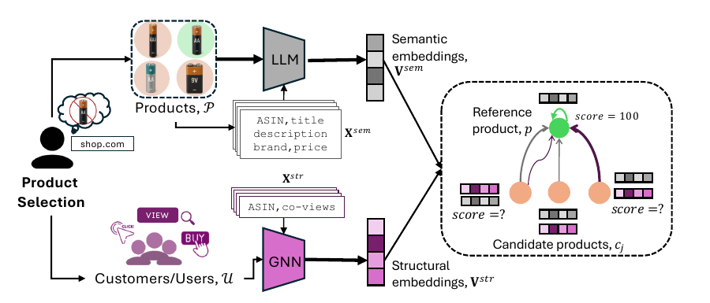

# Amazon, functional substitute recommendation: Claude pseudo-labels plus a two-channel (semantic and behavioral) GNN

> [中文版](amazon-grafs.md)

### Paper: GraFS: An Integrated GNN-LLM Approach for Inferring Best Functional Substitute Products (CIKM'25 short paper)
### Link: https://doi.org/10.1145/3746252.3760961
### Company: Amazon (the first author is a Stanford PhD student who did the work during an Amazon internship; co-authors include Danai Koutra, a University of Michigan professor and Amazon Scholar)
### Idea: LLM pseudo-labels, graph neural networks, fusing semantic and behavioral signals
### Area: i2i (substitute recommendation)

## Overview:
Given one product (the trigger), return its "functional substitutes": items with the same core function that serve the same purpose, even if brand or specs differ. For example, AA and AAA batteries have very similar text but are not interchangeable, while garlic presses from different brands look different but are. The paper encodes product text with an LLM and user behavior with a GNN, propagates both over one graph separately before fusing them, scores substitutes with an MLP, then groups candidates by function and ranks within each group. Both training and evaluation labels are scores produced by Claude. The paper has offline experiments only.

### Data side: Claude pseudo-labels
For each (trigger, candidate product) pair, Claude 3.5 Sonnet sees only the two products' titles and descriptions, with this template:

```
When I want to buy:
<product i title and description>
But it's out of stock...
<product j title and description>
1. Is product j a functional substitute for product i? Answer yes/no.
2. Rate the functional similarity between i and j from 0-100.
```

This 0–100 score is used in three places: as the label for substitution-score regression, as the edge condition when building the graph, and as the ground truth for within-group ranking. Humans re-checked 100 pairs per category; agreement with the LLM scores was r = 0.81.

The data is an e-commerce reviews dataset. The paper doesn't name it, but the ASIN and also_view / also_buy fields indicate the public Amazon reviews dataset. Four categories are used (Beauty, Electronics, Cellphones, Baby), with titles, descriptions, prices and also_view / also_buy links.

### Model side


Two stages: first learn a vector for every product; then, for each (trigger, candidate) pair, score substitution, cluster the candidates into functional groups, and rank within each group.

#### (1) Learning product vectors
Two vectors, semantic and structural, each propagate over the same graph and are fused at the end.

**Graph.** The paper defines it as a heterogeneous graph with two node types, users and products. There are also two kinds of edges: user–product interactions, and undirected edges between the trigger and candidates whose Claude score is at least 0.7 (the paper gives the threshold as 0.7, presumably on the 0–100 score normalized to 0–1). The method section only describes how product nodes are initialized and propagated; user nodes only come in when computing the structural vector. Each channel computes its own weights on the trigger–candidate edges, and a weight below that channel's threshold is set to 0, so the two channels may end up using different neighbors. The paper gives no graph size, only that each category has over 10M reviews.

**Semantic vector.** Title, description and other text are concatenated and passed through an LLM encoder, giving a 1024-d initial vector; when encoding a candidate, two features relative to the trigger are appended: same brand or not (0/1), and the price difference. The paper does not say which LLM it is. The edge weight is the cosine similarity of the two endpoints' semantic vectors. Three layers of HetGAT (heterogeneous graph attention network) then run over the graph, aggregating only the neighbors' semantic vectors, with this edge weight built into the attention coefficients.

**Structural vector.** A GNN over the co-view / co-purchase behavior graph gives a 512-d initial vector. It is then handled the same way as the semantic vector: the edge weight becomes the cosine similarity of the two endpoints' structural vectors, and 3 layers of HetGAT aggregate only the neighbors' structural vectors.

**Fusion.** After each channel has gone through 3 layers, the two are summed with a learned weight γ to give the product vector z.

#### (2) Substitution scoring
The trigger and the candidate share the encoder from (1), with the trigger-relative brand and price features as extra input on the candidate side. The two vectors, plus two per-pair learned weights (whether this pair should lean on semantic or structural similarity) are concatenated and passed through an MLP and a sigmoid to give the substitution score. The loss is MSE against the Claude score.

#### (3) Functional grouping
Candidates are clustered by substitution score into functional groups, e.g. chargers vs. phone cases among cellphone accessories. The grouping loss pushes the scores within a group toward each other and toward 1.

#### (4) Ranking within groups
The substitution score and purchase likelihood (PL) are concatenated and fed to a ranking MLP, trained with a pairwise hinge loss so that the candidate with the higher Claude score ranks higher. The final output is the top 10 across all groups.

The three losses from (2), (3) and (4) are trained jointly with weights 1 : 0.1 : 0.5.

### Results (offline only)
Across the 4 categories, NDCG@10 is 0.71–0.75. The strongest baseline, TransSub or Sceptre (McAuley 2015), gets 0.61–0.66; Claude scoring directly gets only 0.52–0.55. Semantic-only or structural-only variants get 0.65–0.70, and removing the brand or price feature costs 0.02–0.04 each. There is no online A/B test; the paper lists it as future work.

## Takeaways:
* "Substitute" can be split into two signals: an LLM judges whether two items are functionally alike, and the behavior graph tells whether users actually swap one for the other. Propagating each separately and then fusing beats either one alone.
* The "it's out of stock, which would you buy instead" prompt is a cheap way to label substitute relations.
* Relative features such as same brand and price difference give a consistent gain in the substitute setting.

## My take
* Labels, graph edges and ranking ground truth all come from the same Claude score. The paper does not say whether edges for test pairs were removed when building the graph, so label leakage is possible.
* The ground truth is Claude's score, yet Claude scoring directly is the weakest baseline (NDCG 0.52–0.55). The prompt or inputs presumably differ, but the paper does not explain this.
* Equation 2 puts the trigger-relative brand and price features into the candidate's LLM encoding input, so a candidate's semantic vector changes with the trigger; yet each product is a single node with a single vector on the graph. The paper does not say which vector a product uses when it is a candidate for different triggers.
* The abstract says the method maximizes purchase likelihood, but purchase likelihood is only an input to the ranking MLP; the supervision is Claude's functional similarity score, and how PL is computed is not described. "Maintaining diversity" has no corresponding metric, and how candidates are generated is not described either.
* Several numbers don't line up: the text says the gain over the next-best method in Beauty and Cellphones is "approximately 8–13%", but the relative gains for those two categories from Table 1 are 13%–20%, so 8–13 looks like absolute points. γ is the learned weight between semantic and structural in the method section, but the hyperparameter analysis describes it as balancing functional similarity vs. purchase likelihood and gives an optimal range. Results are averages over 10 runs with no variance or significance reported.

## Credibility: offline

## Recommendation level: worth a look if you have time
