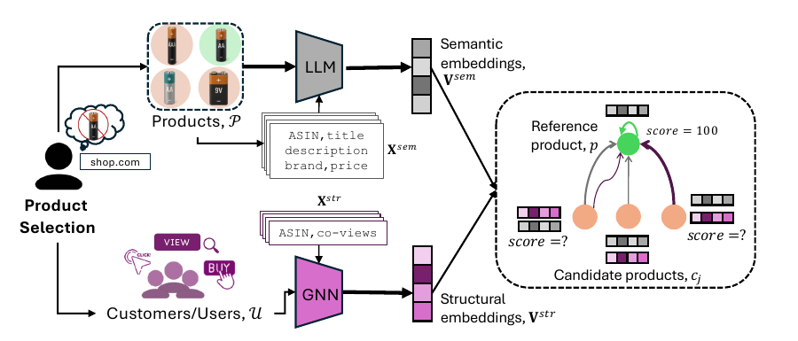

# Amazon 功能替代品推荐：Claude 打伪标签，语义、行为双通道 GNN

关注我，每天为你精挑细选最优质、最新鲜的推荐算法paper，陪你一起保持进步、不断精进！

> [English version](amazon-grafs.full.en.md)

### 论文：GraFS: An Integrated GNN-LLM Approach for Inferring Best Functional Substitute Products
### 网址：https://doi.org/10.1145/3746252.3760961
### 公司：Amazon
### 思想：LLM 伪标签、图神经网络、语义与行为融合
### 方向：i2i

## 解读：
输入一件商品（trigger），输出它的「功能替代品」：核心功能相同、能满足同一用途，但品牌、规格可以不同。比如 AA 和 AAA 电池文本很像，却不能互换；不同品牌的压蒜器看起来不一样，却可以互换。

本文用 LLM 编码商品文本、用 GNN 编码用户行为，两路在同一张图上各自传播后融合，接 MLP 打替代分，再做功能分组和组内排序。训练和评测的标签都是 Claude 打的分。全文只有离线实验。

### 数据侧：Claude 打伪标签
对每个（trigger，候选商品）对，只给 Claude 3.5 Sonnet 两件商品的标题和描述，模板如下：

```
When I want to buy:
<商品 i 标题和描述>
But it's out of stock...
<商品 j 标题和描述>
1. Is product j a functional substitute for product i? Answer yes/no.
2. Rate the functional similarity between i and j from 0-100.
```

这个 0–100 分用在三处：替代分回归的标签、建图时的连边条件、组内排序的真值。每个类目抽 100 对人工复核，和 LLM 分数的一致性 r=0.81。

数据是一个电商评论数据集，论文没点名，从 ASIN、also_view / also_buy 这些字段看是公开的 Amazon 评论数据集。取 Beauty、Electronics、Cellphones、Baby 四个类目，商品带标题、描述、价格和 also_view / also_buy 关系。

### 模型侧


分两个阶段：先给每个商品学一个向量；再对每个（trigger，候选商品）对打替代分，把候选分成功能组，在组内排序。

#### （1）学商品向量
语义向量、结构向量两路，在同一张图上各自传播，最后融合。

**图。** 论文定义为异构图，节点有用户和商品两类。边也有两类：用户和商品之间的交互；trigger 和 Claude 分数 ≥0.7 的候选之间的无向边（论文给的阈值是 0.7，应是把 0–100 分归一化后的值）。方法部分只写了商品节点的初始化和传播，用户节点只在算结构向量时用到。两路在 trigger–候选的边上各算各的边权，低于本通道阈值的置 0，所以两路实际用到的邻居可能不同。论文没给图的规模，只说每个类目有超过 1000 万条评论。

**语义向量。** 标题、描述等文本拼起来过 LLM 编码器，得到 1024 维初始向量；编码候选商品时，额外拼上两个相对 trigger 的特征：是否同品牌（0/1）和价差。论文没说用的是哪个 LLM。边权是两端语义向量的余弦相似度。然后在图上跑 3 层 HetGAT（异构图注意力网络），只聚合邻居的语义向量，注意力系数里带上这个边权。

**结构向量。** 在 co-view / co-purchase 行为异构图上跑 GNN，得到 512 维初始向量。之后和语义向量一样处理：边权换成两端结构向量的余弦相似度，跑 3 层 HetGAT，只聚合邻居的结构向量。

**融合。** 两路各传完 3 层，按可学习的权重 γ 加权求和，得到商品向量 z。

#### （2）打替代分
trigger 和候选商品共享（1）里的编码器，候选侧额外输入相对 trigger 的品牌、价差特征。两边的向量，再加两个按商品对学出来的权重（这一对更看语义还是更看结构），拼起来过 MLP 和 sigmoid，得到替代分。损失是对 Claude 分数的 MSE。

#### （3）功能分组
按替代分把候选聚成若干功能组，比如手机配件里的充电器、手机壳。分组损失让组内各候选的替代分彼此接近、并且都接近 1。

#### （4）组内排序
替代分和购买可能性（PL）拼起来过一个排序 MLP，用 pairwise hinge 损失训练，Claude 分高的要排在前。最后跨组取 top-10。

（2）（3）（4）的三个损失联合训练，权重 1 : 0.1 : 0.5。

### 效果（只有离线）
4 个类目上 NDCG@10 为 0.71–0.75。最强基线是 TransSub 或 Sceptre（McAuley 2015），为 0.61–0.66；Claude 直接打分只有 0.52–0.55。只用语义或只用结构单路时在 0.65–0.70，去掉品牌或价格特征各掉 0.02–0.04。没有线上 A/B，论文把它列为未来工作。

## 心得：
* 「替代」可以拆成两个信号：LLM 判断功能上像不像，行为图判断用户实际拿不拿它替代。两路各自传播再融合，比只用一路好。
* 「缺货时你会买哪个」这个 prompt，是给替代关系打标签的一个低成本办法。
* 同品牌、价差这类相对特征，在替代场景里有稳定的增益。

## 愚见
* 标签、建图的边、排序真值都来自同一个 Claude 打分。论文没说测试集里的商品对在建图时是否去掉了边，存在标签泄漏的可能。
* 真值是 Claude 打的分，可 Claude 直接打分却是基线里最差的（NDCG 0.52–0.55）。两者的 prompt 或输入应该不同，论文没有解释。
* 式 2 把相对 trigger 的品牌、价差写进了候选商品的 LLM 编码输入，候选商品的语义向量会随 trigger 变化；但图上每个商品只有一个节点、一个向量。同一个商品做不同 trigger 的候选时用哪个向量，论文没交代。
* 摘要说「最大化购买可能性」，但购买可能性只是排序 MLP 的一个输入，监督信号是 Claude 的功能相似分；PL 怎么算的也没交代。「保持多样性」没有对应的指标，候选是怎么生成的也没写。
* 几处数字对不上：正文说 Beauty、Cellphones 两类比次优方法高「约 8–13%」，按表 1 算这两类的相对提升是 13%–20%，8–13 更像绝对点数。γ 在方法里是语义和结构之间的可学习权重，到超参分析里却写成「功能相似 vs 购买可能性」，还给了最优区间。结果是 10 次运行的平均，没给方差或显著性。

## 可信度：离线

## 推荐等级：有时间看看

**请帮忙点赞、转发，谢谢。欢迎干货投稿 \ 论文宣传\ 合作交流**


### 【铁粉】请入微信群，群内我会给出更深入的解读，还可以共同讨论技术方案、发招聘广告、内推和交友等。
* 铁粉标准：关注公众号一个月以上，且在公众号上累计15次互动（评论、爱心、转发）、或投稿1次，只欢迎技术同学。
* 入群方法：请您加个人微信lmxhappy，我拉您入群，请备注【公司】（只我个人看，不公开）。

## 推荐您继续阅读：
