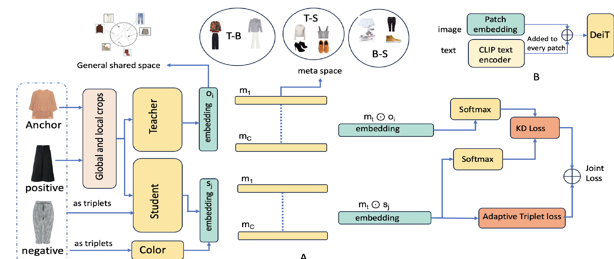

# Amazon outfit compatibility: outfit photos from the web replace manual labels

> [中文版](amazon-medal.md)

### Paper: MEDAL: multi-modal MEta-space Distillation and ALignment for Visual Compatibility Learning (WACV 2026)
### Link: https://doi.org/10.1109/WACV61042.2026.00093
### Company: Amazon
### Idea: self-supervised distillation, per-category-pair subspaces, distant supervision
### Area: i2i

## Overview:
The paper does fashion complementary item retrieval: given an item the user has picked (say a shirt), retrieve items from the catalog that visually go with it (pants, shoes). Unlike similar-item recommendation, the candidate and the trigger are from different categories, so "how alike are they" doesn't work; the question is "do they go together".

The authors see three problems with existing methods, and the paper gives one fix for each:
1. **They use only global CNN features and ignore local cues such as texture and patterns.** Fix: teacher-student self-distillation, so the model learns texture and patterns from small local crops.
2. **All categories share one space, but the rules for shirt-pants differ from those for pants-shoes.** Fix: each category pair (top-bottom, top-shoes, bottom-shoes) gets a learnable mask vector that projects into its own subspace.
3. **They rely on expensive manual outfit annotation.** Fix: compatibility labels are mined automatically from outfit photos on the web.

Color histograms are also added explicitly. The paper has offline experiments only.

### Data side: mining compatible pairs from outfit photos
**Positives.** Photos of people wearing complete outfits are collected from public sites. Grounding-DINO detects and crops each garment, and Amazon's own visual similarity model SkiLL maps each crop to the most similar product in the catalog (colors must match). The products that appear in the same photo form one compatible set. The public Hypatia-OutfitBuilder dataset is expanded the same way, for about 2 million pairs in total.

**Hard negatives.** SkiLL embeddings of the target category's products are clustered hierarchically into a cluster tree. The positive sits in some leaf cluster; 2 products are sampled from each of its 2 nearest sibling clusters as negatives: close in style to the positive but not part of the same outfit, i.e. approximate hard negatives.

### Model side

This is a retrieval model, not a ranking model: it computes one vector per item and retrieves nearest neighbors. Read it in three steps: how an item is encoded into a vector, what objectives train it, and how retrieval works.

### (1) Item encoder: how one item becomes a vector
The backbone is DeiT (a kind of ViT). An item has three inputs:
* **Image:** split into patches and fed into DeiT.
* **Text (figure B):** the item's attribute text (e.g. "striped cotton shirt") goes through the CLIP text encoder to get a vector, which is scaled by a coefficient and added to every patch embedding, fusing from the very first layer. The in-house dataset has no text, so this is used only on the public datasets.
* **Color (Color in the figure):** a self-supervised vision model mainly learns texture and style and is insensitive to color, so color is added separately. The image is converted from RGB to the LUV color space (perceptually uniform: the distance between two colors is close to the difference people perceive), a 560-bin color histogram is computed and compressed to 64 dimensions with a linear layer, then concatenated with the backbone's output and passed through another linear layer to give the item vector (color is attached only to the student, which is also what inference uses).

### (2) Training objectives: distillation learns the representation, the triplet loss learns the metric
The two losses are added and trained together, with different jobs.

**Distillation loss: teaching the backbone the local details compatibility needs (Teacher, Student, KD Loss in the figure).** For a compatible pair (say a shirt and pants), each item gets 2 global images at 224×224 and 8 local crops at 96×96 (a small random crop, plus augmentations such as color jitter and blur); a local crop shows only fabric, texture and pattern, not the overall silhouette. During training, the encoder above is copied once to serve as the teacher, and the original is called the student. The teacher sees only the global images, the student sees the local crops, both outputs go through softmax, and a cross-entropy loss pulls the student's distribution toward the teacher's. The teacher gets no gradient; its parameters are an exponential moving average (EMA) of the student's, which keeps all items from collapsing to one point. Because the global images and local crops come from different items in a compatible pair, the effect of distillation is to align the two compatible items on local details.

**Subspaces plus a triplet loss: learning the "do they go together" distance (m₁…m_C and Adaptive Triplet loss in the figure).** Each category pair t (top-bottom, top-shoes, bottom-shoes; T-B, T-S, B-S in the figure) has a learnable mask vector m_t, multiplied element-wise with the item vector; this gives each dimension a weight and projects into the subspace specific to that category pair. In the subspace, the anchor must be closer to the positive than to the negative by at least a margin. The margin isn't constant: the farther the negative is from the positive on the cluster tree, the larger the margin (a base of 0.4, plus the distance at which the two clusters merge in the tree, minus the average within-cluster distance of the positive's cluster).

### (3) Inference: retrieval by category pair
Only the student is used. When the user picks a shirt and we need pants, the top-bottom mask m_t projects the shirt and all pants into the same subspace and the nearest few are returned. Only the query category and the target category are needed, with no paired image input, so indexing is easy.

## Takeaways:
* Compatibility labels can be mined from outfit photos: detect and crop, then map back to the catalog with a similarity model, at zero annotation cost.
* Split subspaces by category pair with just one per-dimension mask vector each; retrieval only needs the query and target categories, so indexing is easy.
* Self-supervised visual representations are insensitive to color; compatibility needs explicit color features, and an LUV histogram is cheap and effective.

## My take
* No online experiment, and no metrics such as CTR or conversion.
* On in-house data, "retrieved correctly" is judged by SkiLL similarity above 0.7, while the training data was also mapped with SkiLL, so evaluation and data construction use the same model.
* No user behavior at all: "appearing in the same photo" is not "bought together by users", and co-purchase, the most common signal for e-commerce compatibility recommendation, is set aside.

## Credibility: offline

## Recommendation level: worth a look if you have time
