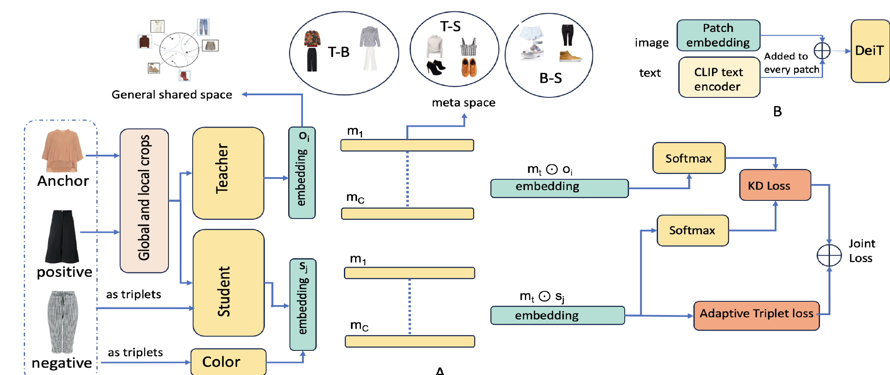

# Amazon 搭配推荐，用网上穿搭照片代替人工标注

关注我，每天为你精挑细选最优质、最新鲜的推荐算法paper，陪你一起保持进步、不断精进！

> [English version](amazon-medal.full.en.md)

### 论文：MEDAL: multi-modal MEta-space Distillation and ALignment for Visual Compatibility Learning（WACV 2026）
### 网址：https://doi.org/10.1109/WACV61042.2026.00093
### 公司：Amazon
### 思想：自监督蒸馏、按品类对分子空间、远程监督
### 方向：i2i

## 解读：
本文做的是时尚互补品检索：给定用户选中的一件单品（比如衬衫），从商品库里检索视觉上能搭配的单品（裤子、鞋）。和相似推荐不同，候选和 trigger 不是同一个品类，「像不像」不管用，要判断「配不配」。

作者认为现有方法有三个问题，本文各给了一个解法：
1. **只用全局 CNN 特征，忽略了纹理、图案这类局部线索。** 解法：teacher-student 自蒸馏，让模型从局部小图里学纹理和图案。
2. **所有品类共用一个空间，但衬衫配裤子和裤子配鞋的规则并不一样。** 解法：每种品类对（上衣-裤子、上衣-鞋、裤子-鞋）用一个可学习的掩码向量，投影到各自的子空间。
3. **依赖昂贵的人工搭配标注。** 解法：搭配标签从网上的穿搭照片里自动挖。

另外显式加了颜色直方图。全文只有离线实验。

### 数据侧：从穿搭照片里挖搭配对
**正样本。** 从公开网站收集真人穿搭的整套照片，用 Grounding-DINO 检测出每件衣服并切图，再用 Amazon 自己的视觉相似模型 SkiLL 把切图映射到商品库里最像的商品（颜色要对得上）。同一张照片里出现的几件商品，就当作一组能搭配的商品。再用同样的办法扩充公开的 Hypatia-OutfitBuilder 数据集，一共约 200 万对。

**难负样本。** 用 SkiLL 向量对目标品类的商品做层次聚类，建一棵聚类树。正样本落在某个叶子簇里，就从离它最近的 2 个兄弟簇里各采 2 个商品当负样本：和正样本风格接近但不在同一套里，算是近似的难负样本。

### 模型侧

这是一个召回模型：它给每个商品算一个向量，检索时找最近邻。分三步看：商品怎么编码成向量，用什么目标训练，怎么检索。

### （1）商品编码器：一件商品怎么变成向量
骨干是 DeiT（ViT 的一种）。一件商品有三路输入：
* **图像：** 切成 patch 送进 DeiT。
* **文本（图 B）：** 商品的属性文本（比如「条纹棉质衬衫」）过 CLIP 文本编码器得到一个向量，乘一个系数后加到每个 patch embedding 上，从第一层就开始融合。内部数据集没有文本，只在公开数据集上用。
* **颜色（图中 Color）：** 自监督的视觉模型学到的主要是纹理和风格，对颜色不敏感，所以单独加。把图片从 RGB 转到 LUV 颜色空间（人眼感知均匀，两个颜色的距离接近人感觉到的差异），统计 560 个颜色格的直方图，过线性层压到 64 维，和骨干的输出拼接后再过一层线性层，得到商品向量（颜色只接在 student 上，推理用的也是 student）。

### （2）训练目标：蒸馏学表征，三元组学度量
两个损失相加一起训练，分工不同。

**蒸馏损失：让骨干学到搭配需要的局部细节（图中 Teacher、Student、KD Loss）。** 对一组搭配对（比如衬衫和裤子），每件生成 2 张 224×224 的全局图和 8 张 96×96 的局部小图（随机裁一小块，加颜色抖动、模糊等增强）；局部小图只看得到面料、纹理、图案，看不到整体轮廓。训练时把上面的编码器拷贝一份当 teacher，原来那份叫 student。teacher 只看全局图，student 看局部小图，两者输出各过 softmax，用交叉熵让 student 的分布逼近 teacher 的。teacher 不回传梯度，参数取 student 参数的滑动平均（EMA），防止所有商品塌缩到同一个点。因为全局图和局部小图来自一组搭配对里的不同商品，蒸馏的效果就是让能搭配的两件商品在局部细节上对齐。

**子空间加三元组损失：学「配不配」这个距离（图中 m₁…m_C、Adaptive Triplet loss）。** 每种品类对 t（上衣-裤子、上衣-鞋、裤子-鞋，图中 T-B、T-S、B-S）有一个可学习的掩码向量 m_t，和商品向量逐元素相乘，相当于给每一维一个权重，投影到这种品类对专属的子空间。在子空间里，要求 anchor 离正样本的距离比离负样本的距离至少近一个间隔。间隔不是常数：负样本在聚类树上离正样本越远，间隔越大（基础值 0.4，加上两个簇在树上合并时的距离，再减去正样本簇的平均簇内距离）。

### （3）推理：按品类对检索
只用 student。用户选中一件衬衫要找裤子，就用「上衣-裤子」的掩码 m_t 把衬衫和所有裤子投影到同一个子空间，取最近的若干条。只需要知道查询品类和目标品类，不需要成对输入图片，索引好建。

## 心得：
* 搭配标签可以从穿搭照片里挖：检测切图，再用相似模型映射回商品库，人工成本为零。
* 按品类对分子空间，每种品类对只用一个逐维的掩码向量，检索时只需知道查询和目标品类，索引好建。
* 自监督的视觉表征对颜色不敏感，搭配场景要显式加颜色特征，LUV 直方图便宜好用。

## 愚见
* 没有线上实验，也没有 CTR、转化之类的指标。
* 内部数据的评估是用 SkiLL 相似度大于 0.7 来判断「检索对了」，而训练数据也是用 SkiLL 映射出来的，评估和数据构造用的是同一个模型。
* 完全没用用户行为：「出现在同一张照片里」不等于「用户会一起买」，电商搭配推荐里最常用的共同购买信号被放弃了。

## 可信度：离线

## 推荐等级：有时间看看

**请帮忙点赞、转发，谢谢。欢迎干货投稿 \ 论文宣传\ 合作交流**

### 【铁粉】请入微信群，群内我会给出更深入的解读，还可以共同讨论技术方案、发招聘广告、内推和交友等。
* 铁粉标准：关注公众号一个月以上，且在公众号上累计15次互动（评论、爱心、转发）、或投稿1次，只欢迎技术同学。
* 入群方法：请您加个人微信lmxhappy，我拉您入群，请备注【公司】（只我个人看，不公开）。

## 推荐您继续阅读：
