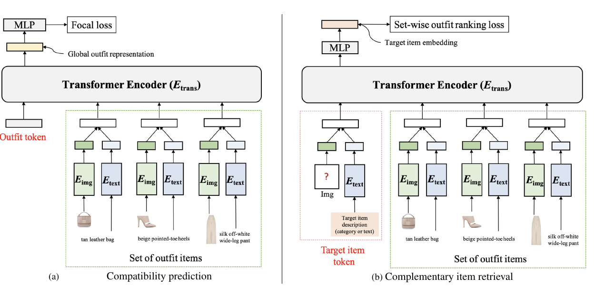

# Outfit completion: feed the partial outfit plus a "target token" carrying the target description through a Transformer, get one query vector and KNN-search for complementary items; pre-train on whole-outfit compatibility first, with negatives going from easy to hard

> [中文版](amazon-outfittransformer.md)

### Paper: OutfitTransformer: Learning Outfit Representations for Fashion Recommendation (WACV 2023)
### Link: https://arxiv.org/abs/2204.04812
### Institution: Amazon, Purdue University
### Ideas: outfit-level representation, task-specific tokens, target item token, query embedding for KNN retrieval, compatibility pre-training, set-wise ranking loss, hard negatives, curriculum negative sampling
### Area: i2i (complementary recommendation, outfit matching)

## Breakdown:
A user has already picked a few items (e.g., a bag, heels and wide-leg pants) and wants one more item of a given category (e.g., a top) or matching a given description (e.g., "long-sleeve shirt with a floral print"). The paper feeds the partial outfit together with a "target token" (image slot left empty, text slot filled with the target description) into a Transformer, takes the output at the target token's position as a query vector, and runs KNN search over the catalog. The Transformer is first pre-trained on compatibility prediction ("does this whole outfit go together"), then fine-tuned into a retrieval model with a ranking loss, with negatives drawn first from the same coarse category and then from the same fine-grained category.

Most existing compatibility models compare items pair by pair and then aggregate the scores, without treating the outfit as a whole. Those that do model the whole outfit (sequence-based Bi-LSTM, graph networks, etc.) only do classification (scoring a whole outfit, four-choice fill-in-the-blank) and can't retrieve from a large catalog. CSA-Net does support large-scale retrieval, but it retrieves separately for each item in the partial outfit and then fuses the rankings, and it stores one vector per item for every target category.

### Method
Two steps: pre-train on whole-outfit compatibility prediction ((1)), then initialize from it and fine-tune into a complementary item retrieval model ((2)).

#### (1) Pre-training: whole-outfit compatibility prediction
Score a whole outfit to judge whether it goes together. The trained item encoders and Transformer initialize (2); the scoring part of this step is dropped in (2).
* **Item vector.** Each item's image goes through ResNet-18 (ImageNet-initialized, trained further) to get 64 dims; its text description goes through SentenceBERT (frozen) plus a trainable fully connected layer to get 64 dims; the two are concatenated into 128 dims. All items share this encoder, and the candidate items in (2) use it too.
* **Scoring the outfit.** A learnable vector (the outfit token, playing the role of BERT's [CLS]) placed at the front of the sequence goes through a 6-layer, 16-head Transformer together with the vectors of all items in the outfit, with no positional encoding. The output at the outfit token's position is the outfit representation, and an MLP on top gives a compatibility score between 0 and 1.

**Loss.** Binary focal loss (down-weights easy examples so training concentrates on hard-to-classify outfits); the image encoder, the text FC layer and the Transformer are trained end to end. Training data are the dataset's own "compatible / incompatible" outfit labels.

**Why no positional encoding.** An outfit has no order; shuffling its items should give the same representation, and a Transformer without positional encoding is naturally insensitive to input order.

#### (2) Fine-tuning: complementary item retrieval
The goal is to output, given a partial outfit and a target description, one query vector that can be used directly for nearest-neighbor search over the catalog.

**Network.**
* **Target token.** Same format as an item vector, "64 image dims + 64 text dims". The image half is a placeholder vector standing for "no image"; the text half is what the user wants, passed through the text encoder. It can be just a category name (e.g., "top"), in which case the model finds the best-matching top; or a sentence (e.g., "long-sleeve shirt with a floral pattern"), in which case it finds an item that both goes with the chosen items and fits the sentence.
* **Query vector.** The target token and the item vectors of the partial outfit go through the Transformer together; the output at the target token's position goes through a new MLP to give the query vector.
* **Candidate vector.** Candidates only go through the image and text encoders from (1) and are concatenated into 128-dim item vectors, without passing through the Transformer. So the partial-outfit items and the candidates share the same item encoder, but the query side additionally passes through the Transformer and MLP. The paper doesn't make clear whether the candidate-side encoder keeps being updated during fine-tuning.
* **Scoring.** The distance between the query vector and the candidate vector, a fixed distance function rather than a learned scoring network; the paper doesn't say whether it is Euclidean or cosine.

**Training samples.** A sample consists of a partial outfit, 1 positive and 10 negatives.
* **Positive and partial outfit.** For each outfit, one random item is removed as the positive and the rest is the partial outfit. The target token's text comes from the removed item, simulating a user saying what they want; the paper doesn't say whether training uses the category or the full description, and the quantitative evaluation fills in the category name.
* **Negatives.** The data contain only complete outfits with no labeled negatives, so negatives are sampled at random from catalog items in the positive's category, in two stages from easy to hard. Stage one samples from the same coarse category (if the positive is a shirt, negatives are other tops); stage two switches to the same fine-grained category (other shirts), where differences are subtler.

**Loss (set-to-item ranking loss).** Two hinge terms with margin m = 2 are added. The first term requires, for each negative, that "distance from query to positive + m" be smaller than "distance from query to that negative", averaged over the 10 negatives; the second term only looks at the negative among the 10 that is closest to the query (the hardest negative). It is called set-wise because the anchor is one vector for the whole partial outfit, whereas CSA-Net computes distances between the target item and each item of the partial outfit separately.

**Why pre-train first.** When trained directly for retrieval, the Transformer starts from scratch with no notion of what goes with what. The authors' explanation is that after pre-training the Transformer has already learned whole-outfit compatibility, and the image encoder has learned fashion-specific features, which also gives better vectors for the positives and negatives.

**Why same-category negatives, in stages.** At retrieval time the user has already specified the category, so the task is to tell which item within that category matches better; negatives from other categories could be separated by category alone. The authors report that using the hardest fine-grained negatives from the start performs poorly, and going from easy to hard trains more stably.

### Inference
* **Indexing.** Every catalog item goes through the image and text encoders to get one 128-dim vector, which is put into an off-the-shelf KNN tool (hnswlib, Faiss). Each item stores a single vector regardless of the number of categories (Type-aware and CSA-Net store one per target category).
* **Retrieval.** One forward pass over the partial outfit plus the target description gives one query vector, and the nearest items within the target category are returned. Only one query is needed no matter how many items the partial outfit has.

### Data and results
Polyvore Outfits, in two versions. The standard version has 53,306 training and 10,000 test outfits, and items can appear in both training and test; the disjoint version shares no items between training and test, with 16,995 training and 15,154 test outfits. The retrieval task reuses the data and test setup adapted by CSA-Net, with R@k as the metric (whether the removed item ranks in the top k). Compatibility AUC and fill-in-the-blank accuracy (pick the removed item among four candidates, done with the retrieval model) are also reported. Only offline experiments plus a crowdsourced human evaluation.
* **Compatibility prediction.** AUC 0.93 (standard) and 0.88 (disjoint), versus CSA-Net's 0.91 and 0.87; images alone already give 0.92. Replacing the image encoder with precomputed ImageNet features that aren't trained gives only 0.82.
* **Retrieval.** On the standard version, R@10 is 9.58 and fill-in-the-blank 67.10%, versus 8.27 and 63.73% for CSA-Net. On the disjoint version, R@10 is 6.53 versus 5.93, but R@30 and R@50 are below CSA-Net (12.12 vs 12.31, 16.64 vs 17.85).
* **Pre-training.** Without compatibility pre-training, fill-in-the-blank accuracy drops from 67.10% to 53.96% (disjoint: 59.48% to 49.15%).
* **Hardest-negative term.** Removing it drops fill-in-the-blank accuracy to 64.48% (disjoint: 55.34%).
* **Negative curriculum.** Using only coarse-category negatives, without the second stage, drops R@10 from 9.29 to 7.26 (this setting uses category text for both the target and the partial outfit) and fill-in-the-blank from 67.10% to 63.33%.
* **Human evaluation.** Only the 5,120 questions where the true item didn't make the top 3 were used; crowd annotators chose which of the true item and an item retrieved by the model matched better, 10 annotators per question. The retrieved item was chosen 52.5% of the time.

## Takeaways
* A target token whose text slot carries the requested category or description turns "partial outfit + what I want" into a single query vector, so complementary retrieval becomes one ordinary KNN lookup over a single-vector-per-item index.
* Pre-training the same Transformer on whole-outfit compatibility before fine-tuning for retrieval is the largest single gain reported (fill-in-the-blank 53.96% to 67.10%).
* For complementary retrieval, negatives should come from the target's own category and get harder over training, since cross-category negatives are separable by category alone.

## Caveats
* The distance function in the ranking loss, whether candidate-side encoders keep training during fine-tuning, whether the target token uses category or full text during training, and how the compatibility negatives are formed are not specified, and no official code has been released to settle them.
* Table 2 reports the image+text variant (R@10 6.53 / 9.58), while the negative-sampling ablation's R@k numbers match the category-only variant (6.03 / 9.29) yet share the same fill-in-the-blank numbers, so the ablation tables mix two configurations.
* On the disjoint split, R@30 and R@50 are below CSA-Net; the authors attribute this to fewer training outfits. The negative-sampling table labels its rows "high-level" vs "fine-grained", and reading the latter as the two-stage curriculum relies on the text; no number is given for training on fine-grained negatives from the start.
* The human study only covers questions where the true item was outside the top 3 and compares against the dataset's own answer rather than against another method; free-text retrieval is shown only with examples, without quantitative results.

## Credibility: offline

## Recommendation level: worth a look if you have time
