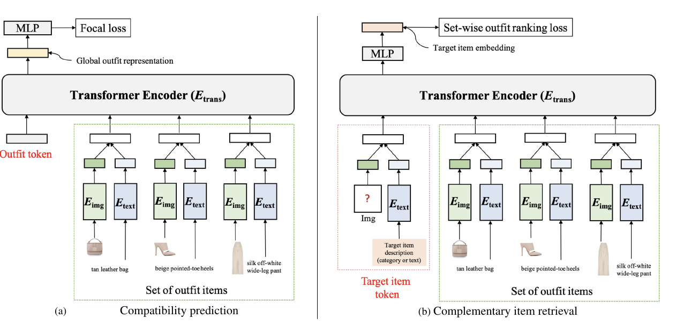

# 穿搭补全：半套单品加一个写着目标描述的「目标 token」一起过 Transformer，输出一个查询向量去 KNN 找互补单品；先预训练整套兼容性，负样本由易到难

关注我，每天为你精挑细选最优质、最新鲜的推荐算法paper，陪你一起保持进步、不断精进！

> [English version](amazon-outfittransformer.full.en.md)

### 论文：OutfitTransformer: Learning Outfit Representations for Fashion Recommendation
### 网址：https://arxiv.org/abs/2204.04812
### 公司：亚马逊、普渡大学
### 思想：
### 方向：i2i（互补推荐、穿搭搭配）

## 解读：
用户已经选了几件（比如包、高跟鞋、阔腿裤），想再配一件指定类目（比如上衣）或指定描述（比如「花朵图案的长袖衬衫」）的单品。本文把半套单品和一个「目标 token」（图像位置空着，文本位置填目标描述）一起输入 Transformer，取目标 token 位置的输出得到一个查询向量，在商品库里做 KNN 检索。

Transformer 先在「这一整套搭不搭」的兼容性预测上预训练，再用排序损失微调成检索模型，负样本先取同大类、再取同细类。

已有的兼容性模型大多两两比较单品再汇总分数，没把整套当整体看；能整体建模的（按序列的 Bi-LSTM、图网络等）只做分类（给整套打分、四选一填空），没法在大商品库里检索。CSA-Net 能做大规模检索，但要拿半套里的每一件分别去检索、再融合各自的排名，每件商品还要为每个目标类目各存一个向量。

### 方法
分两步，先在整套兼容性预测上预训练（（1）），再用它的参数初始化，微调成互补单品检索模型（（2））。

#### （1）预训练：整套兼容性预测
给一整套穿搭打分，判断它搭不搭。训好的单品编码器和 Transformer 用来初始化（2），这一步的打分部分在（2）里不再用。
* **单品向量。** 每件单品的图片过 ResNet-18（ImageNet 初始化，参与训练）得到 64 维，文字描述过 SentenceBERT（冻结）再接一个可训练的全连接层得到 64 维，拼成 128 维。所有单品共用这一套编码器，（2）里的候选商品也用它。
* **整套打分。** 序列最前面放一个可学习的向量（整套 token，作用类似 BERT 的 [CLS]），和整套单品的向量一起过 6 层、16 头的 Transformer，不加位置编码。整套 token 位置的输出就是整套的表示，过一个 MLP 得到 0 到 1 之间的兼容分。

**损失。** 二分类的 focal loss（降低容易样本的权重、让训练集中在难分的整套上），图像编码器、文本全连接层和 Transformer 端到端一起训。训练数据直接用数据集自带的「搭 / 不搭」整套标注。

**为什么不加位置编码。** 一套衣服没有先后顺序，单品换个顺序应当得到同样的表示，Transformer 不加位置编码正好与输入顺序无关。

#### （2）微调：互补单品检索
目标是给定半套和目标描述，输出一个查询向量，直接在商品库里做最近邻检索。

ResNet-18、SentenceBERT、再接一个可训练的全连接层、Transformer等在着里继续使用，即并对ResNet-18、再接一个可训练的全连接层、Transformer等，和新加的输出MLP都做微调。

**网络：**
* **目标 token。** 和单品向量格式相同，也是「图像 64 维 + 文本 64 维」。图像那一半是一个代表「没有图」的占位向量，文本那一半是想要的东西过文本编码器的结果。可以只填类目名（如「上衣」），模型就在上衣里找最搭的那件；也可以填一句描述（如「花朵图案的长袖衬衫」），找既和已选几件搭、又符合这句描述的单品。
* **查询向量。** 目标 token 和半套各件的单品向量一起过 Transformer，取目标 token 位置的输出，过一个新的 MLP，得到查询向量。
* **候选向量。** 候选商品只过（1）的图像、文本编码器，拼成 128 维单品向量，不过 Transformer。也就是说半套单品和候选共用同一个单品编码器，但查询侧多过了 Transformer 和 MLP。论文没说清微调时候选侧编码器是否继续更新。
* **打分。** 查询向量和候选向量之间的距离，是固定的距离函数，不是学出来的打分网络；论文没写用欧氏距离还是余弦。

**训练样本。** 一个样本由半套、1 个正样本和 10 个负样本组成。
* **正样本和半套。** 每套随机拿掉一件作为正样本，剩下的当半套。目标 token 的文字取自被拿掉的那件，模拟用户说出想要什么；论文没写训练时用的是类目还是完整描述，定量评测时填的是类目名。
* **负样本。** 数据里只有搭配好的整套，没有标注的负样本，所以从商品库里和正样本同类目的商品中随机采，分两阶段由易到难。第一阶段从同一大类抽（正样本是一件衬衫，负样本是其他上衣），第二阶段换成同一细类（其他衬衫），彼此差异更细微。

**损失（整套对单品的排序损失）。** 两项 hinge 损失相加，间隔 m 为 2。第一项对每个负样本要求「查询到正样本的距离 + m」小于「查询到该负样本的距离」，对 10 个负样本取平均；第二项只看 10 个里离查询最近的那个（最难负样本）。之所以叫 set-wise，是因为锚点是整个半套的一个向量，而 CSA-Net 要拿目标单品和半套里每一件分别算距离。

**为什么要先预训练。** 直接训检索时 Transformer 从零开始，不知道什么和什么搭。作者的解释是预训练后 Transformer 已学到整套的兼容关系，图像编码器也学到了服饰特征，提取正负样本向量时也更好。

**为什么负样本取同类目、还要分阶段。** 检索时用户已指定类目，要区分的是同类商品里哪件更搭；从别的类目抽负样本，模型靠类目就能分开。作者说一开始就用最难的细类负样本效果很差，先易后难训练更稳。

### 推理
* **建索引。** 商品库里每件商品过图像、文本编码器得到一个 128 维向量，放进现成的 KNN 工具（hnswlib、Faiss）。每件只存一个向量，和类目数无关（Type-aware、CSA-Net 要按每个目标类目各存一个）。
* **检索。** 半套加目标描述前向一次，得到一个查询向量，在目标类目的商品里找最近的。半套有几件都只查一次。

### 数据与效果
Polyvore Outfits 穿搭数据集，分两个版本。普通版 53306 套训练、10000 套测试，单品可以跨训练和测试集出现；disjoint 版训练和测试不共享单品，16995 套训练、15154 套测试。检索任务沿用 CSA-Net 改造的数据和测试设置，指标是 R@k（被拿掉的那件是否排进前 k）；另报兼容性预测 AUC 和填空准确率（四个候选里选出被拿掉的那件，用检索模型做）。只有离线实验和众包人工评测。
* **兼容性预测。** AUC 0.93（普通版）、0.88（disjoint 版），CSA-Net 0.91、0.87；只用图像也有 0.92。把图像编码器换成预先抽好的 ImageNet 特征、不参与训练，只有 0.82。
* **检索。** 普通版上 R@10 9.58、填空 67.10%，CSA-Net 为 8.27、63.73%。disjoint 版 R@10 6.53 对 5.93，但 R@30、R@50 低于 CSA-Net（12.12 对 12.31，16.64 对 17.85）。
* **预训练。** 不做兼容性预训练，填空准确率从 67.10% 掉到 53.96%（disjoint 版 59.48% 掉到 49.15%）。
* **最难负样本一项。** 去掉后填空准确率降到 64.48%（disjoint 版 55.34%）。
* **负样本课程。** 只用同大类负样本、不进入第二阶段，R@10 从 9.29 降到 7.26（这组目标和半套都用类目文字），填空从 67.10% 降到 63.33%。
* **人工评测。** 只挑真实答案没进前 3 的 5120 道题，让众包标注者在真实答案和模型检索出的一件之间选更搭的，每题 10 人。52.5% 的情况下选了模型检索的那件。

## 心得：

## 愚见

## 可信度：离线

## 推荐等级：有时间看看

**请帮忙点赞、转发，谢谢。欢迎干货投稿 \ 论文宣传\ 合作交流**

### 【铁粉】请入微信群，群内我会给出更深入的解读，还可以共同讨论技术方案、发招聘广告、内推和交友等。
* 铁粉标准：关注公众号一个月以上，且在公众号上累计15次互动（评论、爱心、转发）、或投稿1次，只欢迎技术同学。
* 入群方法：请您加个人微信lmxhappy，我拉您入群，请备注【公司】（只我个人看，不公开）。

## 推荐您继续阅读：
