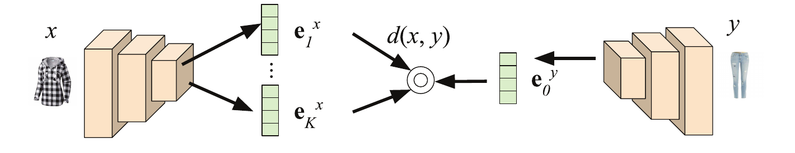

# Complementary recommendation: each item computes K match vectors (where its matches should be), and a candidate counts as compatible if it is close to any one of them; the query uses match vectors and the candidate uses its embedding, so the distance is naturally asymmetric

> [中文版](appier-cfl.md)

### Paper: Compatibility Family Learning for Item Recommendation and Generation (AAAI 2018)
### Link: https://arxiv.org/abs/1712.01262
### Institution: Appier, National Taiwan University, National Tsing Hua University
### Ideas: multiple match vectors (prototypes) per item, projected compatibility distance, soft-min distance, asymmetric compatibility, shared Siamese encoder, metric-regularized conditional GAN, fashion compatibility
### Area: i2i (complementary recommendation, outfit matching)

## Breakdown:
Given an item (e.g., a plaid top), recommend other items that go with it (shoes, bottoms), and draw roughly what such matching items look like. The paper uses one network to map every item to an embedding and, at the same time, to project K match vectors (the paper calls them prototypes; they mark the places where this item's matching items "should land"). The distance between a query item and a candidate depends on whichever of the query's K match vectors is closest to the candidate's embedding, and the model is trained with binary cross-entropy on positive and negative item pairs. Separately, a conditional GAN (MrCGAN) generates images of matching items conditioned on a match vector, purely for visualization.

Existing metric-learning methods pull two compatible items close together in one shared space, which has two problems. First, compatibility is much broader than similarity: one top can go with high heels or with sneakers, and pulling all of them to one spot squeezes them together. Second, compatibility has a direction: recommending car accessories to someone who bought a car makes sense, the reverse does not, yet a distance between single embeddings is symmetric. In addition, labeled compatible pairs are scarce, so learning to generate a matching image directly from the query image is hard.

### Method
Two steps. First train the compatibility space ((1)); recommendation uses only this step. To generate images, MrCGAN is then trained on top of the frozen compatibility space ((2)).

#### (1) Compatibility space: one embedding plus K match vectors
* **Feature extraction.** An item image first goes through a frozen pre-trained image network. Amazon also-bought/viewed uses the 4096-dim image features shipped with the dataset; Amazon co-purchase uses a GoogLeNet Siamese network pre-trained by earlier work (Veit et al., ICCV 2015) with fixed weights, replacing only its last embedding layer with the projection below; Polyvore uses an ImageNet-pre-trained Inception-V3 (in the code, 2048-dim vectors extracted offline). Only on the Fashion-MNIST toy set is it a multi-layer CNN trained from scratch, end to end.
* **Projection.** The features then go through one trainable linear projection (in the code, with no hidden layer and no activation) that outputs K+1 N-dimensional vectors at once. Vector 0 is the item's own embedding and the other K are match vectors (where items that go with it should land). On the real datasets only this layer is trained. The query side and the candidate side share this network (the paper calls it a Siamese CNN; both sides have identical parameters). Every item has both kinds of vectors; it uses its match vectors when it is the query and its embedding when it is the candidate.
* **Projected Compatibility Distance (PCD).** Take a top x and a pair of jeans y. First compute the squared Euclidean distance d_k from each of x's match vectors to y's embedding; apply a softmax to −d_k to get K weights, average the K match vectors with these weights into a single point, then compute the squared distance from that point to y's embedding; that is d(x, y). When one match vector is clearly closest, it takes almost all the weight and d(x, y) is roughly the smallest d_k, so it is a soft minimum. Note that the soft minimum acts on the match vector positions (average the match vectors first, then take one distance), not directly on the K distances.
* **Scoring.** The compatibility probability is sigmoid(c − d), where c is a single learnable scalar threshold; a distance below c means compatible. Scoring is this fixed distance function; there is no scoring network.

**Loss.** Binary cross-entropy over positive and negative pairs. An additional term directly shrinks the distance of positive pairs (weight λm); it is set to 0 for the recommendation experiments and 0.5 for the generation experiments (the authors found it hurts recommendation but helps generation). Negatives differ by dataset (Polyvore randomly samples 4 items from the target categories for each positive pair; the two Amazon datasets reuse the positive/negative pairs of earlier work, with co-purchase reweighted to a 1:16 positive-to-negative ratio).

**Why it is asymmetric.** d(x, y) compares x's match vectors with y's embedding, while d(y, x) compares y's match vectors with x's embedding. The two directions compare different vectors, so the results naturally differ. A single encoder can express direction, with no need for separate networks for query and candidate.

**Why K match vectors.** The match vectors of one top can land one near high heels and one near sneakers; a candidate counts as compatible if it is close to any one of them, while an incompatible item must be far from all of them. This way, matching items of different styles don't have to be squeezed into one spot.

#### (2) MrCGAN: drawing the match vectors as images
The goal is to generate an image of a matching item from a match vector, to see what the model's learned "ideal match" looks like; it plays no part in recommendation scoring.
* **Condition.** The generator takes 20-dim noise and a vector from the compatibility space. Conditioning on the query's k-th match vector generates a matching item, and changing k changes the style; conditioning on an item's embedding generates items in a similar style to it.
* **Discriminator.** Two outputs: one judges real vs fake, the other predicts the image's embedding in the compatibility space (trained to approximate the output of the encoder from (1) on real images).
* **Metric constraints.** The predicted embedding of a generated image must be close to the conditioning vector, with a small slack so the generator doesn't collapse into a one-to-one decoder and lose diversity; for images generated from a match vector, the predicted embedding must stay far (beyond another margin) from the query's incompatible items. The adversarial part is DRAGAN (a gradient penalty around real samples).
* **Training procedure.** In the code, (1) is trained first and then frozen, and only the generator and discriminator are updated. In the co-purchase and Polyvore generation experiments, the query and candidate categories don't overlap, and the code gives each side its own separate encoder; the paper doesn't mention this.

**Why not generate the matching image directly from the query image.** Labeled compatible pairs are too scarce for a generator to learn both "what goes with what" and "how to draw realistically" at once. With match vectors in hand, the generator only has to render a vector, and it can be trained on large numbers of item images without compatibility labels.

### Inference
* **In evaluation.** PCD is computed only for given item pairs, followed by AUC or error rate; there is no retrieval over the full catalog.
* **Retrieval (discussed in the paper, not evaluated).** Since PCD is roughly the smallest of the K distances, the K match vectors can each run a nearest-neighbor search over the candidate embedding index in parallel, and the results are merged. The candidate index stores only one N-dim embedding per item, and match vectors are computed at query time, so storage is 1/K of Monomer's (ICDM 2016, which stores a copy of each item in each of K spaces).

### Data and results
Four datasets. Fashion-MNIST+1+2 has a synthetic asymmetric relation (class c is compatible with classes c+1 and c+2, not the other way round); Amazon also-bought/also-viewed (men, women, boys, girls, baby) follows Monomer's split; Amazon co-purchase follows Veit et al.'s split (about 1.82M training pairs), keeping one random direction per pair; Polyvore is a crawled women's outfit collection, where item pairs that co-occur in the top 20% of outfits by likes are positives, split into three directions (tops, bottoms, shoes to other categories), with items not overlapping across train, validation and test. Metrics are AUC or error rate of pairwise classification. Offline experiments only.
* **Asymmetric toy set.** With K=5 the error rate is 20.01%, versus 41.45% for an L2 distance between single embeddings of the same total size, and 21.60% for the best Monomer (K=4).
* **Real data.** On Amazon also-bought/viewed the average error rate is 6.26% versus Monomer's 6.79%; on co-purchase AUC is 0.8762 versus Monomer's 0.8747; on Polyvore the average AUC is 0.7443 versus Monomer's 0.7405 and L2 distance's 0.7201. The authors also note that the closer the data is to symmetric (co-purchase, Polyvore), the smaller the lead.
* **Generation.** In the user study, MrCGAN's images received roughly twice as many "most compatible" votes as DiscoGAN and pix2pix; on Polyvore the gap against random real images is small.

The code is open source.

## Takeaways
* Letting the query side output K match vectors while the candidate side outputs one embedding gives an asymmetric, multi-modal compatibility distance from a single shared encoder.
* The distance stays a fixed function of vectors (no scoring network), so candidates can still be served from a standard nearest-neighbor index, one search per match vector.
* Generating images from learned match vectors, rather than from the query image, separates "what matches" from "how to draw it".

## Caveats
* The "end-to-end" claim holds only for the toy dataset; on all three real datasets the backbone is frozen and only the final projection layer is trained, so the gains reflect the distance function on fixed image features.
* Margins over Monomer on real data are small (AUC 0.8762 vs 0.8747 on co-purchase, 0.7443 vs 0.7405 on Polyvore), and standard deviations are reported only for the toy dataset.
* Evaluation is pairwise classification (AUC, error rate) on sampled pairs; no ranking metrics are reported, and the proposed retrieval by K parallel nearest-neighbor searches is not evaluated.
* The released code differs from the paper in a few places: the generation experiments use separate encoders for the query and candidate sides, and the Polyvore recommendation script trains for 10 epochs rather than the 50 stated in the paper.

## Credibility: offline

## Recommendation level: worth a look if you have time
