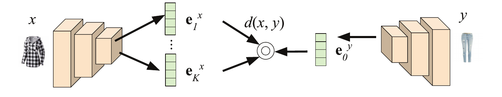

# 互补推荐：每件商品算出 K 个搭配向量（搭配款该在的位置），候选只要靠近其中一个就算搭；查询用搭配向量、候选用嵌入，距离天然不对称

关注我，每天为你精挑细选最优质、最新鲜的推荐算法paper，陪你一起保持进步、不断精进！

> [English version](appier-cfl.full.en.md)

### 论文：Compatibility Family Learning for Item Recommendation and Generation
### 网址：https://arxiv.org/abs/1712.01262
### 公司：Appier、台湾大学、台湾清华大学
### 思想：
### 方向：i2i（互补推荐、穿搭搭配）

## 解读：
给一件商品推荐能和它搭配的其他商品（鞋、下装），并画出搭配款大概长什么样。本文用同一个网络把每件商品映射成一个嵌入，同时投影出 K 个搭配向量（论文叫原型，prototype；表示这件商品的搭配款「应该落在」的位置）；查询商品和候选的距离看查询的 K 个搭配向量里离候选嵌入最近的那个，用正负样本对的二分类交叉熵训练。另外，训练一个条件 GAN（MrCGAN），以搭配向量为条件生成搭配款图片，只做可视化。

已有的度量学习把搭配的两件商品在同一空间里拉近，有两个问题。一是搭配比相似宽得多，一件上衣能配高跟鞋也能配运动鞋，全拉到一处会挤成一团；二是搭配有方向，买了车推车载配件合理，反过来不合理，而单一嵌入的距离是对称的。另外有标注的搭配对很少，直接从查询图生成搭配图很难学。

### 方法
分两步。先训练搭配空间（（1）），推荐只用这一步；要生成图片时，再在冻结的搭配空间上训练 MrCGAN（（2））。

#### （1）搭配空间：一个嵌入加 K 个搭配向量
* **抽特征。** 商品图片先过一个冻结的预训练图像网络。Amazon also-bought/viewed 直接用数据集给的 4096 维图像特征；Amazon 共购用前人（Veit 等，ICCV 2015）预训练好的 GoogLeNet 孪生网络，固定权重，只把最后的嵌入层换成下面的投影层；Polyvore 用 ImageNet 预训练的 Inception-V3（按代码是离线抽好的 2048 维向量）。只有 Fashion-MNIST 玩具集上是从头端到端训练的多层 CNN。
* **投影。** 特征再过一层可训练的线性投影（按代码，没有隐层，也没有激活），一次输出 K+1 个 N 维向量。第 0 个是商品自身的嵌入，其余 K 个是搭配向量（和它搭的商品应该落在哪）。真实数据集上只训这一层。查询侧和候选侧共用这套网络（论文叫孪生 CNN，两边参数完全相同）。每件商品两种向量都有，作查询时用搭配向量，作候选时用嵌入。
* **投影距离（PCD）。** 以上衣 x、牛仔裤 y 为例。先算 x 的每个搭配向量到 y 的嵌入的平方欧氏距离 d_k；对 −d_k 做 softmax 得到 K 个权重，把 K 个搭配向量加权平均成一个点，再算这个点到 y 的嵌入的平方距离，就是 d(x, y)。某个搭配向量明显最近时，权重几乎全给它，d(x, y) 约等于最小的 d_k，所以是一种软最小。注意软最小作用在搭配向量位置上（先加权平均搭配向量，再求一次距离），不是直接对 K 个距离取软最小。
* **打分。** 搭配概率是 sigmoid(c − d)，c 是一个可学的标量阈值，距离小于 c 判为搭配。打分就是这个固定的距离函数，没有打分网络。

**损失。** 对正样本对和负样本对算二分类交叉熵。另有一项直接把正样本对的距离压小（权重 λm），推荐实验设为 0，生成实验设为 0.5（作者发现它伤推荐、利于生成）。负样本各数据集不同（Polyvore 每个正对从目标品类随机抽 4 件当负例；两个 Amazon 数据集沿用前人的正负对，共购按正负 1:16 重新加权）。

**为什么不对称。** d(x, y) 用的是 x 的搭配向量和 y 的嵌入，d(y, x) 用的是 y 的搭配向量和 x 的嵌入，两个方向比的是不同的向量，结果自然不相等。一个编码器就能表达方向，不需要给查询和候选各配一个网络。

**为什么要 K 个搭配向量。** 同一件上衣的搭配向量可以一个落在高跟鞋附近、一个落在运动鞋附近，候选只要靠近任意一个就算搭；不搭的商品则要求所有搭配向量都离它远。这样多种风格的搭配款不必挤在同一处。

#### （2）MrCGAN：把搭配向量画成图
目标是给一个搭配向量生成一张搭配款的图片，看看模型学到的「理想搭配」长什么样，不参与推荐打分。
* **条件。** 生成器输入 20 维噪声和一个搭配空间里的向量。用查询的第 k 个搭配向量作条件，生成搭配款，换 k 就换一种风格；用某件商品的嵌入作条件，生成和它风格相似的商品。
* **判别器。** 两个输出，一个判断真假，一个预测图片在搭配空间里的嵌入（训练它逼近（1）的编码器在真图上的输出）。
* **度量约束。** 生成图的预测嵌入要靠近条件向量，但留一个小余量，避免生成器退化成一对一的解码器、失去多样性；用搭配向量生成的图，预测嵌入要离该查询的不搭商品足够远（大于另一个余量）。对抗部分是 DRAGAN（在真实样本附近加梯度惩罚）。
* **训练方式。** 按代码，先训练（1），再冻结它，只更新生成器和判别器。共购和 Polyvore 的生成实验里，查询品类和候选品类不重叠，代码给两侧各用了一个独立的编码器，论文没写这一点。

**为什么不直接从查询图生成搭配图。** 有标注的搭配对太少，生成器很难同时学会「什么和什么搭」和「怎么画得逼真」。先有搭配向量，生成器只负责把向量画出来，还能用大量没有搭配标注的商品图训练。

### 推理
* **评测时。** 只对给定的商品对算 PCD，再算 AUC 或错误率，没有做全库检索。
* **检索（论文讨论，无实验）。** 因为 PCD 约等于 K 个距离里最小的那个，可以拿 K 个搭配向量分别在候选嵌入库里并行做最近邻搜索，再合并结果。候选库每件商品只存一个 N 维嵌入，搭配向量在查询时现算，存储是 Monomer（ICDM 2016，每件商品在 K 个空间各存一份）的 1/K。

### 数据与效果
四个数据集。Fashion-MNIST+1+2 是人造的不对称关系（第 c 类和第 c+1、c+2 类搭配，反过来不搭）；Amazon also-bought/also-viewed（男、女、男童、女童、婴儿五个品类）沿用 Monomer 的划分；Amazon 共购沿用 Veit 等的划分（约 182 万训练对），只保留随机一个方向；Polyvore 是爬下来的女装穿搭，点赞数前 20% 的穿搭里同时出现的单品对为正，分上衣、下装、鞋到其他品类三个方向，商品在训练、验证、测试间不重叠。指标是商品对二分类的 AUC 或错误率。只有离线实验。
* **不对称玩具集。** K=5 时错误率 20.01%，同等总维度的单嵌入 L2 距离是 41.45%，Monomer 最好是 21.60%（K=4）。
* **真实数据。** Amazon also-bought/viewed 平均错误率 6.26%，Monomer 6.79%；共购 AUC 0.8762，Monomer 0.8747；Polyvore 平均 AUC 0.7443，Monomer 0.7405、L2 距离 0.7201。作者也指出，数据越接近对称（共购、Polyvore），领先越小。
* **生成。** 用户调研里，MrCGAN 的图被选为「最搭」的票数大约是 DiscoGAN、pix2pix 的两倍；Polyvore 上和随机真实图片相比差距很小。

代码开源。

## 心得：

## 愚见

## 可信度：离线

## 推荐等级：有时间看看

**请帮忙点赞、转发，谢谢。欢迎干货投稿 \ 论文宣传\ 合作交流**

### 【铁粉】请入微信群，群内我会给出更深入的解读，还可以共同讨论技术方案、发招聘广告、内推和交友等。
* 铁粉标准：关注公众号一个月以上，且在公众号上累计15次互动（评论、爱心、转发）、或投稿1次，只欢迎技术同学。
* 入群方法：请您加个人微信lmxhappy，我拉您入群，请备注【公司】（只我个人看，不公开）。

## 推荐您继续阅读：
