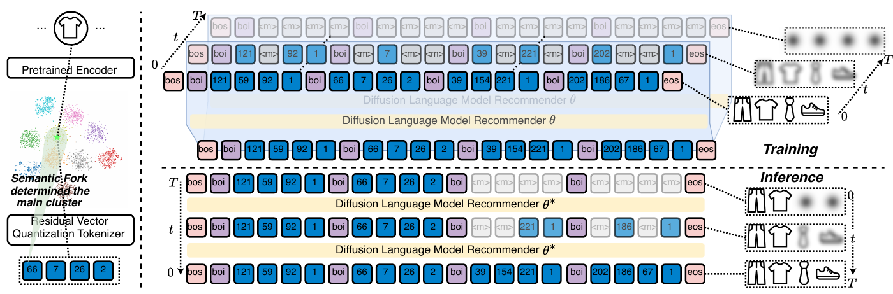

# Bundle completion: treat the missing items as semantic-ID blanks and fill them in round by round; decide the category first for diversity, and distill to fill several per round for speed

> [中文版](asu-dpe-rec.md)

### Paper: DPE-Rec: Diversity-Preserving and Efficient Diffusion Language Model Recommendation for Bundle Construction (arXiv 2026)
### Link: https://arxiv.org/abs/2610.34700
### Institution: Arizona State University, Stevens Institute of Technology
### Ideas: diffusion language model, semantic IDs, semantic-fork-aware GRPO, pseudo-trajectory distillation, parallel decoding, bundle construction
### Area: i2i (bundle completion, generative recommendation)

## Breakdown:
Given half of a bundle already chosen (e.g., two items of an outfit, the first 15 tracks of a playlist), complete the remaining items. Each item is represented by a 4-token semantic ID; a diffusion language model first masks all missing positions, then fills in tokens round by round, and finally maps the generated semantic IDs back to real items. Building on the existing approach DDBC, the paper tackles two problems. Filling tokens by confidence always settles details first and the coarse category last, so the completed items are too similar to each other; the authors use reinforcement learning to make the model decide the category first. Filling several tokens at once easily produces semantic IDs that don't exist; the authors use distillation so the model can reliably fill several per step, making inference an order of magnitude faster.

### Method
The three training steps form one line, each continuing from the previous step's model:
* **(1) Base model.** Turn items into semantic IDs and train a diffusion model that learns to "see half a bundle and complete the rest", following DDBC. It is the starting point for the next two steps and isn't deployed itself.
* **(2) Reinforcement learning.** Fine-tune from (1)'s model so it decides the category before the details, making the completed items more diverse.
* **(3) Distillation.** With (2)'s model as teacher, distill a student that fills several tokens per step, for faster inference.

What gets deployed is the model from (2) or (3). DPE-Rec is the name of the whole method (diversity preservation corresponds to (2), efficiency to (3)); the result tables also have two rows, "DPE-Rec" and "DPE-Rec-Fast", which by the ablation and latency results appear to be (2)'s model and (3)'s student respectively, though the paper doesn't say so.

#### (1) Base model (following DDBC)
* **Semantic IDs.** Each item starts from an existing 64-dimensional item vector from CLHE (a WSDM 2024 bundle construction paper that fuses an item's image and text features with collaborative vectors learned from user interactions via self-attention, plus contrastive learning); 3 levels of residual quantization give 3 tokens, the 1st deciding the coarse category and later ones refining it; a 4th token separates items whose first 3 tokens are identical, so each semantic ID maps to exactly one item.
* **Sequence.** A bundle is laid out as "start, item 1's 4 tokens, item 2's 4 tokens, ..., end". The chosen half is given as is, and the half to complete is fully masked.
* **Training.** A random portion of tokens is masked, and the model recovers them from the unmasked ones, trained with cross-entropy. The model is a bidirectional-attention Transformer trained from scratch.
* **Inference.** Each round predicts all masked positions and fills in the one or few with the highest confidence, until everything is filled.

#### (2) Reinforcement learning: decide the category first
The goal is for the completed items to fall into different categories, making them more diverse.
* **Approach.** Starting from (1)'s model, during training it generates left to right (each item's category first, then details), so the category is chosen while its uncertainty is still there. The sampling temperature is 0.6 for category tokens and 0.2 for detail tokens, concentrating exploration on the category.
* **Reward.** 16 bundles are generated per group and trained with GRPO. The reward is a weighted sum of two terms: the fraction of generated items matching true items on the first 2 tokens, and the fraction matching on the full semantic ID. Both are computed as sets, so generating the same item twice earns nothing extra.
* **How it's used after training.** Left-to-right order is used only in training; the model structure is unchanged. At inference it goes back to filling by confidence: each round fills only the single most confident token, in any order, until done. DPE-Rec in the result tables infers this way, and the teacher in (3) builds its trajectories this way too.

**Why decide the category first.** When filling by confidence, detail tokens are usually more certain and get filled first; the category token is filled last, by which point the details have boxed it in, so it can only pick categories compatible with them. As a result, the completed items fall into the same few categories and look alike.

#### (3) Distillation: fill several per step
The goal is to train a model that reliably fills several tokens per round, reducing the number of rounds and speeding up inference.
* **What the student is.** Exactly the same architecture as the teacher ((2)'s model), a bidirectional Transformer of the same size, initialized directly from the teacher's parameters. The speedup comes not from a smaller model but from reliably filling several tokens per round, so fewer rounds are needed.
* **Training samples.** (2)'s model serves as the teacher, and completing the second half leaves a filling trajectory (which position it filled each round). Cut this trajectory at some point: keep the tokens the teacher filled in its first several steps and mask the rest as the student's input, with the teacher's final answer as the target. A complementary sample is also made: mask the first several steps and keep the later ones. The cut point is random; early in training cuts fall late (mostly filled, little left), and later they move earlier (more left, harder).
* **Loss.** Cross-entropy on the masked positions, summing the two kinds of samples. The student thus learns to guess several later steps at once from the intermediate states the teacher actually passes through.
* **Inference.** Each round the student fills every position whose confidence exceeds a threshold, while guaranteeing completion within a given number of rounds.

**Why not just let (2)'s model fill several per round.** Filling several tokens in one round assumes they are independent, so tokens that each look plausible may combine into a semantic ID that isn't in the catalog. Avoiding errors means filling one per round, which is slow. The student learns only on the trajectories the teacher actually follows, picking up exactly the dependencies among these tokens, so filling several per round rarely goes wrong.

#### Inference
After the semantic IDs are generated, an identical one in the catalog maps directly; otherwise it is reconstructed into a vector from the codebooks and matched to the candidate with the highest cosine similarity, with already chosen items excluded (following DDBC).

### Data and results
Spotify playlist continuation (254K tracks; playlists of 30, 60 and 90 tracks, the first half given and the second half to complete), POG outfits (31K items, 4 per outfit) and IQON3000 outfits (716K items, 8 per outfit). At evaluation each bundle's candidate set contains all true items plus randomly sampled others, 100 times the number of items to complete; the metrics are F1, Jaccard, and mean cosine similarity under optimal one-to-one matching. Offline only.
* **Quality.** On Spotify with 30 tracks, F1 is 0.372 vs. 0.277 for DDBC and 0.371 for the strongest baseline, DiffGRM; with 90 tracks, 0.379 vs. 0.368 for the strongest baseline; on POG, 0.198, below HSTU's 0.202; on IQON3000, 0.131 vs. 0.128 for the strongest baseline. The paper reports a 63% average gain over all 9 baselines, and 26.9% when only 5 stronger baselines are counted.
* **Speed.** The distilled version takes 62 to 67 ms per bundle (Spotify), vs. 2.9 to 8.3 s for DDBC and 0.37 to 1.27 s for DiffGRM, with about a 2.5% quality drop; discriminative models such as BERT4Rec take about 2 ms.
* **Ablation.** Adding reinforcement learning raises F1 by 28.9% on average with unchanged inference time; adding distillation then cuts inference time by 89.5%. The extra training cost is 0.2 to 11.3 GPU-hours.

## Takeaways
* Semantic IDs are hierarchical, with the first token deciding the coarse category; generation should decide the category before the details, or diversity gets locked in too early.
* For a diffusion model to fill several tokens per step, the student can be trained only on the trajectories the teacher actually follows, rather than spreading effort over every random masking pattern.

## Caveats
* "63% average gain" averages over all baselines, including weaker ones such as GRU4Rec and SASRec; against the strongest baseline in each setting, Spotify with 30 tracks is nearly a tie (0.372 vs. 0.371), and POG is slightly lower.
* Evaluation maps generated semantic IDs to the nearest item in a candidate set that always contains all true answers plus random others, which favors generative methods; full-catalog retrieval results aren't reported.
* "25.6× faster" is only against the three generative baselines; discriminative models such as BERT4Rec are 30 to 40 times faster than even the fast variant, and on POG the discriminative HSTU has a higher F1.

## Credibility: offline

## Recommendation level: worth a look if you have time
