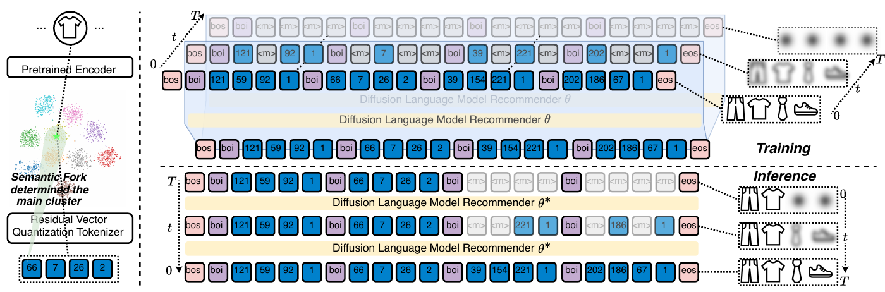

# 套装补全：把缺的商品当成语义 ID 填空，一轮轮填出来；先定大类保多样性，蒸馏后一轮填多个提速

关注我，每天为你精挑细选最优质、最新鲜的推荐算法paper，陪你一起保持进步、不断精进！

> [English version](asu-dpe-rec.full.en.md)

### 论文：DPE-Rec: Diversity-Preserving and Efficient Diffusion Language Model Recommendation for Bundle Construction
### 网址：https://arxiv.org/abs/2610.34700
### 公司：亚利桑那州立大学、史蒂文斯理工学院
### 思想：
### 方向：i2i（套装补全、生成式推荐）

## 解读：
给定半套已选好的商品（比如一套穿搭里的两件、一个歌单里的前 15 首），补出剩下的几件。每件商品用 4 个 token 的语义 ID 表示，扩散语言模型把缺的位置先全部遮住，再一轮轮把 token 填出来，最后把生成的语义 ID 映射回真实商品。

本文在已有做法 DDBC 上解决两个问题：按置信度填 token 时总是先填细节、最后才定大类，补出来的商品彼此太像，作者用强化学习让模型先定大类；一次填多个 token 又容易拼出不存在的语义 ID，作者用蒸馏让模型一步可靠地填多个，推理快了一个数量级。

### 方法
三步训练是一条线，后一步都从前一步的模型接着训：
* **（1）基础模型。** 把商品变成语义 ID，训练一个扩散模型学会「看到半套，补出剩下的」，这一步沿用 DDBC。它是后面两步的起点，本身不上线。
* **（2）强化学习。** 从（1）的模型开始微调，让它先定大类再定细节，补出的商品更多样。
* **（3）蒸馏。** 以（2）的模型为老师，蒸馏出一个一步能填多个 token 的学生，推理更快。

上线用的是（2）或（3）的模型。DPE-Rec 是整套方法的名字（保多样性对应（2），提效率对应（3））；实验表里另有「DPE-Rec」和「DPE-Rec-Fast」两行，按消融和延迟推断，前者是（2）的模型，后者是（3）的学生，论文没明说。

#### （1）基础模型（沿用 DDBC）
* **语义 ID。** 每件商品先用现成的 64 维商品向量表示，来自 CLHE（WSDM 2024 的一篇套装构建论文，把商品的图文特征和用户交互学出的协同向量用自注意力融合，并加了对比学习）；做 3 层残差量化得到 3 个 token，第 1 个 token 决定大类，后面逐层细化；第 4 个 token 用来区分前 3 个都相同的商品，保证一个语义 ID 只对应一件商品。
* **序列。** 一套商品排成「开始、商品 1 的 4 个 token、商品 2 的 4 个 token……、结束」。已选的那半套照常给出，要补的那半套全部遮住。
* **训练。** 随机遮住一部分 token，让模型从未遮住的 token 还原被遮住的，用交叉熵训练。模型是双向注意力的 Transformer，从头训练。
* **推理。** 每轮预测所有被遮住的位置，把置信度最高的一个或几个填上，直到全部填完。

#### （2）强化学习：先定大类
目标是让模型补出的几件商品分属不同大类，更多样。
* **做法。** 从（1）的模型开始，训练时让它按从左到右的顺序生成（每件商品先出大类、再出细节），这样大类在不确定性还在的时候就做出选择。大类 token 的采样温度设为 0.6，细节 token 设为 0.2，把探索集中在大类上。
* **奖励。** 每组生成 16 套，用 GRPO 训练。奖励是两项的加权和：生成商品和真实商品在前 2 个 token 上重合的比例，以及完整语义 ID 重合的比例。按集合算，重复生成同一件不加分。
* **训练完怎么用。** 从左到右只在训练时用，模型结构不变。推理时它回到按置信度填：每轮只填最有把握的一个 token，顺序任意，直到填完。实验表里的 DPE-Rec 就是这样推理的，（3）里的老师也是这样造轨迹的。

**为什么要先定大类。** 按置信度填 token 时，细节 token 通常更有把握，会先被填上；大类 token 最后才填，这时它已被细节 token 限死，只能选和它们兼容的类。结果是补出来的几件商品落在同几个大类里，彼此很像。

#### （3）蒸馏：一步填多个
目标是训练一个每轮能可靠地多填几个 token 的模型，减少填写轮数，加快推理。
* **学生是什么。** 和老师（（2）的模型）结构完全一样，也是同样大小的双向 Transformer，直接从老师的参数初始化。快不是因为模型变小，而是因为每轮能可靠地多填几个 token，轮数少了。
* **造训练样本。** （2）的模型当老师，补完后半套时会留下一条填写轨迹（每轮填了哪个位置）。在这条轨迹上截一刀：保留老师前若干步填的 token，其余位置遮住，作为学生的输入，目标是老师最终填出的答案。另造一个互补的样本：遮住前若干步、保留后面的。截在哪里随机取，训练早期截得靠后（已填得多、剩得少），后期逐步往前截（剩得多、更难）。
* **损失。** 对被遮住的位置算交叉熵，两种样本的损失相加。学生由此学会：在老师实际会走到的那些中间状态下，一次猜出后面好几步。
* **推理。** 学生每轮把置信度超过阈值的位置都填上，并保证在给定的轮数内填完。

**为什么不直接让（2）的模型一轮填多个。** 一轮同时填多个 token，相当于假设它们互相独立，单看都合理的 token 可能拼成目录里不存在的语义 ID。不想出错，就只能一轮填一个，很慢。学生只在老师实际走过的轨迹上学，学到的正是这些 token 之间的依赖，所以一轮多填几个也不容易出错。

#### 推理
补出语义 ID 后，如果目录里有完全相同的就直接对应；没有就用码本把它还原成向量，在候选集合里找余弦最相近的商品，已选过的不再重复选（沿用 DDBC）。

### 数据与效果
Spotify 歌单续写（25 万首歌，每个歌单取 30、60、90 首，前一半给出、后一半要补）、POG 穿搭（3.1 万件商品，4 件一套）、IQON3000 穿搭（72 万件商品，8 件一套）。评测时每套的候选集合是全部真实商品加随机抽的其他商品，总数是要补件数的 100 倍；指标是 F1、Jaccard，以及按最优一一配对算的平均余弦相似度。只有离线实验。
* **质量。** Spotify 30 首时 F1 为 0.372，DDBC 0.277、最强基线 DiffGRM 0.371；Spotify 90 首时 0.379，最强基线 0.368；POG 上 0.198，低于 HSTU 的 0.202；IQON3000 上 0.131，最强基线 0.128。论文说相对所有 9 个基线平均提升 63%，只算 5 个较强基线时是 26.9%。
* **速度。** 蒸馏后的版本每套 62 到 67 毫秒（Spotify），DDBC 是 2.9 到 8.3 秒，DiffGRM 是 0.37 到 1.27 秒，质量下降约 2.5%；BERT4Rec 这类判别式模型只要 2 毫秒左右。
* **消融。** 加强化学习后 F1 平均提升 28.9%，推理时间不变；再加蒸馏，推理时间降 89.5%。额外训练开销在 0.2 到 11.3 GPU 小时之间。

## 心得：

## 愚见

## 可信度：离线

## 推荐等级：有时间看看

**请帮忙点赞、转发，谢谢。欢迎干货投稿 \ 论文宣传\ 合作交流**

### 【铁粉】请入微信群，群内我会给出更深入的解读，还可以共同讨论技术方案、发招聘广告、内推和交友等。
* 铁粉标准：关注公众号一个月以上，且在公众号上累计15次互动（评论、爱心、转发）、或投稿1次，只欢迎技术同学。
* 入群方法：请您加个人微信lmxhappy，我拉您入群，请备注【公司】（只我个人看，不公开）。

## 推荐您继续阅读：
