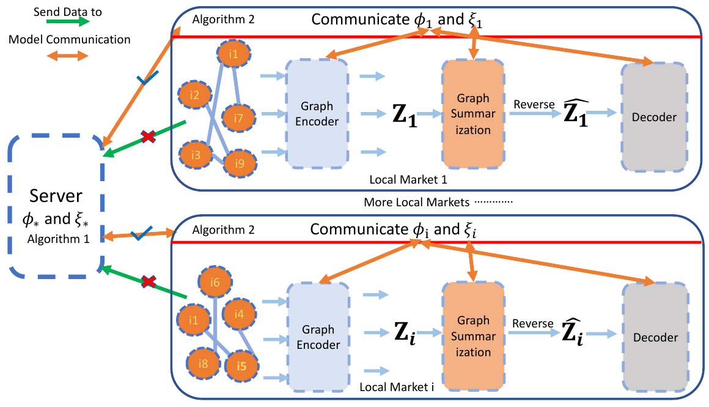

# i2i on an item graph: a variational graph auto-encoder learns item vectors and recommends by inner product, and small markets borrow from large ones via federated learning

> [中文版](aws-pf-gnn.md)

### Paper: Personalized Federated Domain Adaptation for Item-to-Item Recommendation (UAI 2023)
### Link: https://arxiv.org/abs/2306.03191
### Institution: AWS AI Labs, University of Illinois Chicago, Washington State University
### Ideas: personalized federated learning, cross-market domain adaptation, variational graph auto-encoder, simplified GCN, graph summarization by soft clustering
### Area: i2i

## Breakdown:
Given an item, recommend related items. The paper learns item vectors on an item graph with a variational graph auto-encoder (VGAE): nodes are items, features come from titles and descriptions, and edges are item pairs viewed or bought together in the same session; a simplified GCN encodes features and graph structure into item vectors, training reconstructs the item graph from vector inner products, and recommendation ranks by inner product. Because a newly launched country marketplace has too few item pairs, the paper also uses federated learning so it can borrow from large marketplaces without pooling their data.

### Method
First build the item graph, then learn item vectors with a VGAE; inference ranks by inner product.

#### (1) Building the graph
* **Nodes.** One node per item; the feature is a 768-dimensional vector from a pretrained BERT encoding the concatenated title and description.
* **Edges.** Item pairs viewed one after the other in the same session, or both bought in the same session; undirected.

#### (2) VGAE learns item vectors
* **Encoder (Graph Encoder).** Outputs a distribution (mean and variance) for each item, from which the item vector is sampled during training; at inference the mean is usually used directly (the paper doesn't say, but this is the VGAE convention). The mean and variance are each computed by a 3-layer simplified GCN with the same structure and separate parameters: the normalized adjacency matrix is multiplied in three times, which amounts to a weighted average of the features of each item's neighbors within 3 hops, with no parameters in this step; then a single weight matrix gives a 128-dimensional vector. With no nonlinearity in between, the repeated product can be precomputed, making it very cheap.
* **Scoring (Decoder).** The score of two items is σ(θ₁ · inner product of their vectors + θ₂), where θ₁ and θ₂ are two scalars, so ranking is still by inner product. The paper calls it a logistic regressor that judges how strongly two items are related; the figure calls it the Decoder, from the whole-graph view (generating the whole item graph from all items' vectors).
* **Loss.** Maximize the likelihood of observing the marketplace's item graph given the item vectors: pairs with an edge should score high and pairs without one low (by the formula, every pair without an edge counts as a negative); plus a KL term keeping the encoder's output distribution close to a prior (a zero-mean Gaussian whose variance is determined by the item's features).

At inference, other items are ranked by inner product with the query item, and the top N are taken.

#### Small markets borrowing from large ones
Each country marketplace trains its own copy of the model above, with data never leaving the marketplace, and sends only the encoder parameters and a graph summary to a server; the server builds a global version that every marketplace can use after fine-tuning and sends it back, while the scoring parameters stay local.
* **Graph summary (Graph Summarization).** Each marketplace has K learnable cluster centers, and each item gets membership weights by how close its vector is to each center; each cluster sums all item vectors weighted by membership, and the K clusters together form the summary (K × 128). It amounts to weighted centroids not divided by cluster size: uploading it reveals no individual item's vector but keeps the structure of how items cluster.
* **Recovery (Reverse).** The summary can be mapped back to approximate item vectors via the pseudo-inverse of the membership matrix, and the Decoder in the figure scores with these recovered vectors. Local training adds a loss requiring the item graph scored from the recovered vectors to be close to the marketplace's true graph.
* **Two variants.** The version sharing only encoder parameters is called PF-GNN, and the one also sharing summaries PF-GNN+.

### Data and results
The public XMarket data (Amazon marketplaces in various countries); the main experiments use 12 marketplaces in the Electronics category, which vary greatly in size: the smallest, Saudi Arabia, has only 328 items and 6,440 item pairs, and the largest, the US, has 35,939 items and 2.048M item pairs. In each marketplace 90% of item pairs are used for training and 10% for testing, with MRR@20 and NDCG@20 as metrics. Offline only.
* **Overall.** PF-GNN+ is best in all 12 marketplaces and PF-GNN second; among baselines, the standard federated GNN (FedGNN) is best. Results are given only as bar charts, without exact numbers.
* **Local GNN vs. non-graph methods.** A GNN trained only on the marketplace's own data beats Siamese and SPE in small marketplaces but falls behind them in large ones.

## Takeaways
* i2i cold start in a new marketplace can borrow from mature marketplaces, and federated learning means the data needn't be pooled.
* When sharing across marketplaces, separate the transferable part (the encoder) from the locally specific part (the scoring parameters), rather than forcing every marketplace onto one model.
* Sharing clustered graph summaries instead of item vectors is a compromise between privacy and information.

## Caveats
* Results are only bar charts; the main text gives no exact numbers or gain sizes, and standard deviations over repeated runs are in the appendix.
* Hyperparameters are chosen by performance on the US marketplace, which is itself one of the 12 evaluated; the best λw chosen for PF-GNN is 1000, yet the sensitivity analysis only goes up to 100.
* Summaries can be mapped back to approximate item vectors, and the authors acknowledge they can't rule out reverse-engineering; the paper gives no formal privacy guarantee.
* The i2i model itself is a standard simplified GCN plus VGAE, and the contribution lies in the federated learning framework; baselines such as SLIM take the user-item matrix as input, which differs from this paper's input.

## Credibility: offline

## Recommendation level: worth a look if you have time
