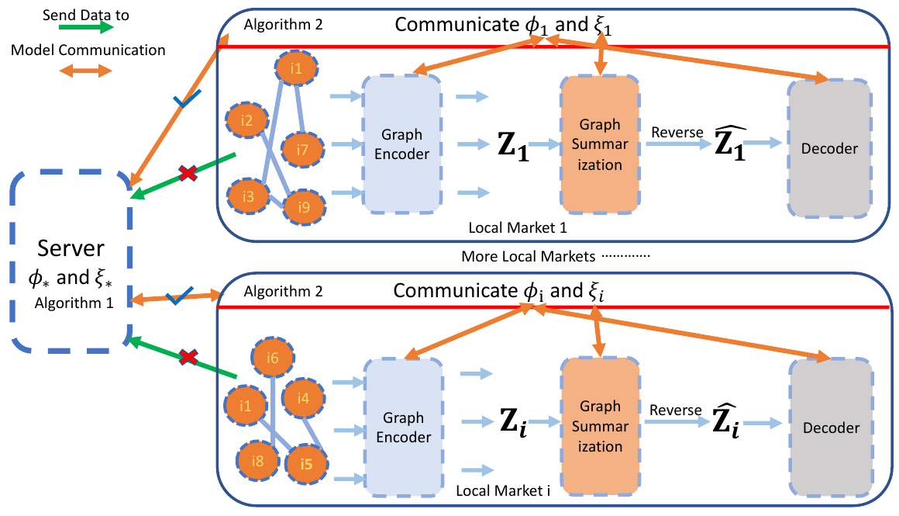

# 商品图上的 i2i：变分图自编码器学商品向量、按内积推荐，小市场用联邦学习借大市场的经验

关注我，每天为你精挑细选最优质、最新鲜的推荐算法paper，陪你一起保持进步、不断精进！

> [English version](aws-pf-gnn.full.en.md)

### 论文：Personalized Federated Domain Adaptation for Item-to-Item Recommendation（UAI 2023）
### 网址：https://arxiv.org/abs/2306.03191
### 公司：AWS AI Labs、伊利诺伊大学芝加哥分校、华盛顿州立大学
### 思想：
### 方向：i2i

## 解读：
给定一件商品，推荐相关商品。本文在商品图上用变分图自编码器（VGAE）学商品向量：节点是商品，特征来自标题和描述，边是同一会话里一起浏览或一起购买的商品对；简化 GCN 把特征和图结构编码成商品向量，训练目标是用向量内积重构这张商品图，推荐时按内积排序。新开的国家站点商品对太少，本文再用联邦学习让它借到大站点的经验，各站数据不用集中。

### 方法
先建商品图，再用 VGAE 学商品向量，推理时按内积排序。

#### （1）建图
* **节点。** 每件商品一个节点，特征是标题和描述拼起来、用预训练 BERT 编码的 768 维向量。
* **边。** 同一会话里先后浏览过，或同一会话里都买了的商品对，无向。

#### （2）VGAE 学商品向量
* **编码器（Graph Encoder）。** 给每件商品输出一个分布（均值和方差），训练时从中采样得到商品向量，推理时一般直接用均值（论文没说明，VGAE 的惯例如此）。均值和方差分别由两个结构相同、参数独立的 3 层简化 GCN 算出：把归一化后的邻接矩阵连乘 3 次，相当于把每件商品 3 跳以内邻居的特征加权平均进来，这一步没有参数；最后只乘一个权重矩阵，得到 128 维向量。因为中间不加非线性，连乘可以预先算好，计算很省。
* **打分（Decoder）。** 两件商品的分数是 σ(θ₁ · 向量内积 + θ₂)，θ₁、θ₂ 是两个标量，本质还是按内积排序。论文把它叫作逻辑回归器，用来判断两件商品之间关系的强弱；图中叫 Decoder，是从整张图的角度说的（由所有商品的向量生成整张商品图）。
* **损失。** 最大化「给定商品向量时，观察到本站这张商品图」的似然：有边的商品对分数要高，没边的要低（按公式，所有没边的商品对都算负样本）；再加一项 KL，让编码器输出的分布不偏离先验太远（先验是均值为 0、方差由商品特征决定的高斯分布）。

推理时，查询商品和其他商品按向量内积排序，取前 N 个。

#### 小市场借大市场
各国站点各训一份上面的模型，数据不出站，只把编码器参数和图摘要交给服务器；服务器合出一个各站拿去微调后都好用的全局版本，再下发给各站，打分参数留在本地。
* **图摘要（Graph Summarization）。** 每个站点有 K 个可学习的簇中心，每件商品按离各簇中心的远近得到隶属度；每个簇把所有商品的向量按隶属度加权求和，K 个簇合起来就是摘要（K × 128）。它相当于没除以簇大小的加权质心，上传它看不到单件商品的向量，但保留了商品怎么成簇的结构。
* **还原（Reverse）。** 摘要可以用隶属度矩阵的伪逆还原成近似的商品向量，图中 Decoder 打分用的就是还原后的向量。本地训练再加一项损失，要求用还原向量打分得到的商品图接近本站真实的图。
* **两个版本。** 只共享编码器参数的叫 PF-GNN，再共享摘要的叫 PF-GNN+。

### 数据与效果
公开的 XMarket 数据（Amazon 各国站点），主实验是电子产品类目的 12 个站点，规模差异很大：最小的沙特站只有 328 件商品、6,440 个商品对，最大的美国站有 35,939 件商品、204.8 万个商品对。每个站点 90% 的商品对训练、10% 测试，指标是 MRR@20、NDCG@20。只有离线实验。
* **整体。** PF-GNN+ 在 12 个站点上都最好，PF-GNN 第二；基线里常规的联邦 GNN（FedGNN）最好。结果只以柱状图给出，没有具体数字。
* **本地 GNN 和非图方法。** 只用本站数据训的 GNN，在小站点上比 Siamese、SPE 好，在大站点上反而不如。

## 心得：

## 愚见

## 可信度：离线

## 推荐等级：有时间看看

**请帮忙点赞、转发，谢谢。欢迎干货投稿 \ 论文宣传\ 合作交流**

### 【铁粉】请入微信群，群内我会给出更深入的解读，还可以共同讨论技术方案、发招聘广告、内推和交友等。
* 铁粉标准：关注公众号一个月以上，且在公众号上累计15次互动（评论、爱心、转发）、或投稿1次，只欢迎技术同学。
* 入群方法：请您加个人微信lmxhappy，我拉您入群，请备注【公司】（只我个人看，不公开）。

## 推荐您继续阅读：
