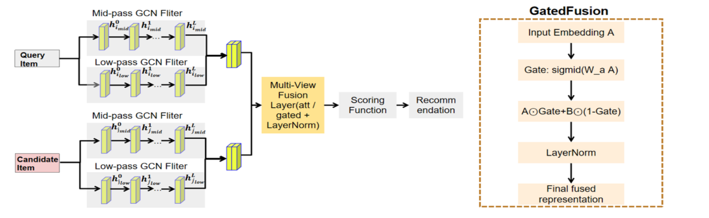

# Complementary item recommendation: replacing a spectral GNN's two-stage attention with a per-dimension gate

> [中文版](bohai-gscomgnn.md)

### Paper: Enhancing Spectral Graph Recommendation via Gated Fusion and Layer Normalization (CISAT 2025)
### Link: https://doi.org/10.1109/CISAT66811.2025.11181798
### Company: Bohai University
### Idea: spectral graph neural networks, gated fusion, LayerNorm
### Area: i2i (complementary recommendation)

## Overview:
Given one product (the trigger), find its complementary products on an item graph. The paper's model, GSComGNN, is an improved version of SComGNN (AAAI'24): the graph filters are kept as they are, and only the two-stage attention that fuses the two representations is replaced with a per-dimension gate followed by LayerNorm. It is a 5-page CISAT 2025 paper with offline experiments only.

### Data side: the item graph and the spectral observation
**Graph.** Nodes are products and edges are Amazon co-purchase relations (such as also-bought), treated as complementary relations. Each product's input features are only its category and a discretized price level, each embedded and then concatenated. Three datasets: Appliances (804 products, 8,290 edges), Grocery (39K, 643K) and Toys (25K, 615K).

**Spectral observation (inherited from SComGNN).** Treating product features as signals on the graph and applying the graph Fourier transform, the energy concentrates in the low and middle frequencies, with very little at high frequencies. The low-frequency part is what connected products share smoothly, corresponding to "relevance"; the mid-frequency part is what differs between connected products, corresponding to "dissimilarity". A complement needs both: related to the trigger (same usage scenario) but not too similar (otherwise it becomes a substitute).

### Model side

Two steps: first, a low-pass and a mid-pass graph filter each learn one representation of every product; then the two are fused into each product's final vector. The trigger and the candidate go through the same network, and a scoring function scores each (trigger, candidate) pair to pick the top K.

#### (1) Low-pass and mid-pass graph filtering
**Low-pass.** Each layer sums neighbor representations weighted by the normalized adjacency matrix, averages the result with the node itself, multiplies by a weight matrix and applies ReLU, keeping what connected products have in common.

**Mid-pass.** Each layer's propagation matrix is the identity minus two-hop propagation (I − ò), i.e., the node's own representation minus that of its two-hop neighbors, highlighting what differs from the neighbors; it is likewise followed by a weight matrix and ReLU.

Both channels start from the product features and stack several layers, giving each product a low-frequency and a mid-frequency representation.

#### (2) Gated fusion + LayerNorm
SComGNN uses two-stage attention at this step: first pairwise attention, where one item of a pair decides how much weight the other item's low- and mid-frequency representations get, i.e., whether this pair leans on relevance or on dissimilarity; then self-attention over the two outputs of that step, letting each item re-balance the two channels on its own. GSComGNN replaces this with a gate in four steps:

**Concatenate.** Each product's low- and mid-frequency representations are concatenated into a 2d-dimensional vector.

**Compute the gate.** A fully connected layer plus sigmoid gives a d-dimensional gate, where each dimension says how much to trust the low-frequency channel in that dimension.

**Weight.** Fused representation = gate ⊙ low-frequency representation + (1 − gate) ⊙ mid-frequency representation, a per-dimension weighted average.

**LayerNorm.** LayerNorm is applied to each product's fused vector.

The gate looks only at the product's own two representations and is independent of the trigger it is paired with, so the balance between relevance and dissimilarity is set per product rather than per (trigger, candidate) pair. The model keeps a switch to fall back to attention fusion.

### Results (offline only)
GSComGNN beats SComGNN on HR@5, HR@10 and NDCG on all three datasets. For HR@10: Appliances 0.713 → 0.773, Toys 0.859 → 0.895, Grocery 0.857 → 0.894. Other baselines include GIN, GraphSAGE, P-Companion and ALCIR; SComGNN is the strongest of them.

## Takeaways:
* Complementarity = relevance + dissimilarity, which on an item graph map to the low and mid frequencies; learning the two separately and then fusing them. The idea comes from SComGNN and is a clean framework for modeling complementary relations.
* Fusing per product makes each product's final vector independent of the trigger, so it can be precomputed offline; fusing per (trigger, candidate) pair is more expressive but must be computed for every pair. Which to choose depends on whether it serves retrieval or ranking.

## My take
* Only the fusion module changes, yet there is no ablation: the separate contributions of the gate and LayerNorm, and how "attention + LayerNorm" would do, are not reported; results come without variance or significance.
* The text says the gain is most pronounced on Toys because Toys has stronger mid-frequency signals. But in Table 2, Toys has the largest gain only on NDCG; on HR@5 and HR@10 the largest gains are on Appliances (HR@10 +0.06 vs. +0.04 on Toys). Table 1 only reports the high-frequency share S_high, with no mid-frequency number, and Toys has the lowest S_high of the three (0.308). The conclusion says the gains are significant where spectral heterogeneity is high, yet Grocery, with the highest S_high (0.421), has the smallest gains of the three on HR@5 and NDCG.
* The scoring function and loss are not described; the figure only shows a "Scoring Function" box. The baseline description says SComGNN uses contrastive learning, but whether GSComGNN keeps it is unclear. The NDCG cutoff is not given either.
* The motivation is that attention is "unstable and hard to interpret", but there are no training curves and no learned gate values, so the "more stable and interpretable" claim has no corresponding evidence.
* Several details don't line up: the experiments section says four datasets but there are three; Equation 2 writes the low-pass branch with the mid-pass propagation matrix; in Figure 1 the gate is computed from a single input, unlike Equations 3–4, which concatenate both channels first; and some references don't match where they are cited, e.g., the GCN citation points to a paper on personalized complementary recommendation.

## Credibility: offline

## Recommendation level: worth a look if you have time
