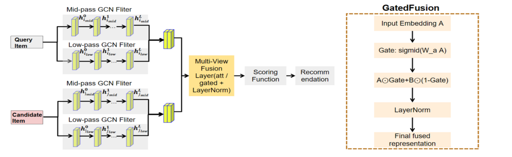

# 互补品推荐：频谱 GNN 的两阶段注意力换成逐维门控

关注我，每天为你精挑细选最优质、最新鲜的推荐算法paper，陪你一起保持进步、不断精进！

> [English version](bohai-gscomgnn.full.en.md)

### 论文：Enhancing Spectral Graph Recommendation via Gated Fusion and Layer Normalization
### 网址：https://doi.org/10.1109/CISAT66811.2025.11181798
### 公司：渤海大学
### 思想：频谱图神经网络、门控融合、LayerNorm
### 方向：i2i

## 解读：
输入一件商品（trigger），从商品图上找它的互补品。本文提出的 GSComGNN 是 SComGNN（AAAI'24）的改进版：图滤波部分原样保留，只把融合两路表示的两阶段注意力换成逐维门控，再加一层 LayerNorm。CISAT 2025 的 5 页短文，只有离线实验。

### 数据侧：商品图与频谱观察
**图。** 节点是商品，边是 Amazon 的共购关系（如 also-bought），当作互补关系。每个商品的输入特征只有类目和离散化的价格档位，各自 embedding 后拼接。三个数据集：Appliances（804 个商品、8290 条边）、Grocery（3.9 万、64 万）、Toys（2.5 万、61 万）。

**频谱观察（沿用 SComGNN）。** 把商品特征看成图上的信号做图傅里叶变换，能量集中在低频和中频，高频很弱。低频是相连商品之间平滑一致的部分，对应「相关」；中频是相连但彼此不同的部分，对应「差异」。互补品两者都要：和 trigger 相关（同一个使用场景），又不能太像（太像就成了替代品）。

### 模型侧

分两步：先用低通、中通两个图滤波器各学一路商品表示，再把两路融合成每个商品的最终向量。trigger 和候选商品走同一套网络，最后由打分函数给（trigger，候选）对打分，取 top-K。

#### （1）低通、中通两路图滤波
**低通。** 每层把邻居表示按归一化邻接矩阵加权求和，再和自身取平均，乘权重矩阵、过 ReLU，保留相连商品的共性。

**中通。** 每层的传播矩阵是单位阵减去两跳传播（I − ò），即自身表示减去两跳邻居的表示，突出和邻居不一样的部分，同样乘权重、过 ReLU。

两路的初始输入都是商品特征，各自堆若干层，得到每个商品的低频表示和中频表示。

#### （2）门控融合 + LayerNorm
SComGNN 在这一步用两阶段注意力：先做 pairwise attention，一对商品中的一件决定另一件的低频、中频表示各占多少，即这一对更看重相关还是差异；再对上一步得到的两路结果做 self-attention，每件商品自己再调一次两路的比重。GSComGNN 换成门控，分四步：

**拼接。** 每个商品的低频、中频表示拼成 2d 维。

**算门。** 过一层全连接 + sigmoid，得到 d 维的门，每一维的值是「这一维信低频多少」。

**加权。** 融合表示 = 门 ⊙ 低频表示 + (1 − 门) ⊙ 中频表示，逐维加权平均。

**LayerNorm。** 对每个商品的融合向量做 LayerNorm。

门只看这个商品自己的两路表示，和它配对的 trigger 无关，所以相关与差异的配比按商品定，不再按（trigger，候选）对定。模型保留了一个开关，可以切回注意力融合。

### 效果（只有离线）
三个数据集上 HR@5、HR@10、NDCG 都高于 SComGNN。以 HR@10 为例：Appliances 0.713 → 0.773，Toys 0.859 → 0.895，Grocery 0.857 → 0.894。其他基线有 GIN、GraphSAGE、P-Companion、ALCIR 等，SComGNN 是其中最强的。

## 心得：
* 互补 = 相关 + 差异，在商品图上分别对应低频和中频，两路分开学再融合。这个思路来自 SComGNN，是建模互补关系的一个清晰框架。
* 融合放在单个商品上做，每个商品的最终向量与 trigger 无关，可以离线算好；放在（trigger，候选）对上做表达力更强，但每一对都要现算。选哪种取决于用在召回还是精排。

## 愚见
* 只改了融合模块，但没有消融：门控和 LayerNorm 各贡献多少、「注意力 + LayerNorm」效果如何，都没给；结果也没有方差或显著性。
* 正文说 Toys 上提升最明显，因为 Toys 的中频信号更强。但按表 2，只有 NDCG 是 Toys 提升最大，HR@5、HR@10 提升最大的都是 Appliances（HR@10 +0.06，Toys +0.04）；表 1 只给了高频占比 S_high，没有中频的数字，而 Toys 的 S_high 是三者中最低的（0.308）。结论说在频谱异质性高的数据上提升显著，S_high 最高的 Grocery（0.421）在 HR@5、NDCG 上的提升却是三者中最小的。
* 打分函数和损失没写，图里只有一个 Scoring Function 框；介绍基线时说 SComGNN 用对比学习，GSComGNN 是否沿用不清楚。NDCG 也没写截断位置。
* 动机是注意力「不稳定、难解释」，但文中没有训练曲线，也没展示学到的门值，「更稳定、可解释」缺少对应证据。
* 几处细节对不上：实验部分说四个数据集，实际是三个；式 2 的低通分支写成了中通的传播矩阵；图 1 里的门只由一路输入算出，和式 3–4 先拼接两路再算门不一致；部分参考文献和引用处不符，如 GCN 处引的是一篇个性化互补推荐的论文。

## 可信度：离线

## 推荐等级：有时间看看

**请帮忙点赞、转发，谢谢。欢迎干货投稿 \ 论文宣传\ 合作交流**

### 【铁粉】请入微信群，群内我会给出更深入的解读，还可以共同讨论技术方案、发招聘广告、内推和交友等。
* 铁粉标准：关注公众号一个月以上，且在公众号上累计15次互动（评论、爱心、转发）、或投稿1次，只欢迎技术同学。
* 入群方法：请您加个人微信lmxhappy，我拉您入群，请备注【公司】（只我个人看，不公开）。

## 推荐您继续阅读：
