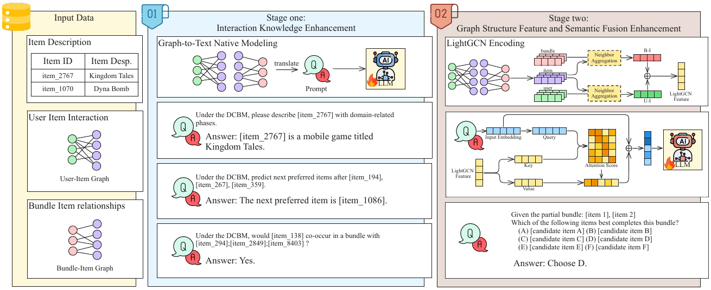

# Bundle completion: first translate user–item and bundle–item relations into Q&A to fine-tune an LLM, then fuse LightGCN vectors into its input and solve a multiple-choice question

> [中文版](bupt-dpb-llm.md)

### Paper: Dual-Enhancement Product Bundling: Bridging Interactive Graph and Large Language Model
### Link: https://arxiv.org/abs/2604.14030
### Institution: Beijing University of Posts and Telecommunications, Tsinghua University, Beijing Wispirit Technology
### Ideas: per-item tokens, graph relations as Q&A, cross-attention fusion of LightGCN vectors, LoRA fine-tuning, multiple-choice completion
### Area: i2i (bundle completion)

## Breakdown:
Bundle completion is posed as a multiple-choice question: given the items already in a bundle and 10 candidates, the LLM picks the missing one. The paper fine-tunes the LLM in two stages: the first translates user–item and bundle–item interactions into text Q&A so the LLM learns these relations; the second fuses LightGCN item vectors into the LLM's input via cross-attention and then does supervised fine-tuning on the multiple-choice task.

The scenario is bundle recommendation, e.g., a burger with fries and a drink, a top with trousers and shoes, or a game collection. Collaborative filtering relies on past interactions and can't handle new items; LLMs understand item text but can't read interaction graphs. The paper aims to combine the two. The task setup follows Bundle-MLLM (KDD 2025).

### Method
Two stages run one after the other, both LoRA fine-tuning the same LLM (Llama-2-7B-Chat or Qwen2-7B-Instruct). Stage one teaches the LLM each item and the relations between items, without training the completion task itself; stage two continues from the stage-one model, adds LightGCN vectors, and trains specifically on multiple-choice completion.

#### (1) Stage one: translating interaction relations into Q&A
* **Aligning item tokens with descriptions.** Each item is added to the LLM's vocabulary as a new token (e.g., [item_2767]), initialized as the average of the token vectors of the item's description. The training sample's prompt is "please describe [item_2767]" and the answer is the item's description ("[item_2767] is a mobile game titled Kingdom Tales"). The LLM must generate the whole description from this one token, so training updates the token's vector to hold the item's meaning; when it later appears in other prompts, the LLM knows what it refers to.
* **Continuing user sequences.** A user's interacted item sequence is split in half; given the first half, the LLM generates the second ("after [item_194], [item_267], what's the next preferred item?").
* **Judging whether a bundle holds.** "Would [item_138] co-occur in a bundle with [item_294], [item_2849]?" Real bundles get "yes"; replacing one item with a random item outside the bundle gets "no".

The three bullets above are three kinds of training samples (aligning item tokens with descriptions, continuing user sequences, judging whether a bundle holds), mixed for LoRA fine-tuning. Each sample is "prompt + answer", with the language-modeling loss on the answer part. The paper doesn't give the number of samples of each kind or the mixing ratio.

#### (2) Stage two: fusing LightGCN vectors and solving the multiple-choice task
* **Training LightGCN.** LightGCN is trained separately on the user–item graph and the bundle–item graph, giving each item two vectors, which are concatenated and passed through a two-layer MLP into the LLM's hidden dimension.
* **Cross-attention fusion (reshaping the input vectors fed to the LLM).** Each token in the prompt "asks" the items' LightGCN vectors for graph-structure information, in three steps:
  * **Turning the prompt into vectors.** The prompt first goes through the LLM's embedding layer, giving each token a vector. These include ordinary words such as "bundle" and "which" as well as item tokens such as [item_1].
  * **Cross-attention.** The vector of every token in the prompt (not just item tokens, but ordinary words and option letters too) is projected into a query; the mapped LightGCN vectors of the items involved in the prompt are projected into keys and values. Each token's query is compared with all items' keys, softmax gives weights, and the values are summed with those weights, so each token gets its own share of graph-structure information (one vector), as many shares as there are tokens in the prompt.
  * **Adding it back.** This information passes through an output projection, is added back to the token's own vector (residual connection), and is LayerNormed. The processed vectors replace the original embeddings as the LLM's input. Item tokens' embeddings remain the ones learned in stage one; LightGCN vectors don't replace or re-initialize them, but are only added on in this way (Eq. 10 in the paper).

  The design intent is for each item token to draw mainly on its own LightGCN vector, so it carries both text meaning (learned in stage one) and collaborative signal (learned by LightGCN). Two things aren't explained: ordinary words also draw information from the items' graph vectors, and the effect of that isn't discussed; and whether "the items involved in the prompt" means only the known items or also the candidates isn't stated.
* **Training through the LLM.** Just like ordinary instruction fine-tuning, in three steps:
  * **Reading the question and answering.** With the fused vectors as input, the LLM reads from start to end, seeing the known items and all candidates, then continues by generating an answer, e.g., "Choose D.".
  * **Computing the loss.** Only the answer part counts: the higher the probability the LLM gives to the correct option letter, the lower the loss (cross-entropy). The prompt part has no loss. At the answer position, each of the ten letters "A" to "J" gets a probability, which amounts to a score for each of the 10 candidates; the cross-entropy is a softmax classification over these 10 candidates, pushing up the correct one and pushing down the rest. So what's trained is really a function that scores the whole set of candidates.
  * **Updating parameters.** Gradients flow back to update the LoRA parameters and the fusion module (the two-layer MLP that maps LightGCN vectors over, and the projection matrices in the cross-attention). LightGCN is trained beforehand and isn't updated in this step.

**Supplement: how the multiple-choice samples are built.** Samples and labels are both built automatically from real bundles, with no human labeling:
* **Take a real bundle.** E.g., {T-shirt, jeans, sneakers, cap}.
* **Mask one item.** E.g., the jeans; the T-shirt, sneakers and cap become the known items.
* **Assemble options.** The jeans are mixed with several negatives into 10 options, (A) to (J), written as a prompt: "given [item_1], [item_2], [item_3], which of the following best completes this bundle? (A) [item_1086] (B) [item_2049] ...". Known items and candidates are both written as item tokens learned in stage one; (A), (B) are ordinary text.
* **Set the label.** Whichever option the jeans are in, that letter is the label; e.g., if it's D, the target answer for training is "Choose D.".

Whether the correct answer's position is shuffled, and how negatives are sampled, isn't stated.

**Inference.** Each query lists the known items and candidates in a prompt and has the LLM generate an answer, which amounts to taking the highest-scoring of the 10 candidates, so the paper reports only HitRate@1 (reading out the ten letters' probabilities directly would also rank the candidates, but the paper doesn't do this). The score isn't computed for each candidate on its own: the same candidate can score differently alongside different candidates or in a different position. So it can only choose among a few given candidates, not retrieve from the full catalog.

### Data and results
Three datasets: POG (Alibaba iFashion outfits, 49K items, 20K bundles), POG dense (same source, denser user feedback), and Steam (game collections, 2,798 games, 615 bundles). Bundles are split 8:1:1 into train, validation and test. The metric is the share of correct picks among 10 candidates (HitRate@1). Offline only.
* **Versus Bundle-MLLM.** On POG, from 0.41 to 0.49 (Llama) and 0.52 (Qwen); on POG dense, from 0.67 to 0.71 and 0.72; on Steam, from 0.76 to 0.81 and 0.83.
* **Ablation (Llama, POG).** Stage two only without LightGCN fusion gives 0.44; adding LightGCN gives 0.46; both stages but no LightGCN at inference gives 0.48; the full model 0.49; merging the two stages into one joint training drops to 0.43.

## Takeaways
* Translating an interaction graph into Q&A (who is bought with whom, what sits in the same bundle) is a simple way for an LLM to learn collaborative signals.
* Giving each item its own token, initialized from and aligned with its description, is less prone to confusion than writing item names directly.
* Staged training beats joint training: learn the relations first, then the task.

## Caveats
* The abstract's maximum 26.5% gain compares Qwen-based DPB-LLM with Llama-based Bundle-MLLM, i.e., different backbones. With Llama for both, the gains on the three datasets are about 19.5%, 6% and 6.6%.
* The simplest variant (stage two only, no LightGCN fusion, i.e., text-only fine-tuning) already reaches 0.44 on POG, above Bundle-MLLM's 0.41. A sizable part of the gain over Bundle-MLLM doesn't come from the paper's two components, which together add only about 0.05.
* A section titled "cold-start analysis" only compares variants without LightGCN; it doesn't pick out genuinely new items for separate evaluation.
* How negatives are sampled isn't clearly stated. Randomly sampled negatives often don't even match the category, which makes the multiple choice easier. Bundles are split 8:1:1, but the paper doesn't say whether stage one's bundle Q&A and stage two's LightGCN use only training bundles, so test information could leak.
* Each query runs a 7B model's generation and can only choose among about 10 candidates, far from full-catalog retrieval at the retrieval stage; the paper doesn't discuss how this would fit into a real system.

## Credibility: offline

## Recommendation level: worth a look if you have time
