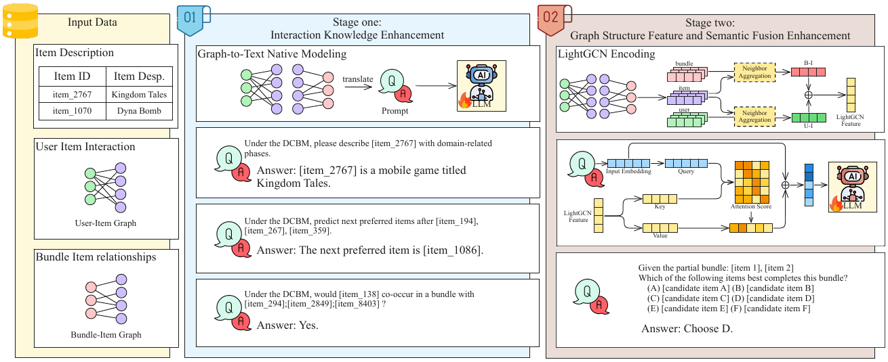

# 套装补全：先把用户–商品、套装–商品关系翻译成问答微调 LLM，再把 LightGCN 向量融进输入，做选择题

关注我，每天为你精挑细选最优质、最新鲜的推荐算法paper，陪你一起保持进步、不断精进！

> [English version](bupt-dpb-llm.full.en.md)

### 论文：Dual-Enhancement Product Bundling: Bridging Interactive Graph and Large Language Model
### 网址：https://arxiv.org/abs/2604.14030
### 公司：北京邮电大学、清华大学、Beijing Wispirit Technology
### 思想：商品专属 token、图关系转成问答、LightGCN 向量交叉注意力融合、LoRA 微调、选择题式补全
### 方向：i2i（套装补全）

## 解读：
套装补全被做成一道选择题：给出一个套装里已有的几件商品和 10 个候选，让 LLM 选出缺的那一件。本文分两个阶段微调 LLM：第一阶段把用户–商品、套装–商品的交互关系翻译成文字问答，让 LLM 先学会这些关系；第二阶段把 LightGCN 学出的商品向量通过交叉注意力融进 LLM 的输入，再在选择题上做监督微调。

场景是套装推荐，比如汉堡配薯条和饮料、上衣配裤子和鞋、游戏合集。协同过滤靠历史交互，新商品没法处理；LLM 懂商品文字，但读不懂交互图。本文想把两者结合起来。任务设定沿用 Bundle-MLLM（KDD 2025）。

### 方法
两个阶段先后进行，都用 LoRA 微调同一个 LLM（Llama-2-7B-Chat 或 Qwen2-7B-Instruct）。第一阶段让 LLM 认识每件商品、学会商品之间的关系，不做补全任务本身；第二阶段在第一阶段微调好的模型上继续，加入 LightGCN 向量，专门训练选择题式的补全。

#### （1）第一阶段：把交互关系翻译成问答
* **商品 token 对齐描述。** 每件商品作为一个新 token 加进 LLM 的词表（如 [item_2767]），它的向量初始化为这件商品描述文字各 token 向量的平均。训练样本的提示词是「请描述 [item_2767]」，答案是这件商品的描述（「[item_2767] 是一款名为 Kingdom Tales 的手游」）。LLM 要从这一个 token 生成整段描述，训练时梯度会更新这个 token 的向量，让它装下这件商品的含义；之后它出现在别的提示词里，LLM 就知道指的是什么。
* **用户序列续写。** 把用户交互过的商品序列切成前后两半，给前一半，让 LLM 生成后一半（「看过 [item_194]、[item_267] 之后，下一个喜欢的是？」）。
* **套装是否成立。** 问「[item_138] 会和 [item_294]、[item_2849] 出现在同一个套装里吗？」，真实套装答「是」；把其中一件随机换成套装外的商品，答「否」。

上面三条对应三种训练样本（商品 token 对齐描述、用户序列续写、套装是否成立），混在一起做 LoRA 微调。每条样本都是「提示词 + 答案」，损失是答案部分的语言模型生成损失。三种样本的数量和混合比例，论文没写。

#### （2）第二阶段：融合 LightGCN 向量，做选择题
* **训练 LightGCN。** 在用户–商品图和套装–商品图上分别训练 LightGCN，每件商品得到两个向量，拼起来过一个两层 MLP，映射到 LLM 的隐层维度。
* **交叉注意力融合（改造送进 LLM 的输入向量）。** 让提示词里的每个 token 去向商品的 LightGCN 向量「要」图结构信息，分三步：
  * **提示词变成向量。** 提示词先过 LLM 的词向量层，每个 token 得到一个向量。这里面既有「套装」「哪一件」这样的普通词，也有 [item_1] 这样的商品 token。
  * **交叉注意力。** 提示词里的每个 token（不只是商品 token，普通词和选项字母也一样）的向量投影成查询；提示词里涉及的商品，它们映射后的 LightGCN 向量分别投影成键和值。每个 token 的查询和所有商品的键算相似度，softmax 后对值加权求和，各自得到一份图结构信息（一个向量），整个提示词有多少个 token 就有多少份。
  * **加回去。** 这份信息过一个输出投影，加回 token 自己的向量（残差连接），再做 LayerNorm。处理后的向量代替原来的词向量，送进 LLM。商品 token 的词向量仍是第一阶段学到的那份，LightGCN 向量没有替换或重新初始化它，只是这样叠加上去（论文公式 10）。

  设计意图是让商品 token 主要取到自己的 LightGCN 向量，使它同时带有文本含义（第一阶段学的）和协同信号（LightGCN 学的）。论文没交代两点：普通词也会从商品图向量里取信息，效果如何没讨论；「提示词里涉及的商品」是只有已知商品，还是也包括候选项，也没写。
* **送进 LLM 训练。** 和普通的指令微调一样，分三步：
  * **读题、作答。** 融合后的向量作为输入，LLM 从头读到尾，看到已知商品和所有候选，然后接着生成答案，比如「Choose D.」。
  * **算损失。** 只看答案部分：LLM 生成正确选项字母的概率越高，损失越小（交叉熵）。提示词部分不算损失。答案位置上「A」到「J」十个字母各有一个概率，相当于给 10 个候选各打了一个分，交叉熵就是在这 10 个候选上做 softmax 分类，拉高正确候选、压低其他候选。所以训练的其实是一个对整组候选打分的函数。
  * **更新参数。** 梯度往回传，更新 LoRA 参数和融合模块（把 LightGCN 向量映射过去的两层 MLP、交叉注意力里的几个投影矩阵）。LightGCN 是事先训好的，这一步不再更新。

**补充：选择题样本怎么构造。** 样本和标签都从真实套装里自动构造，不需要人工标注：
* **取一个真实套装。** 比如 {T 恤、牛仔裤、球鞋、帽子}。
* **遮掉一件。** 比如牛仔裤，剩下的 T 恤、球鞋、帽子当作已知商品。
* **拼选项。** 把牛仔裤和若干负样本混在一起，排成 (A) 到 (J) 共 10 个选项，写成提示词：「已有 [item_1]、[item_2]、[item_3]，下面哪一件最能补全这个套装？(A) [item_1086] (B) [item_2049] …」。已知商品和候选商品都用第一阶段学过的商品 token 表示，(A)、(B) 是普通文字。
* **定标签。** 牛仔裤排在哪个选项，那个字母就是标签。比如排在 D，训练的目标答案就是「Choose D.」。

正确答案是否随机打乱位置、负样本怎么采，论文没写。

**推理。** 每个查询都要把已知商品和候选列进提示词，让 LLM 生成一个答案，相当于取 10 个候选里分数最高的那个，所以论文只报 HitRate@1（直接读出十个字母的概率，也能给候选排序，论文没这么做）。这个分数不是每个候选单独算的：同一个候选和不同的候选放在一起、排在不同的位置，分数都可能不同。所以只能在给定的少量候选里选，不能在全库里检索。

### 数据与效果
三个数据集：POG（阿里 iFashion 的穿搭，4.9 万件商品、2 万个套装）、POG dense（同源、用户反馈更密）、Steam（游戏合集，2,798 个游戏、615 个套装）。套装按 8:1:1 划分训练、验证、测试。指标是 10 个候选里选对的比例（HitRate@1）。只有离线实验。
* **对比 Bundle-MLLM。** POG 上从 0.41 提到 0.49（Llama）和 0.52（Qwen）；POG dense 从 0.67 到 0.71、0.72；Steam 从 0.76 到 0.81、0.83。
* **消融（Llama，POG）。** 只做第二阶段、不融合 LightGCN 是 0.44；加上 LightGCN 是 0.46；两个阶段都做、但推理时不用 LightGCN 是 0.48；完整模型 0.49；两个阶段合并成一次联合训练反而降到 0.43。

## 心得：

## 愚见

## 可信度：离线

## 推荐等级：有时间看看

**请帮忙点赞、转发，谢谢。欢迎干货投稿 \ 论文宣传\ 合作交流**

### 【铁粉】请入微信群，群内我会给出更深入的解读，还可以共同讨论技术方案、发招聘广告、内推和交友等。
* 铁粉标准：关注公众号一个月以上，且在公众号上累计15次互动（评论、爱心、转发）、或投稿1次，只欢迎技术同学。
* 入群方法：请您加个人微信lmxhappy，我拉您入群，请备注【公司】（只我个人看，不公开）。

## 推荐您继续阅读：
