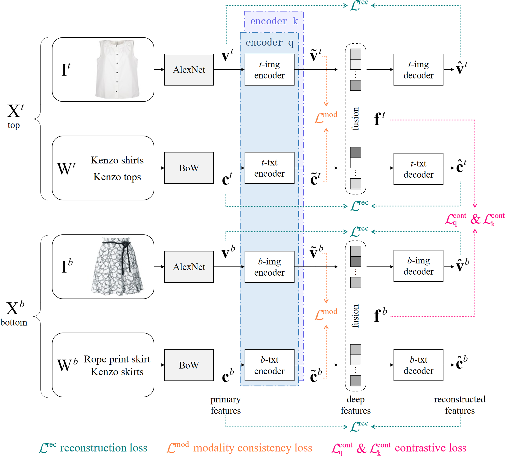
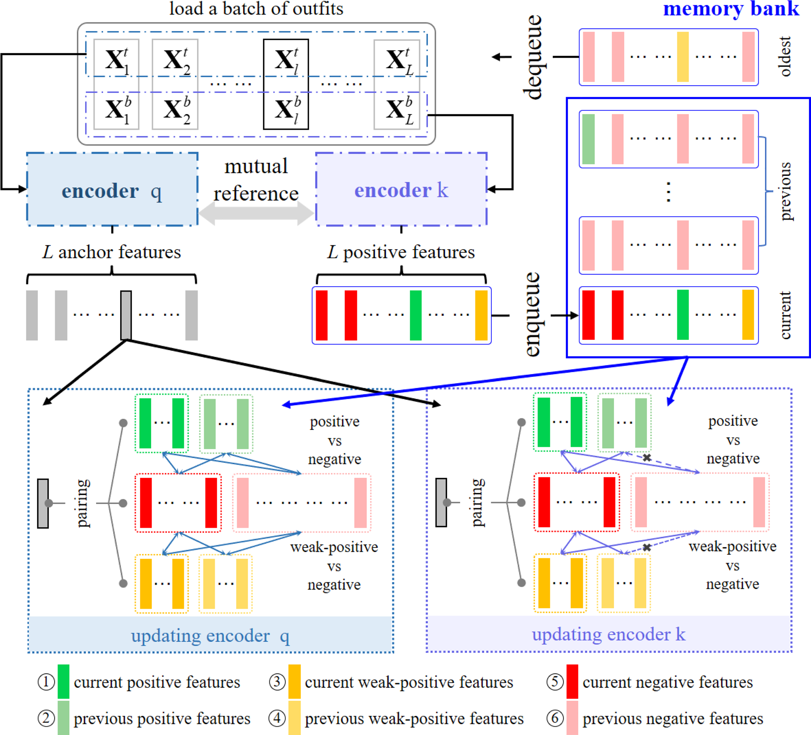

# Top–bottom compatibility scoring: a memory bank scales negatives to 512, and bottoms that "look like the positive" become weak positives

> [中文版](dhu-mrmoco.md)

### Paper: Evaluating fashion compatibility based on mutual reference momentum contrast with weak-positive samples (Multimedia Systems 32:111, 2026)
### Link: https://doi.org/10.1007/s00530-025-02175-9
### Company: Donghua University
### Idea: momentum contrast (MoCo), memory bank, weak-positive samples, autoencoders, multimodal
### Area: i2i (a top → compatible bottoms)

## Overview:
The paper addresses top–bottom compatibility scoring: given a top, score and rank candidate bottoms (and the other way round, finding tops for a bottom). The trigger is the top. Most such models are trained with a triplet loss, which the authors see as having two problems. First, each triplet provides only one contrast (one positive against one negative), a weak supervision signal. Second, negatives are sampled at random, and sometimes the sampled bottom looks very much like the positive and would actually go with the top, yet is treated as a negative, which confuses training.

The paper proposes MRMoCo (Mutual Reference Momentum Contrast, published in Multimedia Systems 2026). The model keeps the usual structure of one set of autoencoders for tops and one for bottoms, scored by an inner product; training switches to MoCo-style contrastive learning, using a memory bank to give each sample hundreds of negatives to contrast against; and bottoms that "share the positive's style and look like it" are picked out as weak positives, contrasted against negatives in a separate, gentler group. Offline experiments only.

### Model side
Four steps overall. First, autoencoders encode each item into a vector, and the inner product of a top and a bottom is the compatibility score; then weak positives are mined to augment the training data; then the encoders are trained with an improved momentum contrast; at inference only the trained encoder is used for scoring.

#### (1) Item encoding and scoring

This is the figure above.

* **Primary features.** Images go through an ImageNet-pretrained AlexNet, taking the second fully connected layer (4,096 dimensions); text uses bag-of-words (2,890 words).
* **Four autoencoders.** Top image, top text, bottom image and bottom text each get their own encoder, with no shared parameters, each mapping to 512 dimensions; each encoder has a decoder that reconstructs the primary feature from the 512-dimensional vector (reconstruction loss).
* **Image–text alignment.** The image vector and text vector of the same item are dotted, passed through a sigmoid, and the negative log is the loss, pulling the two together.
* **Scoring.** An item's image and text vectors are concatenated into the item vector; the inner product of the top vector and the bottom vector is the compatibility score.

**How it is trained.** AlexNet and bag-of-words only provide fixed primary features and are not trained. The four encoders and decoders are not pretrained separately; they are trained together with the contrastive learning in (3), with the reconstruction, image–text alignment and contrastive losses acting on them at the same time.

#### (2) Mining weak positives
* **Style labels.** Four textile and fashion experts labeled 10,000 training outfits with styles (7 classes: casual, sports, girlish, neutral, business, western, retro; inter-annotator agreement Fleiss' Kappa 0.63).
* **Finding look-alikes.** Within outfits of the same style, each outfit's bottom is matched with the other bottom closest to it in Euclidean distance on primary image features (AlexNet).
* **Forming weak positives.** "This top + that look-alike bottom" becomes a weak positive. Only 1 per outfit (J = 1); taking more makes results worse. The augmented training set is called FashionVC-S.

#### (3) Mutual reference momentum contrast (MRMoCo)

This is the figure above. It treats the whole figure from (1) as one encoder and shows how a training batch is organized. This step trains the encoders from (1) with contrastive learning; the framework follows MoCo, with three changes on top.

**What follows MoCo.**
* **Two encoders.** q and k have the same structure, each a copy of the four encoders from (1), with separate parameters. q encodes the anchor (top), and k encodes the targets (bottoms). k's learning rate is 1/20 of q's, so it changes slowly.
* **Memory bank.** Bottom vectors encoded by k go into a first-in, first-out queue (capacity 512). Vectors stored from previous batches are used directly, without recomputation and without gradients. The number of samples each anchor can contrast against is therefore set by the queue's capacity, independent of the batch size (32).
* **Grouping by relation to the anchor.** The same vector plays different roles for different anchors (the anchor's own outfit's bottom is its positive, the look-alike mined for it is its weak positive, and the rest are negatives), split further by "current batch / previous batches", six groups in all.
* **Alternating anchors.** Training alternates between "top as anchor" and "bottom as anchor". Only q is used at inference, and both its top encoders and bottom encoders need gradients, so the two sides must alternate (removing either side drops AUC by about 0.06).

**What this paper changes.**
* **Weak positives as a separate contrast group.** The loss has the same form as InfoNCE: the anchor's inner product with a positive should exceed its inner products with negatives. Positives vs. negatives and weak positives vs. negatives are computed as separate groups, the latter with a higher temperature (τ1 = 0.3, τ2 = 1.2), i.e., a gentler penalty.
* **k gets a loss too.** In the original MoCo, k receives no gradient and only follows q by momentum. Here k also gets its own contrastive loss, with gradients flowing only through the vectors freshly computed for the current batch.
* **Mutual reference momentum update.** After each gradient update, q and k move toward each other by momentum (each keeps 99.9% of itself and takes 0.1% of the other); in the original MoCo only k moves toward q.

**Loss.** The contrastive loss plus the reconstruction and image–text alignment losses from (1). At inference only encoder q is used; k and the memory bank are no longer needed.

**Why weak positives get a higher temperature.** A weak positive only "looks like the positive" and is less reliable than a true positive. The lower the temperature, the harder the penalty on hard negatives; giving weak positives a higher temperature asks only that they beat negatives by a little, not by a lot. Too low a temperature makes results worse, and too high a temperature makes weak positives nearly useless.

#### (4) Inference
Given a top, encoder q's top encoders produce its vector, and candidate bottoms are encoded by q's bottom encoders (independent of the top, so they can be computed offline); the inner product of the two is the compatibility score, and candidates are ranked by it. Finding tops for a bottom works the other way round.

### Data side
**Dataset.** FashionVC: 20,726 top–bottom outfits, 14,871 tops and 13,663 bottoms, each with an image and text, split 8:1:1.

**Evaluation protocol.** Each test top is paired with its real bottom plus 9 bottoms randomly sampled from the test set as negatives, and AUC and MRR are computed over these 10.

### Results (offline only)
AUC 0.7709 and MRR 0.5472, vs. 0.7542 and 0.5229 for the strongest baseline, MNLFF. Raising the memory bank from 128 to 512 lifts AUC from 0.7598 to 0.7709; weak positives add +0.003 AUC on average; mutual reference beats the original MoCo by 0.0036. Extended to multi-item outfits (Polyvore, splitting an outfit into pairs and averaging), AUC is 0.611, below the purpose-built multi-item model TAE (0.830).

## Takeaways:
* A memory bank decouples the number of negatives from the batch size; here going from 128 to 512 contrasts gives the largest single gain in the paper (+0.011 AUC), more than either of the paper's own additions.
* Items that look like the positive and share its style can be treated as weak positives contrasted at a higher temperature, a way to soften the false-negative problem of random sampling.
* The momentum encoder does not have to be a pure follower: giving it its own loss with a small learning rate helps slightly over MoCo.

## My take
* Most of the improvement comes from the larger number of negatives that the memory bank provides (standard MoCo). The paper's own additions are small: mutual reference over a MoCo-like variant is +0.0036 AUC, and weak positives add +0.003 on average; no variance across runs is reported, so it is hard to tell whether gaps this size are beyond noise.
* The comparison is not at equal negatives: the baselines contrast against at most 33 samples, the proposed model against 512. The baselines are also older (BPR-DAE and Bi-LSTM from 2017, MNLFF), and the gain over the strongest one is 0.017 AUC; the "gains up to 0.0696" figure is against the weakest baseline, Bi-LSTM.
* Evaluation ranks 1 true bottom against 9 randomly sampled ones, a small and easy candidate set with no catalog-scale retrieval; it also relies on exactly the random negatives the paper argues can be unreliable.
* Weak-positive mining needs four experts to label 10,000 outfits by style, and look-alikes are found on AlexNet features; the gain is small, and mining more than one per outfit hurts.
* The multi-item extension is well below a purpose-built model (0.611 vs. 0.830 for TAE). Offline only.

## Credibility: offline

## Recommendation level: worth a look if you have time
