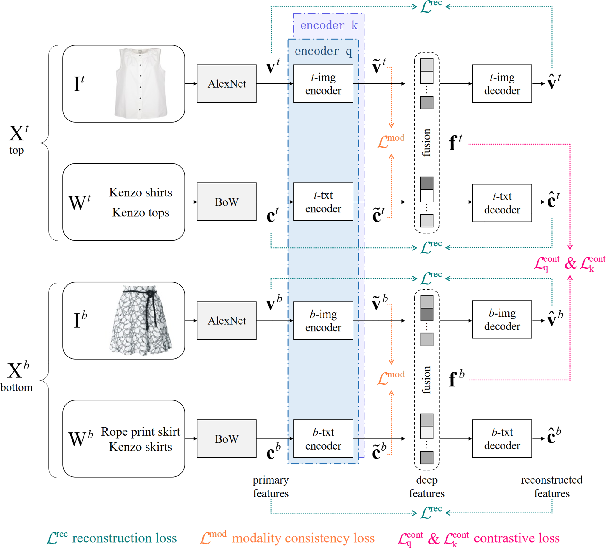
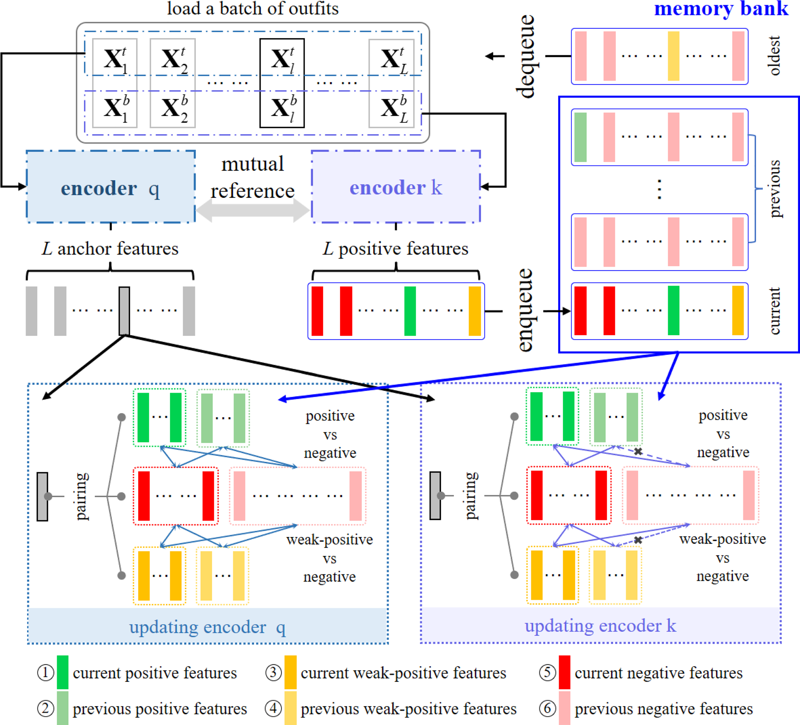

# 上下装搭配打分：记忆库把负样本扩到 512 个，再把「和正样本长得像」的下装当弱正样本

关注我，每天为你精挑细选最优质、最新鲜的推荐算法paper，陪你一起保持进步、不断精进！

> [English version](dhu-mrmoco.full.en.md)

### 论文：Evaluating fashion compatibility based on mutual reference momentum contrast with weak-positive samples
### 网址：https://doi.org/10.1007/s00530-025-02175-9
### 公司：东华大学
### 思想：动量对比学习（MoCo）、记忆库、弱正样本、自编码器、多模态
### 方向：i2i

## 解读：
本文做的是上下装搭配打分。给一件上衣，给候选下装打分排序（反过来给下装找上衣也一样）。trigger 是这件上衣。

这类模型大多用 triplet loss 训练，作者认为有两个问题。一是每个三元组只提供一组对比（一个正样本对一个负样本），监督信号弱。二是负样本随机抽，有时抽到的下装和正样本长得很像，其实也能搭，却被当成负样本，给训练添乱。

本文提出，模型沿用上下装各一套自编码器、内积打分的结构；训练改用 MoCo 式的对比学习，用记忆库把每个样本能对比的负样本扩到几百个；再把「和正样本风格相同、长得像」的下装挑出来当弱正样本，单独和负样本做一组较温和的对比。

### 模型侧
整体分四步。先用自编码器把每件单品编码成向量，上衣和下装的内积就是搭配分；再挖出弱正样本，扩充训练数据；然后用改进的动量对比学习训练编码器；推理时只用训练好的编码器打分。

#### （1）单品编码与打分

对应上图。

* **原始特征。** 图片过 ImageNet 预训练的 AlexNet，取第二个全连接层（4096 维）；文本用词袋（2890 个词）。
* **四个自编码器。** 上衣图片、上衣文本、下装图片、下装文本各一个编码器，参数互不共享，各自映射到 512 维；每个编码器配一个解码器，把 512 维向量还原回原始特征（重构损失）。
* **图文对齐。** 同一件单品的图片向量和文本向量做内积，过 sigmoid 后取负对数作为损失，把两者拉近。
* **打分。** 同一件单品的图片向量和文本向量拼起来，得到单品向量；上衣向量和下装向量的内积就是搭配分。

**怎么训练。** AlexNet 和词袋只提供固定的原始特征，不训练。四个编码器和解码器不单独预训练，和（3）的对比学习一起训练，重构损失、图文对齐损失、对比损失同时作用在它们身上。

#### （2）挖弱正样本
* **标风格。** 请 4 位纺织服装专家给训练集里 1 万套 outfit 打风格标签（休闲、运动、少女、中性、商务、西部、复古 7 类，标注一致性 Fleiss' Kappa 0.63）。
* **找相似。** 在同一风格的 outfit 里，给每套的下装找原始图像特征（AlexNet）欧氏距离最近的另一件下装。
* **组成弱正样本。** 把「这件上衣 + 那件相似的下装」当作弱正样本。每套只取 1 个（J = 1），取多了反而变差。扩充后的训练集称为 FashionVC-S。

#### （3）互参考动量对比（MRMoCo）

对应上图。这张图把（1）那张整个当成一个编码器，画的是训练时一个 batch 的样本怎么组织。这一步用对比学习训练（1）的编码器，框架沿用 MoCo，本文在上面改了三处。

**沿用 MoCo 的部分。**
* **两个编码器。** q 和 k 结构相同，各是（1）里四个编码器的一份副本，参数分开。q 编锚点（上衣），k 编目标（下装）。k 学习率只有 q 的 1/20，变化很慢。
* **记忆库。** k 编出的下装向量放进一个先进先出的队列（容量 512）。之前 batch 存进去的向量直接拿来用，不重新计算，也不传梯度。所以每个锚点能对比的样本数由队列容量决定，和 batch 大小（32）无关。
* **按和锚点的关系分组。** 同一个向量对不同锚点角色不同（它自己那套的下装是正样本，为它挖出的相似下装是弱正样本，其余是负样本），再按「当前 batch / 之前的 batch」分开，共六组。
* **轮流当锚点。** 训练在「上衣当锚点」和「下装当锚点」之间交替。推理时只用 q，q 的上衣编码器和下装编码器都要有梯度，所以必须两边轮流（去掉任意一边，AUC 掉 0.06 左右）。

**本文改动的部分。**
* **弱正样本单独一组对比。** 损失和 InfoNCE 同形，锚点和正样本的内积要高于和负样本的内积。正样本对负样本、弱正样本对负样本各算一组，后者温度更高（τ1 = 0.3，τ2 = 1.2），惩罚更温和。
* **k 也有损失。** 原版 MoCo 里 k 不接受梯度，只按动量跟着 q 走。本文给 k 也算一份对比损失，梯度只经当前 batch 新算的向量回传。
* **互参考动量更新。** 每步梯度更新后，q 和 k 再互相按动量靠拢（各保留自己 99.9%，取对方 0.1%），原版 MoCo 只有 k 向 q 靠拢。

**损失。** 对比损失加上（1）里的重构损失和图文对齐损失。推理时只用编码器 q，k 和记忆库都不再需要。

**为什么弱正样本要用更高的温度。** 弱正样本只是「长得像正样本」，可信度不如真正的正样本。温度越低，对难负样本惩罚越重；给弱正样本更高的温度，相当于只要求它比负样本强一点，不要求强很多。温度太低反而变差，太高则弱正样本几乎不起作用。

#### （4）推理
给一件上衣，用编码器 q 的上衣编码器编出向量，候选下装用 q 的下装编码器编码（和上衣无关，可以离线算好），两者内积就是搭配分，按分数排序；给下装找上衣时反过来。

### 数据侧
**数据集。** FashionVC，20726 套上下装，14871 件上衣、13663 件下装，每件有图片和文本，按 8:1:1 切分。

**评测方式。** 测试集里每件上衣配它的真实下装，再从测试集随机抽 9 件下装当负样本，在这 10 件里算 AUC 和 MRR。

### 效果（仅离线）
AUC 0.7709、MRR 0.5472，最强基线 MNLFF 为 0.7542、0.5229。记忆库容量从 128 加到 512，AUC 从 0.7598 升到 0.7709；弱正样本平均带来 AUC +0.003；互参考比原版 MoCo 高 0.0036。扩展到多件 outfit（Polyvore，把整套拆成两两配对再平均）时 AUC 为 0.611，低于专门做多件的 TAE（0.830）。

## 心得：

## 愚见

## 可信度：离线

## 推荐等级：有时间看看

**请帮忙点赞、转发，谢谢。欢迎干货投稿 \ 论文宣传\ 合作交流**

### 【铁粉】请入微信群，群内我会给出更深入的解读，还可以共同讨论技术方案、发招聘广告、内推和交友等。
* 铁粉标准：关注公众号一个月以上，且在公众号上累计15次互动（评论、爱心、转发）、或投稿1次，只欢迎技术同学。
* 入群方法：请您加个人微信lmxhappy，我拉您入群，请备注【公司】（只我个人看，不公开）。

## 推荐您继续阅读：
