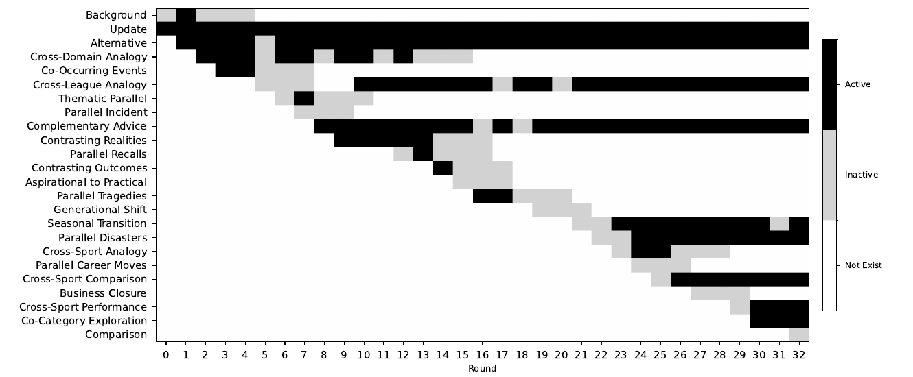

# Complementary news recommendation: each round an LLM proposes new article-relation labels, a per-relation expert predicts clicks, and a label is dropped when removing its expert doesn't hurt validation loss

> [中文版](drsd-news-complementary.md)

### Paper: Towards Dynamic Relationship Schema Discovery for Complementary News Recommendation (RecSys 2026)
### Link: https://doi.org/10.1145/3773078.3841261
### Institution: Kai Sugahara (affiliated with MicroAd; a footnote states the work was done outside the company)
### Ideas: automatic relation-label discovery, LLM annotation, gating + relation experts, validation-ablation pruning
### Area: i2i (complementary recommendation of news articles)

## Breakdown:
**The set of relation labels between articles is no longer fixed by hand. Each round an LLM proposes new labels, an expert is trained per label, and labels whose removal doesn't raise validation loss are pruned.**

The scenario is recommending the next article after a user finishes reading one. The author argues that what readers want at that point is often a functionally different follow-up (a background explainer, or the latest update on the event), and calls this dependency between article pairs a complementary relationship. Existing work either doesn't model article-pair relations explicitly, or first fixes a set of relation labels by hand (e.g., "Background", "Update") and then annotates against it. The problem is that news topics and reading habits keep changing, so which labels are useful changes too; a fixed label set falls behind, and useless labels only add complexity.

The paper proposes DRSD, which treats "which relation labels should exist" as something to optimize as well. The CTR model consists of a relation classifier plus one click expert per relation. Each round it picks clicks that the current labels can't explain, has an LLM propose new labels and annotate them, retrains, then removes experts one at a time and checks validation loss; labels whose removal doesn't make things worse are pruned. This is a three-page RecSys 2026 short paper with offline experiments on MIND only.

### Model architecture
The model predicts the probability that a user who just read the query article clicks the target article. It first decides what relation the pair has, then predicts the click with a model dedicated to that relation.

An example (my own, not from the paper): the query article is "Typhoon makes landfall in Zhejiang"; the candidate "Why there are so many typhoons this year" is Background, and "Latest typhoon track" is Update. Whether a user clicks follows different patterns under different relations, so each relation gets its own click model.

**Input features.** Each article's title and abstract are encoded with Sentence-BERT, plus pair features such as entity overlap, category and time. The relation classifier and the relation experts below are all LightGBM and use the same features.

#### Relation classifier
A multiclass model that outputs the probability of the pair belonging to each relation (e.g., Background 0.7, Update 0.2, Unknown 0.1); the paper calls it the gate. The classes are the current label set plus Unknown, and its training labels come from the LLM's annotations (see step (2) in the next section). Unknown holds pairs that no existing label fits, so while the label set is incomplete those pairs aren't forced into an ill-fitting relation.

#### Relation experts
One binary CTR model per relation (Unknown included). During training each sample goes only to the expert of its own relation (the paper calls this hard routing): the Background expert sees only Background samples, the Update expert only Update samples. That way each expert learns its own click pattern instead of all of them becoming the same generic model.

#### Final click probability
The relation classifier's probabilities serve as weights on the experts' click probabilities, which are then summed. In the example above, final click probability = 0.7 × Background expert's click probability + 0.2 × Update expert's + 0.1 × Unknown expert's.

### Each round: change the label set, retrain the network
The section above is the network for a fixed label set. The label set determines how many classes the relation classifier has and how many experts there are; the iteration is an outer loop around network training that changes the label set and retrains the network once per round. Of the four steps, (1) uses the current network's predictions to pick samples, (2) adds new labels (so the network gains new classes and new experts), (3) retrains the network, and (4) removes experts one at a time and checks validation loss to decide which labels to delete (so the network shrinks). There is no two-stage "train the network first, then iterate" setup; the loop runs from the start. Round 0 trains the first network with the two hand-given labels (Background, Update), without calling the LLM; from round 1 on, every round runs the four steps below, and the network retrained in each round can be used for recommendation directly (the paper evaluates each round on the test set).

#### (1) Pick clicks the current labels can't explain
Only clicked positives are considered. Each sample's score is the gate's uncertainty times the click prediction loss. Uncertainty is 1 minus the gate's maximum probability over relations; the prediction loss is the negative log of the predicted click probability. A high score means the model predicted this click poorly and also can't tell what relation the pair has. The top 256 pairs are taken.

#### (2) LLM proposes and annotates labels
The titles of these 256 pairs go to gemini-3.5-flash, which proposes zero or more new relation labels. These are tentatively added to the label set, then the pairs are annotated, with non-matching pairs labeled Unknown. The LLM only proposes candidates; step (4) decides what stays.

#### (3) Retrain
Each added label gives the relation classifier one more output class and adds one new expert. A LightGBM multiclass model can't simply gain a class on top of the existing model, so the gate is retrained in full; the old experts are retrained too, since some pairs are now annotated with the new relation and the samples each expert receives may have changed.

#### (4) Validation-driven pruning
For each label, its expert is temporarily taken out, the gate probabilities are renormalized over the remaining relations, and the change in validation cross-entropy is measured (just a test, no retraining). If loss doesn't rise, the expert wasn't helping and the label is marked inactive; a label is actually deleted only after 3 consecutive inactive rounds, to avoid deleting on single-round noise. Deleting a label means the relation classifier loses that class and the expert is discarded; the paper doesn't say where the pairs previously annotated with that relation go afterwards.

The figure shows each label's state over 33 rounds (black active, gray inactive, white not yet proposed or already deleted). The hand-given "Background" label is deleted at round 5, while "Update" stays active throughout. 22 new labels are proposed in total; 8 of them are still active at round 32 (Alternative, Cross-League Analogy, Complementary Advice, Seasonal Transition, Parallel Disasters, Cross-Sport Comparison, Cross-Sport Performance, Co-Category Exploration).

### Inference
The paper doesn't describe inference separately; from the model structure it works like this. Take the network trained in some round, compute pair features for the query article and each candidate, have the relation classifier give the probability of each relation, have every expert produce a click probability, take the weighted sum, and rank candidates by the final click probability to take the top k. In training each sample goes to only one expert, but at inference every expert is computed and the results are weighted by the probabilities. The LLM takes no part in inference; it only proposes labels and annotates during training. Because there are pair features such as entity overlap, candidates can't be precomputed into vectors for ANN retrieval, so the model can only rank an already-retrieved candidate set. The experiments presumably rank each MIND impression's candidate list (MIND's standard evaluation), and how the query article is chosen (e.g., the user's most recent click) isn't stated either.

### Data and results
MIND-small (the Microsoft News Dataset), compared with a standard CTR model without schema discovery, averaged over three runs; offline only. Cross-entropy is essentially on par with the baseline, and nDCG@1 and @3 fluctuate around the baseline with no upward trend over rounds. The gain is in catalog coverage (the number of distinct articles appearing in the top-k recommendations). Reading off the figure, coverage@1 rises from about 940 articles for the baseline to around 1,050, and coverage@3 from about 1,660 to around 1,800; both climb in roughly the first 5 rounds and then hold. Code is open source.

## Takeaways
* The relation-label set can be chosen by the data, keeping or dropping each label by whether removing its expert hurts validation loss.
* Use the LLM only as a label proposer and leave the decision to the downstream metric.
* Send the LLM the clicks that are both badly predicted and relation-ambiguous, so calls go where current labels don't reach.

## Caveats
* Ranking accuracy doesn't improve. Cross-entropy is flat and nDCG fluctuates around the baseline (nDCG@1 dips to about 0.130 in its worst round vs. about 0.135 for the baseline); the paper's explanation is that the training objective is pointwise cross-entropy rather than a ranking objective. The only gain is coverage, which on its own doesn't show recommendations got better, and there's no significance testing.
* A control is missing that would separate whether the coverage gain comes from meaningful labels or simply from several divide-and-conquer experts, e.g., the same number of hard-routed experts built from clustering or random labels, to see whether coverage rises just as much.
* Pruning measures an expert's contribution to validation cross-entropy, so surviving labels help prediction, but that doesn't mean the relation itself holds. The survivors are mostly analogy and comparison labels (Cross-League Analogy, Cross-Sport Comparison, Parallel Disasters), which differ from the background explainers and event updates the paper opens with, and the hand-given "Background" label is in fact deleted at round 5. The author also acknowledges that label plausibility hasn't been independently validated.
* Several experimental details are missing: how query-target article pairs are built from MIND (is the query the user's most recent click, or every article in their history?); since only 256 pairs per round are annotated by the LLM, where the relation labels for the remaining training samples come from (gate predictions, or all set to Unknown); how many training samples a new label's expert gets; and which of the three runs the heatmap comes from.

## Credibility: offline

## Recommendation level: worth a look if you have time
